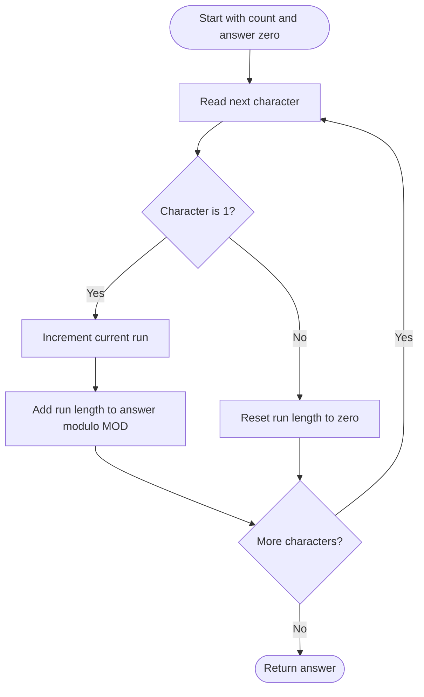

# 1513 — Number of Substrings With Only 1s

## 1. Understanding

या प्रश्नाचा गाभा म्हणजे फक्त ones असलेल्या substrings ची मोजणी.

> **मराठी:** प्रश्नात काय दिले आहे आणि नेमके काय शोधायचे आहे, हे आधी स्पष्ट करा.
> Count all substrings consisting only of `'1'`; return the answer modulo `1e9+7`.

## 2. Worked examples and edge cases

उदाहरणे आणि सीमाप्रकरणांत फक्त ones असलेल्या substrings ची मोजणी कशी लागू होते ते पाहा.

> **मराठी:** उदाहरणातील input पासून output पर्यंत प्रत्येक बदल समजून घ्या.
> A run of four ones contributes `4·5/2=10` substrings. `"101"` contributes two; `"000"` contributes zero.

## 3. Pattern identification + cheat sheet

येथे मुख्य pattern म्हणजे सलग ones च्या suffix ची लांबी जमा करणे; वरील तुलना लक्षात घ्या.

> **मराठी:** या clues मुळे योग्य pattern ओळखता येतो; constraints आणि relations नीट तपासा.
> This is **count contiguous runs / one-pass DP**.
> | Current character | State |
> |---|---|
> | `'1'` | Extend current run; add its length |
> | `'0'` | Reset run length |
> | Run length `r` | Adds `r(r+1)/2` total over the run |

## 4. Approaches

पद्धतींची तुलना करताना सलग ones च्या suffix ची लांबी जमा करणे याचा वेळ आणि जागेवरील परिणाम पाहा.

> **मराठी:** सोप्या उपायापासून सुरुवात करा आणि constraints नुसार योग्य optimization निवडा.

- Enumerate every substring and verify all ones: correct but `O(n²)` or worse.
- Source DP array: `O(n)` time, `O(n)` space.
- Source running counter: `O(n)` time, `O(1)` extra space and preferred.

## 5. Mermaid flowchart and explanation

आकृतीमध्ये सलग ones च्या suffix ची लांबी जमा करणे ही प्रक्रिया क्रमाने दाखवली आहे.

> **मराठी:** Flowchart मध्ये प्रत्येक decision, loop आणि loop कधी थांबतो ते पाहा.
> Every new one-ending substring is the prior run plus the new one-character substring.

## 6. Algorithm / intuition

मूळ कल्पना: सलग ones च्या suffix ची लांबी जमा करणे.

> **मराठी:** मुख्य observation समजल्यावर algorithm चे steps लक्षात ठेवणे सोपे होते.
> If the current suffix of ones has length `r`, there are exactly `r` all-one substrings ending at this position. Add `r`; zero resets the suffix length.

## 7. Code explanation

Code मधील state आणि updates हे सलग ones च्या suffix ची लांबी जमा करणे या कल्पनेशी जोडून वाचा.

> **मराठी:** Code मधील variable आणि condition यांचा algorithm मधील उद्देश समजून घ्या.
> `numSub_Optimized` keeps `count` and `result`. `numSub_DP` stores the run-ending count for each position and sums it. The DP method indexes `s[0]`, so it assumes nonempty input; problem constraints guarantee this.

## 8. Dry run

Dry run मध्ये सलग ones च्या suffix ची लांबी जमा करणे कसे घडते ते प्रत्येक टप्प्यावर तपासा.

> **मराठी:** प्रत्येक महत्त्वाच्या step नंतर variable ची value trace करा.
> For `"1110"`:
> | Character | Current run | Added substrings | Total |
> |---|---:|---:|---:|
> | 1 | 1 | 1 | 1 |
> | 1 | 2 | 2 | 3 |
> | 1 | 3 | 3 | 6 |
> | 0 | 0 | 0 | 6 |

## 9. Complexity

सलग ones च्या suffix ची लांबी जमा करणे यासाठी लागणारा वेळ आणि अतिरिक्त जागा वरील bounds मध्ये दिली आहेत.

> **मराठी:** Input size आणि प्रत्येक operation कितीदा चालतो यावरून complexity ठरवा.
> Both methods use `O(n)` time. Optimized uses `O(1)` auxiliary space; DP uses `O(n)`. Modulo prevents count overflow for long input.

## 10. Correctness

योग्यतेचा युक्तिवाद सलग ones च्या suffix ची लांबी जमा करणे यावर आधारित आहे; वरील अटी तपासा.

> **मराठी:** Invariant किंवा तर्क वापरून algorithm योग्य उत्तर देतो हे समजून घ्या.
> At each index, the algorithm maintains the exact length of the all-one suffix ending there. Each such suffix length corresponds one-to-one with all-one substrings ending at that index. Summing these contributions counts every valid substring once by its endpoint.

## 11. Mistakes / interview traps

लक्षात ठेवा: zero आल्यावर suffix लांबी पुन्हा शून्य करायची.

> **मराठी:** Boundary, duplicate आणि off-by-one cases स्वतंत्रपणे तपासा.

- Count substrings, not runs; a run of length `r` contributes triangularly.
- Reset on zero.
- Apply modulo during accumulation.
- Empty-string handling would need guarding in the DP implementation.

## 12. Quick revision

थोडक्यात, सलग ones च्या suffix ची लांबी जमा करणे. zero आल्यावर suffix लांबी पुन्हा शून्य करायची.

> **मराठी:** दोन मिनिटांच्या revision साठी pattern, मुख्य कल्पना आणि complexity आठवा.
> Scan: one → `run++`, answer `+=run`; zero → run reset. A run of `r` contributes `r(r+1)/2`.

## 13. Related problems / variations

संबंधित प्रश्नांत फक्त ones असलेल्या substrings ची मोजणी यासारखी अट बदलल्यास योग्य पद्धतही तपासा.

> **मराठी:** Related problem मध्ये constraints बदलल्यास approach कसा बदलेल ते विचारा.
> Count Binary Substrings, Number of Substrings With Only 1s variants, Max Consecutive Ones; variation: count substrings with at most `k` zeros.

## 14. Self-assessment

वरील प्रश्न स्वतः सोडवून फक्त ones असलेल्या substrings ची मोजणी याची उजळणी करा.

> **मराठी:** उत्तर न पाहता प्रश्न सोडवा आणि तुमच्या निवडीचे कारण सांगा.

1. Why add the current run length?
2. How many substrings does a run of five ones contribute?
3. What happens to the state on zero?
4. Why is the running-counter version constant-space?
