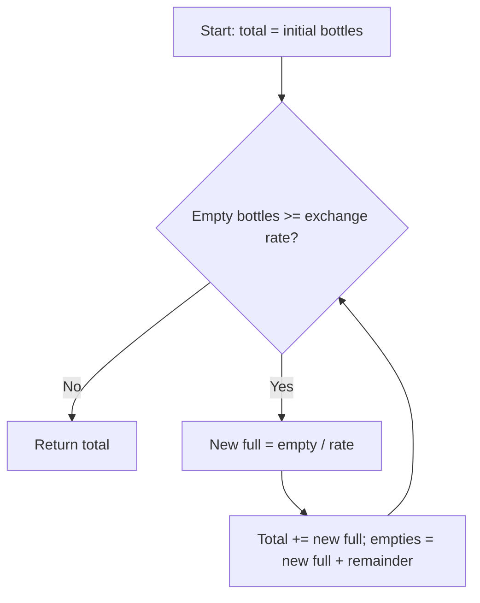

# Water Bottles — LeetCode 1518

## Problem, constraints आणि examples

`numBottles` full bottles प्या; प्रत्येक `numExchange` empty bottles देऊन एक full bottle मिळतो. जास्तीत जास्त किती bottles पिता येतील ते मोजा. LeetCode मध्ये exchange rate `> 1` आहे.
Example: `9, 3`: 9 प्या → 9 empties; exchange 3+3+3 → 3 नवीन full, प्या; नंतर 3 empties → 1 नवीन bottle; total `9+3+1=13`. `5, 5` → `6`; `2,3` → `2` (no exchange).

## Pattern clues

| Clue                                           | Pattern                    |
| ---------------------------------------------- | -------------------------- |
| resource बदलून पुन्हा त्याच नियमाने process    | simulation                 |
| प्रत्येक exchange मध्ये quotient आणि remainder | integer division invariant |
| finite number of exchanges                     | loop until threshold       |

## Approaches

| Method                                           | Status               | Notes                                        |
| ------------------------------------------------ | -------------------- | -------------------------------------------- |
| Repeated exchange simulation                     | Correct / selected   | `O(log_e B)` rounds, `O(1)` space            |
| Try every possible exchange sequence / recursion | Correct but needless | Same deterministic state; no branching       |
| Add only `bottles / exchange` once               | Incorrect            | Newly emptied bottlesही exchangeable आहेत    |
| Formula / geometric sum                          | Possible, less clear | Loop better handles remainder at every round |

## Flowchart

Each iterationमध्ये exchanged empties आणि न exchange झालेले empties जोडून पुढील state बनते.

## Selected algorithm, intuition आणि code-specific notes

दोन्ही source versions योग्य आहेत: `SolutionOriginal::numWaterBottles` आणि `SolutionOptimized::numWaterBottles`. `Result/totalDrank` हे आतापर्यंत प्यायलेल्या bottlesचे total; `numBottles/bottles` म्हणजे सध्याचे empties. `getFilled = bottles / numExchange`; remainder पुढच्या roundला carry होतो. `main` अनेक input pairs वर दोन्ही outputs तुलना करतो.
Dry run (`9,3`):
| Round | Empties before | New full | Remainder | Total drank |
|---|---:|---:|---:|---:|
| Start | 9 | — | — | 9 |
| 1 | 9 | 3 | 0 | 12 |
| 2 | 3 | 1 | 0 | 13 |
| Stop | 1 | 0 | 1 | 13 |

## Edge cases

> **मराठी:** Boundary, duplicate आणि off-by-one cases स्वतंत्रपणे तपासा.
> No exchange when empties are below the rate; exact multiples and a final nonzero remainder both occur. Rate 1 is excluded by constraints.

## Complexity, correctness, traps

Per-iteration emptied count roughly rateने कमी होते: `O(log_exchange(numBottles))` rounds, `O(1)` space. Correctness: प्रत्येक loop exactly शक्य exchanges करतो आणि remainderसह पुढील empties मोजतो; stop झाल्यावर अजून exchange शक्य नाही.
Trap: full bottle पिल्यावर एक empty मिळतो हे विसरू नका; `bottles = newBottles + oldRemainder` आवश्यक. Rate `1` असेल तर loop संपणार नाही, पण input constraintमध्ये ते नसते.

## Quick revision, variations, self-check

पुनरावलोकन: प्रत्येक exchangeनंतर उरलेले empties carry करा.
Total initial full + प्रत्येक roundचे exchanges; remainder carry करा. Related: coin exchange simulation, repeated division processes.

1. `15,4` साठी rounds कसे बदलतात?
2. Remainder पुढच्या roundमध्ये का ठेवतो?
3. Exchange rate `1` हा code handle करतो का?
4. Loop कधी थांबतो?
