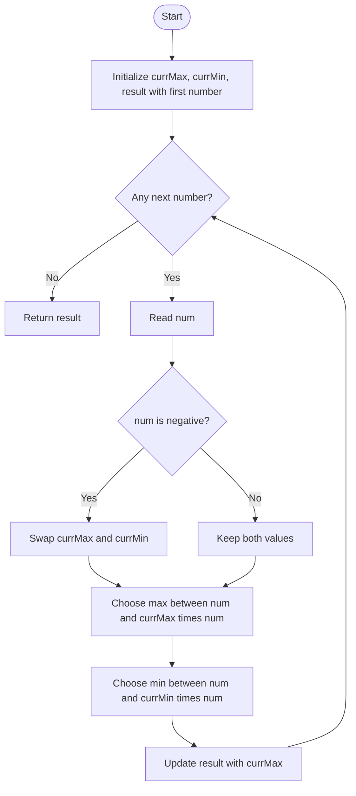

# 152. Maximum Product Subarray

## 1. Problem Understanding

दिलेल्या integer array मधील **non-empty, contiguous subarray** निवडून त्याचा product सर्वाधिक करा आणि तो maximum product परत करा. “Contiguous” म्हणजे मध्ये element skip करता येत नाहीत. Subarray मध्ये एक element असू शकतो; त्यामुळे negative answer असला तरी तो valid आहे.
Input मध्ये positive numbers, negative numbers आणि zero असू शकतात. प्रश्न maximum **sum** नाही, maximum **product** विचारतो.

## 2. Example Understanding

### Example 1

```text
nums = [2, 3, -2, 4]
Output: 6
```

Contiguous products: `[2] = 2`, `[2,3] = 6`, `[2,3,-2] = -12`, `[4] = 4`. `[2,3]` चा product सर्वाधिक म्हणजे `6`.

### Example 2

```text
nums = [-2, 0, -1]
Output: 0
```

`[-2] = -2`, `[0] = 0`, `[-1] = -1`, आणि `[-2,0] = 0`. Maximum `0`.

### Example 3

```text
nums = [-2, 3, -4]
Output: 24
```

पूर्ण subarray चा product `(-2) * 3 * (-4) = 24`; दोन negatives चा product positive होतो.

## 3. Problem Identification

“Maximum” आणि “contiguous subarray” हे Kadane-style DP चे संकेत आहेत. पण येथे **multiplication** असल्यामुळे नेहमीचा maximum-only Kadane पुरत नाही: negative number multiplication ने sign उलटा करून minimum ला maximum बनवू शकतो.
स्वतःला विचारा:

1. Subarray contiguous आहे का? होय, त्यामुळे प्रत्येक index वर ending subarray state पाहता येते.
2. Negative number आल्यावर काय बदलते? मोठा negative product उपयोगी positive होऊ शकतो.
3. एखादा maximum product पुरेसा आहे का? नाही; **minimum productही** जपावा लागतो.
4. Zero काय करतो? चालू product ला zero करतो; पुढचा subarray नव्याने सुरू होऊ शकतो.

### Pattern Recognition Cheat Sheet

| Clue in Question                                | Possible Pattern                   | Why?                                                 |
| ----------------------------------------------- | ---------------------------------- | ---------------------------------------------------- |
| Maximum/minimum contiguous subarray             | Kadane-style DP                    | प्रत्येक index वर ending best state update करता येते |
| Product मध्ये positive व negative values        | Track max and min                  | Negative factor max/min ची भूमिका उलटवतो             |
| Zero असू शकतो                                   | Segment reset / prefix-suffix scan | Zero product चे segments वेगळे करतो                  |
| प्रत्येक possible interval विचारात घ्यावा लागतो | Brute force baseline               | छोट्या input साठी सर्व `O(n²)` intervals पाहता येतात |

Subarray sum problems मध्ये एक running maximum पुरू शकतो; product मध्ये negative असल्याने min state जोडा.

## 4. Different Approaches

### A. Brute force — correct पण slow

प्रत्येक start index साठी पुढे वाढत जाणारा product ठेवा; प्रत्येक end index वर answer update करा. सर्व contiguous subarrays तपासले जातात.

- Time: `O(n²)`; प्रत्येक interval constant-time incremental product ने.
- Extra space: `O(1)`.
- फायदे: सर्वात सरळ baseline, छोट्या arrays साठी स्वीकार्य.
- तोटे: मोठ्या `n` साठी quadratic काम.

### B. Prefix and suffix product — linear scan

Array च left-to-right prefix product आणि right-to-left suffix product scan करा. Zero भेटल्यावर त्या direction चा product `1`-ээс reset करा. **Why it works:** zero नसलेल्या segment मध्ये, negative count even असेल तर full segment product positive; odd असेल तर maximum positive product boundary वरचा prefix किंवा suffix negative factor-ийг “хасल्यावर” கிடतो. Zero असलेले segments वेगळे होतात.

- Time: `O(n)`, extra space `O(1)`.
- फायदे: छोटा, दोन scans एकाच loop मध्ये.
- तोटे: reasoning maximum/minimum DP पेक्षा काहींना कमी स्पष्ट; scan reset logic नीट समजून घ्या.
- Code: `maxProductPrefixSuffix`.

### C. Dynamic Programming — max आणि min ending here

प्रत्येक index वर `currMax` आणि `currMin` म्हणजे त्या index वर संपणाऱ्या subarrays मधील अनुक्रमे maximum/minimum product. `num < 0` असल्यास दोन्ही swap करा; मग `num` स्वतः सुरू करायचे की मागील product extend करायचा ते निवडा.

- Time: `O(n)`, space: `O(1)`.
- फायदे: प्रत्येक index ची recurrence स्पष्ट, sign बदल थेट handle होतो.
- तोटे: फक्त max track केला तर चुकीचे उत्तर येऊ शकते; swap/update क्रम महत्त्वाचा.
- Code: `maxProductDP`; final selected approach म्हणून हा सर्वात सोपा proof-friendly पर्याय.
  | Approach | Time | Space | Pros | Cons |
  |---|---:|---:|---|---|
  | Brute force | `O(n²)` | `O(1)` | सहज समजतो, baseline | मोठ्या input वर slow |
  | Prefix/suffix | `O(n)` | `O(1)` | Linear, constant-space | Zero/negative-count reasoning |
  | Max-min DP | `O(n)` | `O(1)` | State transition स्पष्ट | दोन्ही extrema सांभाळावे लागतात |
  **Logically incorrect:** फक्त current maximum ठेवणे; negative मुळे discard केलेला minimum पुढे maximum होऊ शकतो. **Correct but inefficient:** सर्व intervals तपासणे. **Optimal:** Prefix/suffix किंवा max-min DP, दोन्ही linear time आणि constant extra space.

## 5. Flowchart



Negative आल्यावर swap केल्यामुळे जुना minimum हा multiplication नंतरचा maximum candidate बनतो. नंतर current element पासून नवीन subarray सुरू करायचा की जुना extend करायचा हे दोन्ही states ठरवतात.

## 6. Algorithm / Intuition

**Key observation:** पुढचा element positive असेल तर मोठा positive product वाढू शकतो; negative असेल तर मोठा negative product सकारात्मक होऊ शकतो. म्हणून दोन्ही extremes आवश्यक.

1. पहिल्या element ने `currMax`, `currMin`, `result` initialize करा.
2. प्रत्येक पुढील `num` साठी तो negative असल्यास `currMax` आणि `currMin` swap करा.
3. `currMax = max(num, currMax * num)` करा.
4. `currMin = min(num, currMin * num)` करा.
5. `result = max(result, currMax)` करा.
   `num` हा नवीन subarray सुरू करतो; `currMax * num` / `currMin * num` आधीचा subarray पुढे वाढवतात.

## 7. Code Explanation

`maxProductBruteForce` प्रत्येक start index वरून products वाढवतो. `maxProductPrefixSuffix` दोन्ही दिशांचे running products ठेवतो व zero नंतर reset करतो. `maxProductDP` max/min state वापरून एकाच pass मध्ये उत्तर काढतो.
DP मध्ये negative आल्यावर swap **multiplication आधी** आहे; त्यामुळे जुन्या minimum मधून नवीन maximum तयार होण्याची शक्यता योग्यरीत्या समाविष्ट होते. `result` प्रत्येक index वरील `currMax` शी update होतो.
**Submission note:** दिलेल्या फाइलमध्ये LeetCode चे `maxProduct` method नाही; ती approaches compare करणारा local program आहे. Judge submission साठी DP method-ला अपेक्षित signature-शी जोडावे आणि `main` local-only आहे हे लक्षात घ्यावे. दिलेल्या logic मध्ये recurrence ची त्रुटी दिसत नाही.

## 8. Dry Run

Input: `[2, 3, -2, 4]`
| Step | Variables | Condition | Action | Result |
|---:|---|---|---|---:|
| 0 | `currMax=2, currMin=2` | First value | Initialize | `result=2` |
| 1 | `num=3` | Positive | max=`max(3,2*3)=6`; min=`min(3,2*3)=3` | `result=6` |
| 2 | `num=-2` | Negative | Swap: max=3, min=6; then max=`max(-2,-6)=-2`, min=`min(-2,-12)=-12` | `result=6` |
| 3 | `num=4` | Positive | max=`max(4,-8)=4`; min=`min(4,-48)=-48` | `result=6` |
Final answer `6`, subarray `[2,3]`.

## 9. Complexity Analysis

`maxProductDP` प्रत्येक element एकदाच पाहतो आणि प्रत्येक वेळी constant operations करतो: **`O(n)` time**. `currMax`, `currMin`, `result`, आणि `num` एवढेच अतिरिक्त variables: **`O(1)` space**. Brute force प्रत्येक start पासून प्रत्येक पुढचा end तपासतो, म्हणून `1+2+...+n = O(n²)`.
सामान्य LeetCode constraints साठी linear approaches योग्य आहेत. Product overflow constraints/input type शी संबंधित असू शकतो; code `int` वापरतो, त्यामुळे वापराच्या constraints मध्ये products `int` range मध्ये असावेत.

## 10. Why This Solution Works

प्रत्येक index `i` साठी invariant: `currMax`/`currMin` हे `i` येथे संपणाऱ्या non-empty subarrays मधील maximum/minimum product आहेत. नवीन subarray एकतर `nums[i]` पासून सुरू होतो किंवा आधीचा ending subarray `nums[i]` ने extend होतो. Multiplication negative असल्यास order उलटतो, म्हणून जुन्या max व min दोघांची गरज आहे (swap हेच रूपांतर करतो). त्यामुळे `currMax` प्रत्येक index ला संपणारा सर्वोत्तम candidate आहे; सर्व indices मधील त्याचा maximum हेच global answer.

## 11. Common Mistakes & Interview Traps

- फक्त maximum product track करणे.
- Zero नंतर state reset/restart करण्याची गरज विसरणे.
- `result = 0` initialize करणे; all-negative input मध्ये चुकीचे ठरू शकते. First element ने initialize करा.
- Subarray contiguity विसरून arbitrary elements multiply करणे.
- Negative असताना max/min swap न करणे किंवा चुकीच्या वेळी करणे.
- Empty input विचारणे: LeetCode input मध्ये array non-empty असतो; code `nums[0]` वापरतो.
- Interview follow-up: actual subarray indices कसे परत कराल? Best-state सुरू/extend झाल्यावर start index track करा.

## 12. Revision Notes (Quick Recall)

- **Pattern:** Kadane-style DP for contiguous product.
- **Clues:** maximum product, contiguous, negative values possible.
- **Intuition:** negative sign max/min उलटवतो; दोन्ही extremes ठेवा.
- **Steps:** initialize first value → negative असल्यास swap → max/min transition → global answer.
- **Complexity:** `O(n)` time, `O(1)` extra space.
- **Mistakes:** max-only state, zero handling, wrong initialization.
- **Takeaway:** Product subarray मध्ये negative दिसले की minimum ending product सुद्धा जतन करा.

## 13. Similar Problem Recognition

Maximum Subarray Sum मध्ये Kadane चा एक maximum state वापरतो; product version ला sign बदलामुळे min state लागतो. Maximum product interval, circular array variants, किंवा zero-free segment variants मध्ये हाच sign reasoning उपयोगी पडतो. Constraints मध्ये integers खूप मोठे असतील तर numeric range/overflow तपासा; `int` आपोआप पुरेल असे गृहीत धरू नका.

## 14. Final Self-Assessment

1. `[-2, 3, -4]` मध्ये सुरुवातीचा minimum product शेवटी उपयोगी का पडतो?
2. DP state मध्ये `currMin` चा नेमका अर्थ काय?
3. सर्व input values negative असतील तर answer initialization कशी असावी?
4. Prefix/suffix method मध्ये zero भेटल्यावर product reset का होतो?
5. फक्त `currMax` ठेवणारा उपाय कोणत्या sign pattern वर fail होऊ शकतो?
