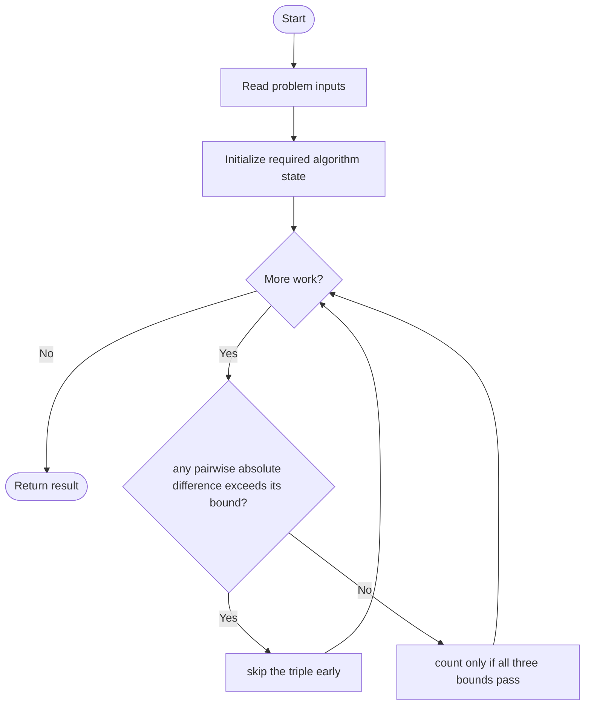
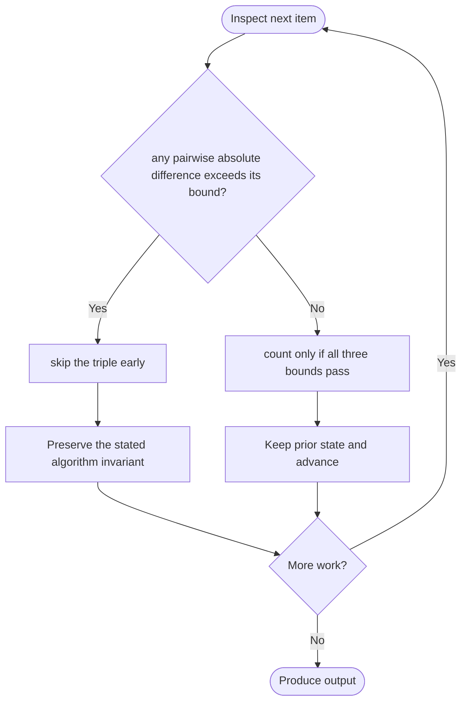

# Count Good Triplets

**LeetCode ID:** 1534

**Source file(s):** `1534.cpp` (originally `countGoodTriplets.cpp`)

**Identification evidence:** The original filename, declared signature, and distinctive behavior described below uniquely identify this problem; no number was inferred from a filename alone.

## Expected input/output or judge interface

countGoodTripletsIterative(arr,a,b,c); countGoodTripletsRecursive(...). Inputs follow the problem constraints; the output is the documented scalar, sequence, or design-object behavior. The description below reflects the implementation actually present in the source.

## Main flow



## Important branch and loop flow



## Core logic and invariant

Enumerates triples i<j<k and counts those satisfying all three absolute-difference bounds; recursion chooses triples by backtracking.

The key branch/loop rule above is applied once per relevant item; the algorithm relies on that rule to preserve its state and produce the required result.

## Optimization / comparison

The iterative loops can prune later work early; recursion explores the same combination set with more overhead.

## Complexity

O(n^3) time; O(1) iterative auxiliary space, constant-depth selection recursion.

## Compile and run

The repository file includes a standalone demonstration `main()`; it is not a raw LeetCode submission unit. From the repository root, with a C++17 compiler:

```powershell
g++ -std=c++17 LeetCode\1534\1534.cpp -o solution.exe
.\solution.exe
```

For LeetCode's class-method judge, copy the relevant class/method or design-class API and omit the demo `main()` and local harness. Adapt free-function implementations to the requested `Solution` class signature where necessary. See the source caveat above for any compile blocker.
