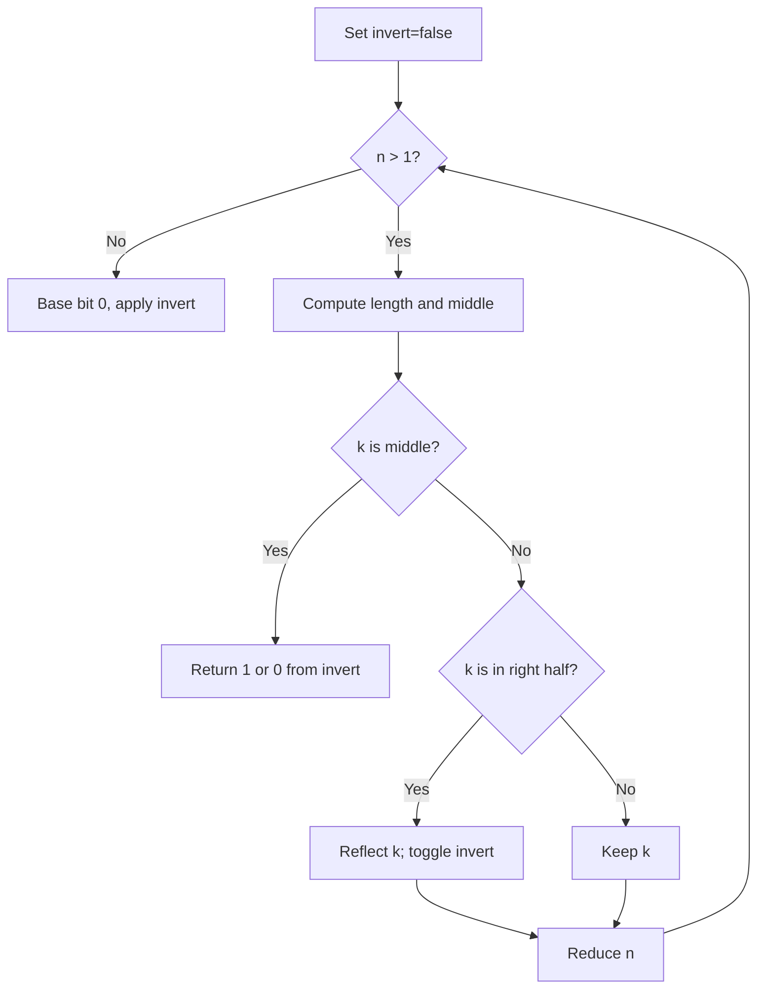

# Find Kth Bit in Nth Binary String — LeetCode 1545

## Problem, constraints आणि examples

`S1="0"`; पुढे `Sn = S(n-1) + "1" + reverse(invert(S(n-1)))`. 1-indexed position `k` वरील bit शोधा. Length `2^n-1`; constraintsमुळे sourceचा `1 << n` `int` मध्ये बसतो.
Example: `S2="011"`, so `k=2` returns `1`, `k=3` middle is `1`. `S3="0111001"`; `k=5` हे reflected half मधील position असून inverted mappingने bit `0` मिळतो. `n=1,k=1` → `0`.

## Pattern clues

> **मराठी:** या clues मुळे योग्य pattern ओळखता येतो; constraints आणि relations नीट तपासा.
> | Clue | Pattern |
> |---|---|
> | recursive string mirrored and inverted | divide-and-conquer symmetry |
> | position reflected around middle | `len-k+1` mapping |
> | only one bit requested | avoid building full string |

## Approaches

> **मराठी:** सोप्या उपायापासून सुरुवात करा आणि constraints नुसार योग्य optimization निवडा.
> | Method | Status | Complexity |
> |---|---|---|
> | Iteratively fold position toward left half; track inversion | Best / selected `O(n)` time, `O(1)` space |
> | Recursive divide-and-conquer | Correct `O(n)` time, `O(n)` stack |
> | Construct all `Sn` | Correct but inefficient `O(2ⁿ)` time/space |
> | Reflect right half without flipping bit | Incorrect; inversion is part of recurrence |

## Flowchart

प्रत्येक foldमध्ये problem `S(n-1)` पर्यंत कमी होतो; right half असल्यास mirrored bit invert होतो.

## Selected algorithm, source explanation, dry run

`findKthBit_Iterative`: `len=(1<<n)-1`, middle `(len+1)/2`. Middle थेट current orientationनुसार answer; right halfला `k=len-k+1`, `invert` toggle; नंतर `n--`. `findKthBit_Recursive` same recurrence वापरते; brute method सर्व strings `arr` मध्ये बनवते. `main` तीन पद्धती compare करतो.
Dry run (`n=3,k=5`): `len=7, mid=4`; right half, map `k=7-5+1=3`, invert=true; `n=2,len=3,mid=2`; right half, map `k=1`, invert=false; `n=1` base returns `0`.

## Edge cases

> **मराठी:** Boundary, duplicate आणि off-by-one cases स्वतंत्रपणे तपासा.
> Base case n=1 gives 0; middle position gives 1 before inversion; k is 1-indexed.

## Complexity, correctness, traps

Selected: `O(n)` time, `O(1)` extra. Correctness: recurrenceमध्ये left half unchanged, center fixed `1`, right half reversed+inverted; mapping हेच प्रत्येक levelवर जपते.
Trap: `k` 1-indexed आहे; `k==mid` आधी handle करा; right-side inversion parity विसरू नका. String construct करणे मोठ्या `n` ला infeasible.

## Quick revision, variations, self-check

पुनरावलोकन: middle नसेल तर position reflect करा आणि inversion flip करा.
Middle `1`; right mirror position + invert; fold to base. Related: recursive sequence indexing, Gray-code/reflection patterns.

1. `S4` ची length किती?
2. Right half position कशी map होते?
3. `invert` कधी toggle होते?
4. Explicit constructionची space किती वाढते?
