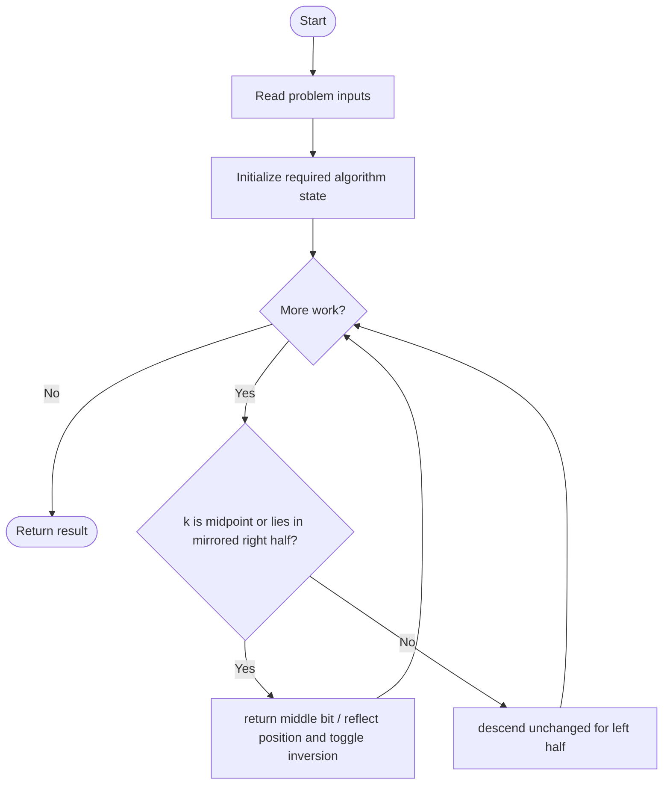
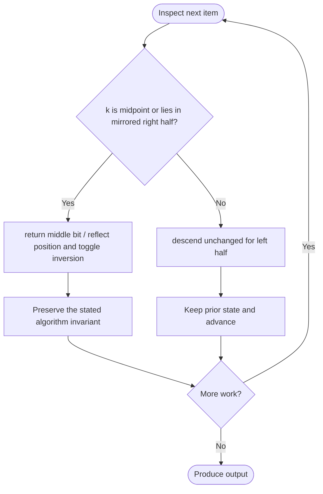

# Find Kth Bit in Nth Binary String

**LeetCode ID:** 1545
**Source file(s):** `1545.cpp` (originally `findKthBit.cpp`)
**Identification evidence:** The original filename, declared signature, and distinctive behavior described below uniquely identify this problem; no number was inferred from a filename alone.

## Expected input/output or judge interface

findKthBit_Iterative/Recursive/Brute(int n,int k). Inputs follow the problem constraints; the output is the documented scalar, sequence, or design-object behavior. The description below reflects the implementation actually present in the source.

## Main flow



## Important branch and loop flow



## Core logic and invariant

Uses S*n=S*(n-1)+1+reverse(invert(S\_(n-1))); efficient methods mirror positions around the midpoint and track inversion.
The key branch/loop rule above is applied once per relevant item; the algorithm relies on that rule to preserve its state and produce the required result.

## Optimization / comparison

Right-half reflection maps k to len-k+1 and inverts the lower-level bit; iteration avoids materializing the string.

## Complexity

Iterative/recursive O(n), space O(1)/O(n); brute construction O(2^n) time/space.

## Compile and run

The repository file includes a standalone demonstration `main()`; it is not a raw LeetCode submission unit. From the repository root, with a C++17 compiler:

```powershell
g++ -std=c++17 LeetCode\1545\1545.cpp -o solution.exe
.\solution.exe
```

For LeetCode's class-method judge, copy the relevant class/method or design-class API and omit the demo `main()` and local harness. Adapt free-function implementations to the requested `Solution` class signature where necessary. See the source caveat above for any compile blocker.
