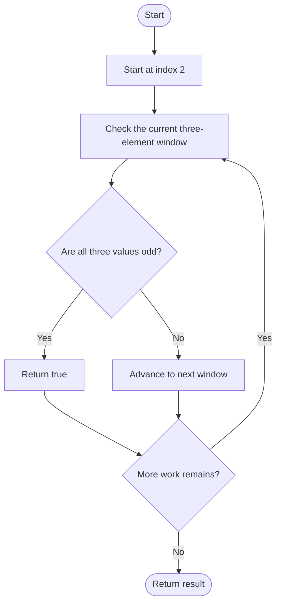
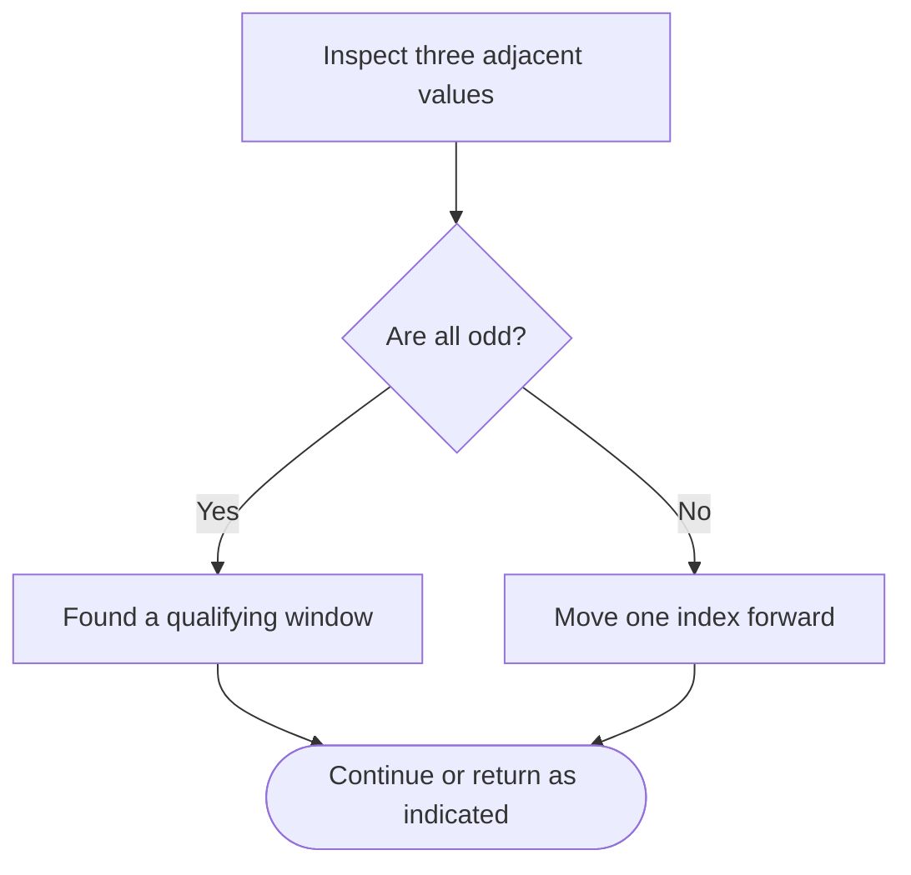

# Three Consecutive Odds — LeetCode 1550

## Problem and judge interface

bool threeConsecutiveOdds(vector<int>& arr); test whether any three adjacent entries are odd.

## Identification evidence

The method checks each length-three window for odd parity, uniquely matching problem 1550.

## Main flow



## Important branch / loop



## Core logic and invariants

Start at index 2 and inspect the current and previous two values. Return true immediately on a match; otherwise return false after all windows.

## Complexity

O(n) time and O(1) auxiliary space.

## Comparison and optimization

Direct window checks avoid storing a sliding-window counter.

## Compile and run

The `.cpp` is the original standalone source, including its local `main()` demonstration where present. Compile and run from the repository root with a C++17 compiler:

```text
g++ -std=c++17 LeetCode\1550\1550.cpp -o solution.exe
.\solution.exe
```

For LeetCode, adapt the implementation to the required class/method signature and omit the local `main()` and demonstration helpers; use the judge-provided node types. Notes above identify method-name or behavior differences. The moved source bytes have not been edited.
