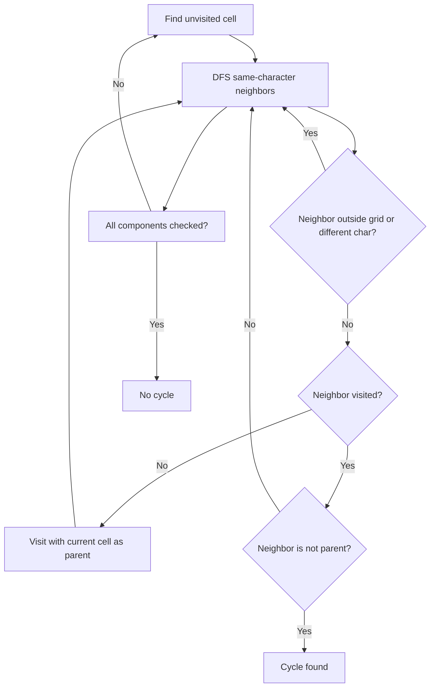

# Detect Cycles in 2D Grid — LeetCode 1559

## Problem, constraints आणि examples

Gridमध्ये horizontal/vertical adjacent, समान अक्षरांच्या cellsचा cycle आहे का ते ठरवा. Cycleला किमान 4 cells लागतात. Grid rectangular आणि non-empty असते.
Example: `a a / a a` मध्ये चार `a` cellsचा cycle → true. एका rowमधील `a a a` मध्ये cycle नाही; pathला परत त्याच parentकडे जाणे cycle समजू नये.

## Pattern clues

| Clue                               | Pattern                      |
| ---------------------------------- | ---------------------------- |
| same-character connected cells     | connected components / graph |
| grid adjacencyला graph edges       | DFS/BFS किंवा DSU            |
| visited neighbor हा parent नसल्यास | undirected-cycle test        |

## Approaches

> **मराठी:** सोप्या उपायापासून सुरुवात करा आणि constraints नुसार योग्य optimization निवडा.
> | Method | Status | Complexity |
> |---|---|---|
> | DFS + parent coordinates | Selected; `O(RC)` time, `O(RC)` visited + recursion |
> | BFS + parent coordinates | Correct; `O(RC)` time/space |
> | Union-Find on same-char right/down edges | Correct; optimized `O(RC α(RC))`, `O(RC)` space |
> | Visited neighbor without excluding parent | Incorrect; every ordinary tree edge looks cyclic |

## Flowchart

असंबद्ध components सुरूवातीपासून scan होतात; cycleसाठी समान अक्षर आणि non-parent visited neighbor दोन्ही आवश्यक.

## Selected algorithm, source explanation, dry run

`containsCycleDFS` सर्व unvisited cellsवर `dfs` बोलावतो. `dfs` cell visited mark करतो, चार directions तपासतो, वेगळे अक्षर/बाहेरचे neighbor skip करतो, unvisited neighborकडे parent म्हणून `(x,y)` पाठवतो. Sourceमध्ये BFS, basic DSU आणि rank+path-compression DSUही आहेत. Grid argument by value असल्याने प्रत्येक callमध्ये matrix copy होते.
Dry run (`a a / a a`): `A→B→D→C`; `C` ला visited `A` दिसतो, तो parent `D` नाही → cycle.

## Edge cases

> **मराठी:** Boundary, duplicate आणि off-by-one cases स्वतंत्रपणे तपासा.
> A single cell and a straight same-letter path have no cycle; the smallest grid cycle is a 2x2 square.

## Complexity, correctness, traps

DFS scan `O(RC)` graph work; `vis` `O(RC)`, recursion worst `O(RC)`; sourceचे by-value grid copyही `O(RC)`. Correctness: undirected DFSमध्ये tree-edge parent वगळल्यावर visited same-component neighbor म्हणजे alternate path + edge, hence cycle.
Mistakes: diagonal neighbors धरू नका; characters समान असणे आवश्यक; parent-edge ignore करणे विसरू नका. Deep grid recursion stack concern interviewमध्ये नमूद करा; iterative BFS/DSU पर्याय.

## Quick revision, variations, self-check

पुनरावलोकन: same-character neighbor आणि parent वेगळे ओळखा.
Four directions + same-char + visited non-parent. Related: Number of Islands, graph cycle detection, DSU connectivity.

1. `1x3` same-letter rowला cycle का नाही?
2. Parent exclusionचा उद्देश काय?
3. DSUमध्ये फक्त right/down edges का पुरतात?
4. Diagonal adjacency allowed आहे का?
