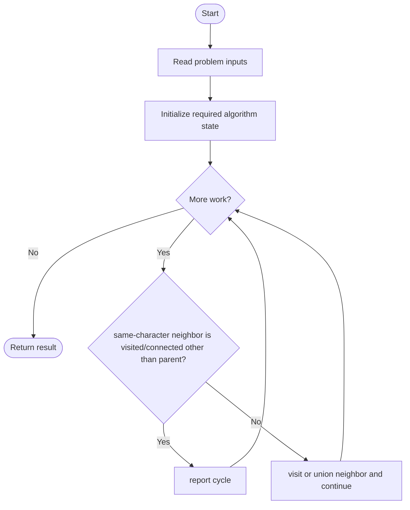
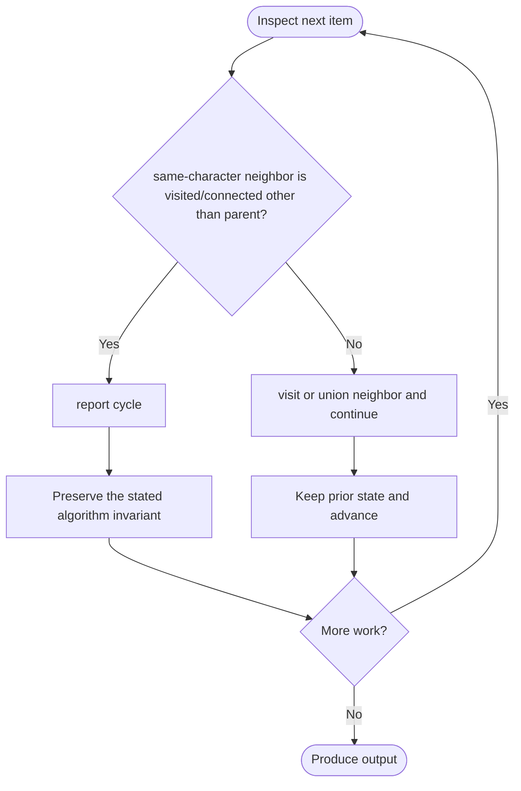

# Detect Cycles in 2D Grid

**LeetCode ID:** 1559
**Source file(s):** `1559.cpp` (originally `containsCycle.cpp`)
**Identification evidence:** The original filename, declared signature, and distinctive behavior described below uniquely identify this problem; no number was inferred from a filename alone.

## Expected input/output or judge interface

containsCycleDFS/BFS/UnionFind(vector<vector<char>> grid). Inputs follow the problem constraints; the output is the documented scalar, sequence, or design-object behavior. The description below reflects the implementation actually present in the source.

## Main flow



## Important branch and loop flow



## Core logic and invariant

Detects cycles among orthogonally adjacent equal-character cells using parent-aware traversal or union-find; four alternatives are included.
The key branch/loop rule above is applied once per relevant item; the algorithm relies on that rule to preserve its state and produce the required result.

## Optimization / comparison

DFS/BFS are direct; DSU detects an edge joining vertices already in the same component.

## Complexity

DFS/BFS O(mn); DSU O(mn alpha(mn)); O(mn) storage.

## Compile and run

The repository file includes a standalone demonstration `main()`; it is not a raw LeetCode submission unit. From the repository root, with a C++17 compiler:

```powershell
g++ -std=c++17 LeetCode\1559\1559.cpp -o solution.exe
.\solution.exe
```

For LeetCode's class-method judge, copy the relevant class/method or design-class API and omit the demo `main()` and local harness. Adapt free-function implementations to the requested `Solution` class signature where necessary. See the source caveat above for any compile blocker.
