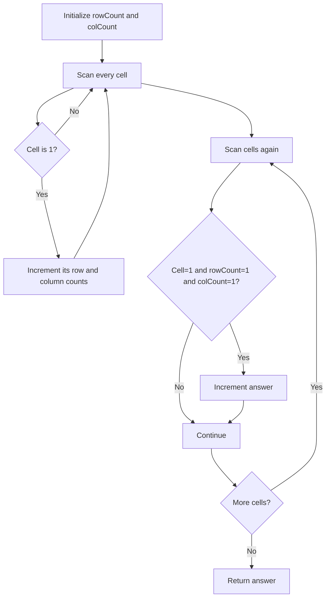

# Special Positions in a Binary Matrix — LeetCode 1582

## Problem, constraints आणि examples

Cell `(r,c)` special तेव्हाच जेव्हा cell `1` आहे, त्या rowमध्ये इतर `1` नाहीत आणि त्या columnमध्ये इतर `1` नाहीत. Matrix binary, rectangular आणि non-empty आहे.
Example: `[[1,0,0],[0,0,1],[1,0,0]]`: `(0,0)` columnमध्ये `(2,0)` दुसरा one आहे, म्हणून नाही; `(1,2)` row आणि columnमध्ये unique → one special position. All-zero matrix → `0`.

## Pattern clues

| Clue                                    | Pattern                          |
| --------------------------------------- | -------------------------------- |
| row आणि column uniqueness               | frequency/counting               |
| प्रत्येक cellची condition independently | preprocess counts, then validate |
| binary matrix                           | row/column sums हे one-count     |

## Approaches

| Method                                 | Status                                                     | Cost |
| -------------------------------------- | ---------------------------------------------------------- | ---- |
| प्रत्येक `1` साठी row/column rescan    | Correct brute force `O(mn(m+n))`, `O(1)` extra             |
| Row/column count arrays, then validate | Selected `O(mn)`, `O(m+n)` auxiliary                       |
| Source one-pass variant                | Correct, पण दोन matrix scans `O(mn)`, column counts `O(n)` |
| Row count एकटा तपासणे                  | Incorrect; column uniquenessही आवश्यक                      |

Source methods matrix by value घेतात; त्यामुळे matrixची `O(mn)` copy देखील अतिरिक्त आहे.

## Flowchart

Count passने candidatesचे uniqueness एका lookupमध्ये तपासता येते.

## Selected algorithm, code-specific explanation, dry run

`numSpecialCounting` first passमध्ये `rowCount`/`colCount` fills; second pass only `1` where both counts equal 1 counts. `numSpecialBrute` rescans; `numSpecialOptimized` first identifies one-one rows and their columns, then rechecks. `main` methods compare करतो.
Dry run (`[[1,0],[0,1]]`): row counts `[1,1]`, col counts `[1,1]`; दोन्ही one-कोशिकांसाठी counts `1,1`, answer `2`.

## Edge cases

> **मराठी:** Boundary, duplicate आणि off-by-one cases स्वतंत्रपणे तपासा.
> An all-zero matrix returns 0; a lone 1 is special; a row or column with multiple ones disqualifies candidates.

## Complexity, correctness, traps

Selected method `O(mn)` time, `O(m+n)` auxiliary arrays; by-value parameter copy `O(mn)`. Correctness: one at `(r,c)` special असण्यासाठी आणि फक्त त्यासाठी संबंधित row/column counts दोन्ही one असणे आवश्यक.
Traps: `mat[r][c]==1` check ठेवा; row/column count namesची orientation गोंधळू नका; matrix value-copy spaceचा उल्लेख source-specific complexityमध्ये करा.

## Quick revision, variations, self-check

पुनरावलोकन: row आणि column counts दोन्ही एक असावेत.
Count rows+columns, then both counts `1`. Related: sparse matrix constraints, row/column degree, rook placement.

1. Row count 1 पण column count 2 असल्यास special का नाही?
2. All-zero matrix answer?
3. First pass व second pass काय ठरवतात?
4. Source parameter by value असल्याने extra space किती?
