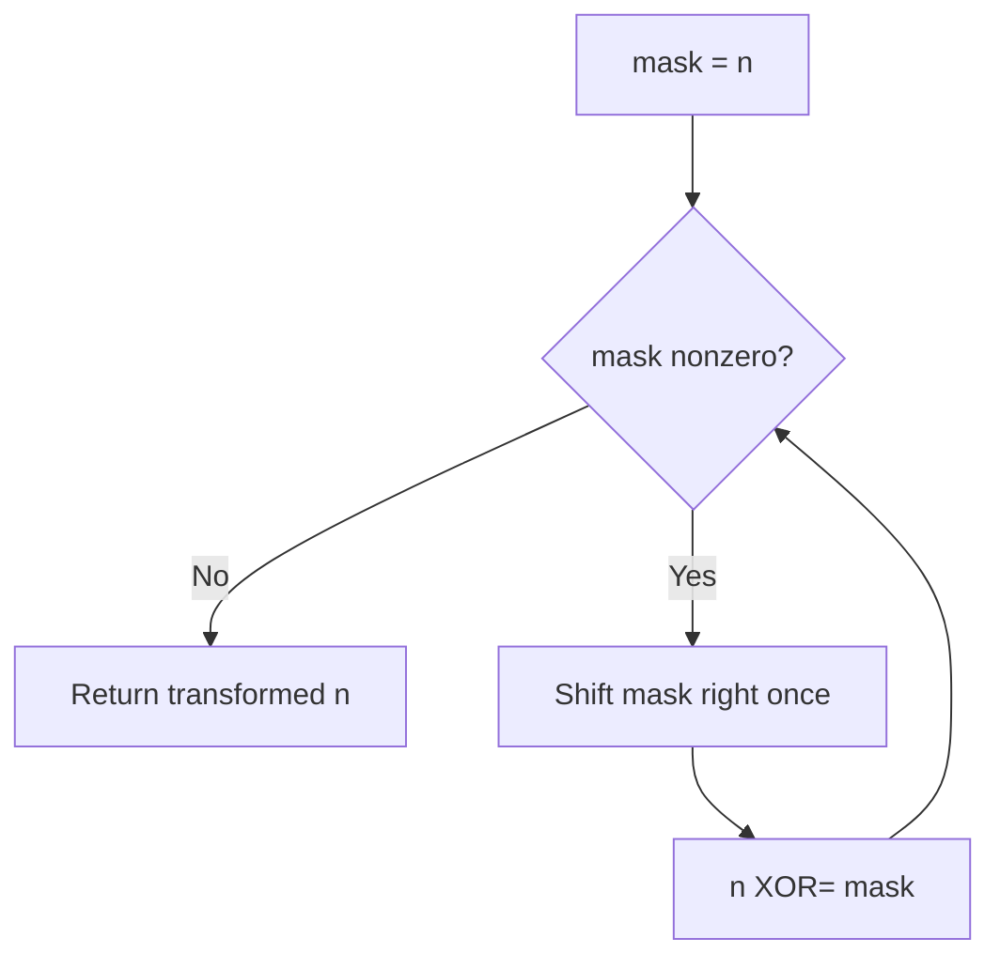

# Minimum One Bit Operations to Make Integers Zero — LeetCode 1611

## Problem, constraints आणि examples

Allowed moveमध्ये integerच्या rightmost `1` bitला `0` करता येतो; पुढील bit बदलता येतो फक्त त्याच्या उजवीकडील सर्व bits zero असताना. `n` ला zero करण्यासाठी minimum moves return करा. `n≥0`.
Example: `n=3 (11₂)` → `11→01→00`, answer `2`. `n=6 (110₂)` → answer `4`; `n=0` → `0`.

## Pattern clues

> **मराठी:** या clues मुळे योग्य pattern ओळखता येतो; constraints आणि relations नीट तपासा.
> | Clue | Pattern |
> |---|---|
> | Gray-code-like restricted bit transitions | inverse Gray-code transform |
> | answer grows from high bits down | prefix XOR / bit manipulation |
> | direct state BFS branches exponentially | exploit mathematical bit structure |

## Approaches

> **मराठी:** सोप्या उपायापासून सुरुवात करा आणि constraints नुसार योग्य optimization निवडा.
> | Method | Status | Cost |
> |---|---|---|
> | XOR with successive right shifts | Selected, correct `O(log n)` time, `O(1)` space |
> | BFS over all reachable states | Correct for tiny `n`, exponential states |
> | Count set bits / popcount | Incorrect; operation count is not Hamming weight |
> | Greedy clear low bit each step | Incorrect unless move legality is modelled exactly |

## Flowchart

Each iteration highest remaining prefix contribution XOR करून resultला inverse Gray-code valueकडे नेतं.

## Selected algorithm, intuition आणि source

`minimumOneBitOperations` मध्ये `mask=n`; प्रत्येक loop `mask >>= 1`, नंतर `n ^= mask`. हे `n ^ (n>>1) ^ (n>>2) ...` म्हणजे Gray codeचे inverse prefix XOR. Sourceमध्ये फक्त हाच method आहे; `main` काही sample values print करतो.
Dry run (`n=6`, binary `110`):
| mask before | mask after shift | n after XOR |
|---:|---:|---:|
| `110` | `011` | `101` |
| `011` | `001` | `100` |
| `001` | `000` | `100` |
Answer `4`.

## Edge cases

> **मराठी:** Boundary, duplicate आणि off-by-one cases स्वतंत्रपणे तपासा.
> n=0 returns 0; powers of two are useful checks because they are not answered by popcount.

## Complexity, correctness, traps

`O(log n)` iterations, `O(1)` extra. Correctness: reflected Gray-code sequenceच्या inverseमध्ये output bit `i` हा inputच्या bit `i` पासून सर्व higher bitsपर्यंत XOR असतो; loop हेच संचयी XOR काढतो.
Trap: loopमध्ये shift केलेला `mask` आणि बदललेला `n` वेगळे समजा; `n` वर bit count लागू होत नाही. Signed shift/overflow टाळण्यासाठी constraintsप्रमाणे integer type ठेवा.

## Quick revision, variations, self-check

पुनरावलोकन: right-shifted prefixesचा XOR घ्या.
Repeated `n ^= n>>1` then continue shifts. Related: Gray code, XOR prefixes, bitwise sequence inversion.

1. `n=0` साठी loop किती वेळा?
2. `n=3` चे उत्तर `popcount` का नाही?
3. प्रत्येक stepमध्ये कोणता variable shift होतो?
4. Inverse Gray codeमध्ये XOR कुठून कुठपर्यंत असतो?
