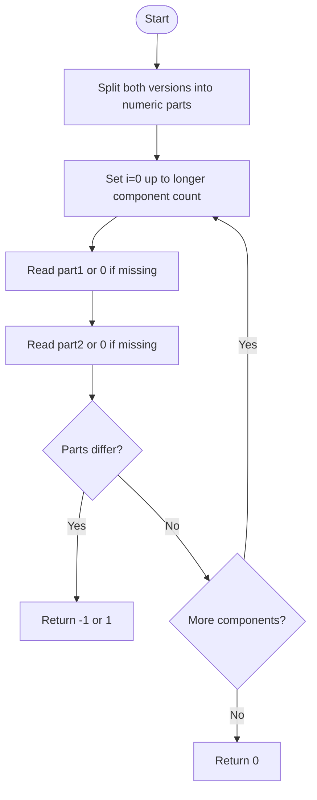

# Compare Version Numbers — LeetCode 165

## 1. Understanding

Dot-separated non-negative integer revision components असलेल्या दोन version strings lexicographically by numeric component compare करा. Return `-1`, `1`, किंवा `0`.

## 2. Worked examples and edges

- `"1.0.1"` vs `"1.0.2"` → -1.
- `"1.2"` vs `"1.10"` → -1; string comparison करू नका.
- `"1.1.0"` vs `"1.1"` → 0; missing components zero मानले जातात.
- Leading zeros असलेले components numeric valueने समान.

## 3. Pattern identification + cheat sheet

| Clue                       | Pattern                    | कारण                               |
| -------------------------- | -------------------------- | ---------------------------------- |
| Delimited numeric fields   | Tokenize / parse           | प्रत्येक revision स्वतंत्र compare |
| Different component counts | Zero padding               | Missing trailing component = 0     |
| First difference decides   | Lexicographic numeric scan | पुढे जाण्याची गरज नाही             |

## 4. Approaches

- Source `splitVersion` + vectors: O(n+m) parse/compare time, O(n+m) space.
- In-place two-string pointers: O(n+m) time, O(1) extra space; efficient variation.
- Direct whole-string lexical comparison चुकीची (`"10"` vs `"2"`).
- `stoi` overflow हा constraintबाहेरच्या मोठ्या componentसाठी धोका; arbitrary length असल्यास digit-wise compare.

## 5. Flowchart

पहिला non-equal numeric componentच ordering ठरवतो.

## 6. Algorithm / intuition

दोन्ही strings `.` वर split करा. Indexने paired values compare करा; कमी arrayमध्ये component नसेल तर 0. First differenceवर sign return, अन्यथा equal.

## 7. Code explanation

`splitVersion` `stringstream/getline` वापरून `stoi` components तयार करतो. `compareVersion` max component count loop करतो, absent componentला zero देतो आणि -1/1/0 परत करतो.

## 8. Dry run

> **मराठी:** प्रत्येक महत्त्वाच्या step नंतर variable ची value trace करा.
> `"1.2"` vs `"1.10"`:
> | component | v1 | v2 | decision |
> |---:|---:|---:|---|
> | 0 | 1 | 1 | equal |
> | 1 | 2 | 10 | return -1 |

## 9. Complexity

> **मराठी:** Input size आणि प्रत्येक operation कितीदा चालतो यावरून complexity ठरवा.
> Let total string length be `L`: O(L) time, O(L) space for split vectors (ignoring output).

## 10. Correctness

Version order हा पहिल्या वेगळ्या numeric componentच्या orderने ठरतो. Code प्रत्येक component क्रमाने तपासतो आणि missing trailing ones zero करतो; म्हणून पहिल्या differenceचा sign योग्य, आणि differences नसल्यास versions equivalent.

## 11. Mistakes and interview traps

- Components numeric compare करा, lexical नाही.
- Trailing zeros equality बदलत नाहीत.
- Dot parsing boundary cases, e.g. versions with unequal number of components, handle.
- Component size constraints allow `stoi`; otherwise overflow-safe parse design.

## 12. Quick revision

> **मराठी:** दोन मिनिटांच्या revision साठी pattern, मुख्य कल्पना आणि complexity आठवा.
> Split → pair components → missing=0 → first difference determines result.

## 13. Related problems / variations

> **मराठी:** प्रश्नात काय दिले आहे आणि नेमके काय शोधायचे आहे, हे आधी स्पष्ट करा.
> Natural sort, compare semantic versions (pre-release rules differ), compare numeric strings, version normalization.

## 14. Self-assessment

1. `"1.0"` आणि `"1"` equal का?
2. `"1.2"` vs `"1.10"` कोणता मोठा?
3. Missing componentची value?
4. Very long component असल्यास `stoi`चा पर्याय?
