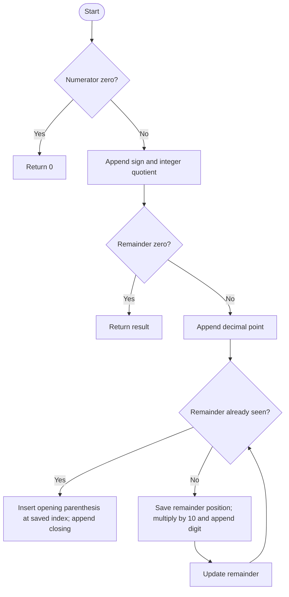

# Fraction to Recurring Decimal — LeetCode 166

## 1. Understanding

Integer numerator/denominator भागाकार decimal stringमध्ये द्या. Repeating fractional digits parenthesesमध्ये दाखवा; उदा. `2/3 = "0.(6)"`.

## 2. Worked examples and edges

- `1/2` → `"0.5"`; `1/6` → `"0.1(6)"`.
- `4/333` → `"0.(012)"`; remainder cycle सुरू होण्याच्या जागी `(`.
- Negative sign numerator/denominatorच्या signsच्या XORने; `0/x` → `"0"`.
- Denominator शून्य नसतो (problem contract).

## 3. Pattern identification + cheat sheet

| Clue                      | Pattern              | कारण                         |
| ------------------------- | -------------------- | ---------------------------- |
| Division decimal digits   | Remainder simulation | प्रत्येक digit remainderमधून |
| Repeating decimal         | Cycle detection      | Same remainder repeats       |
| Need cycle start position | Hash map             | Remainder → output index     |

## 4. Approaches

- Long division with remainder map: O(k) expected time, O(k) space for `k` generated digits/remainders; source method.
- Remainder-position vector indexed by denominator can give O(1) lookup but O(denominator) memory; large denominators undesirable.
- Fixed number of decimal digits किंवा floating point rounding चुकीचे/अपूर्ण; exact repeat detection आवश्यक.

## 5. Flowchart

Remainder परत दिसणे म्हणजे त्यानंतरचे digits आणि cycle पुन्हा सुरू होतो.

## 6. Algorithm / intuition

Absolute valuesने integer quotient आणि remainder काढा. प्रत्येक stepमध्ये remainder×10 करून next digit append करा. प्रत्येक remainderचा result-string index जतन करा; repeat झाल्यावर त्या indexला `(` घाला.

## 7. Code explanation

`fractionToDecimal` zero आणि sign आधी handle करतो; numerator widen करून `long long` absolute करतो, `num/denom` integer part append करतो. `unordered_map<long long,int> remainder_map` cycle position track करतो; remainder zero झाला तर terminate.

## 8. Dry run

> **मराठी:** प्रत्येक महत्त्वाच्या step नंतर variable ची value trace करा.
> `1/6`: integer part `0`, remainder 1; fractional processing:
> | remainder before | saved index | digit `(r*10)/6` | new remainder |
> |---:|---:|---:|---:|
> | 1 | after decimal point | 1 | 4 |
> | 4 | next position | 6 | 4 |
> | 4 | already seen | — | insert `(` there, append `)` |
> Result: `"0.1(6)"`.

## 9. Complexity

> **मराठी:** Input size आणि प्रत्येक operation कितीदा चालतो यावरून complexity ठरवा.
> `k` distinct remainder states/digits emitted: expected O(k) time and O(k) auxiliary map space; hash operations are expected O(1).

## 10. Correctness

> **मराठी:** Invariant किंवा तर्क वापरून algorithm योग्य उत्तर देतो हे समजून घ्या.
> Long division guarantees each appended digit is the next decimal digit and new remainder is exact. A zero remainder means termination. A repeated remainder yields identical future division states, hence an infinite repeating suffix; placing parentheses at its first saved output index marks exactly that cycle.

## 11. Mistakes and interview traps

> **मराठी:** Boundary, duplicate आणि off-by-one cases स्वतंत्रपणे तपासा.

- Sign handling before taking absolute values; XOR means exactly one operand negative.
- Widen before absolute value to support `INT_MIN`.
- Save output index before appending the digit for that remainder.
- Do not forget parentheses begin at the first occurrence of repeated remainder.

## 12. Quick revision

> **मराठी:** दोन मिनिटांच्या revision साठी pattern, मुख्य कल्पना आणि complexity आठवा.
> Sign + integer quotient; while remainder: detect repeat, save index, `r*=10`, append `r/denom`, update `r%=denom`.

## 13. Related problems / variations

> **मराठी:** प्रश्नात काय दिले आहे आणि नेमके काय शोधायचे आहे, हे आधी स्पष्ट करा.
> Rational number expansion, fraction simplification, detect cycle in linked list, decimal-to-fraction conversion.

## 14. Self-assessment

1. Repeated remainder काय दर्शवतो?
2. `1/6` मध्ये cycle कुठून सुरू होतो?
3. Sign कसा ठरतो?
4. `INT_MIN` साठी widen-before-abs का?
