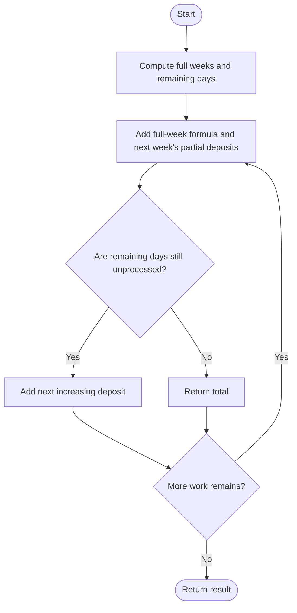
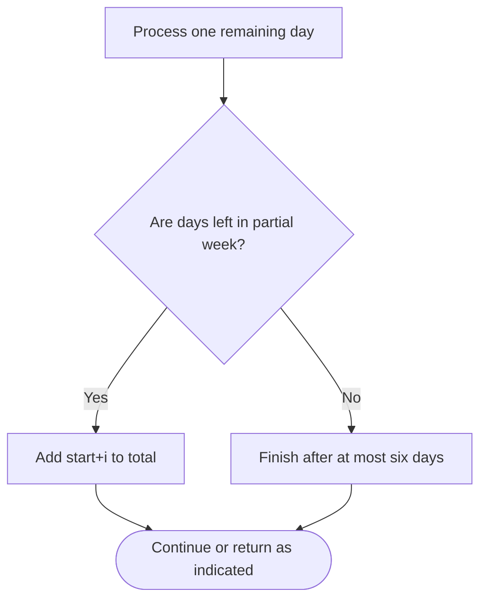

# Calculate Money in Leetcode Bank — LeetCode 1716

## Problem and judge interface

int totalMoney(int n); return total deposits over the first n days under the weekly schedule.

## Identification evidence

It sums complete weeks as 28+7\*weekIndex and adds a partial increasing week, identifying problem 1716.

## Main flow



## Important branch / loop



## Core logic and invariants

Split n into full weeks m and remainder r. Sum complete weeks by an arithmetic series, then add at most six amounts starting at m+1.

## Complexity

O(1) time and O(1) space; remainder loop runs at most six times.

## Comparison and optimization

Closed-form full-week sum avoids simulating every day; only the partial week is iterated.

## Compile and run

The `.cpp` is the original standalone source, including its local `main()` demonstration where present. Compile and run from the repository root with a C++17 compiler:

```text
g++ -std=c++17 LeetCode\1716\1716.cpp -o solution.exe
.\solution.exe
```

For LeetCode, adapt the implementation to the required class/method signature and omit the local `main()` and demonstration helpers; use the judge-provided node types. Notes above identify method-name or behavior differences. The moved source bytes have not been edited.
