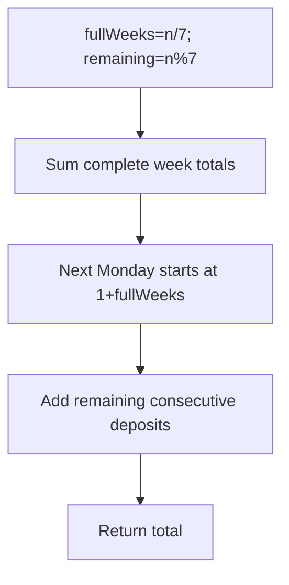

# Calculate Money in Leetcode Bank — LeetCode 1716

## Problem, constraints आणि examples

पहिल्या Mondayला `$1` जमा; प्रत्येक पुढच्या दिवशी त्या आठवड्यात `$1` जास्त. प्रत्येक पुढच्या Mondayला आधीच्या Mondayपेक्षा `$1` जास्त सुरूवात. `n` दिवसांनंतर एकूण savings return करा.
Example: `n=10`: first week `1+2+...+7=28`; पुढील Mondayपासून `8+9+10=27`; total `55`. `n=4` → `10`; `n=0` (जर विचारले) → `0`.

## Pattern clues

> **मराठी:** या clues मुळे योग्य pattern ओळखता येतो; constraints आणि relations नीट तपासा.
> | Clue | Pattern |
> |---|---|
> | weekly schedule repeats with incrementing start | arithmetic series |
> | complete 7-day blocks plus remainder | quotient/remainder decomposition |
> | at most six leftover days | constant-time tail loop |

## Approaches

> **मराठी:** सोप्या उपायापासून सुरुवात करा आणि constraints नुसार योग्य optimization निवडा.
> | Method | Status | Cost |
> |---|---|---|
> | Simulate every day | Correct, `O(n)` time / `O(1)` space |
> | Full weeks arithmetic sum + leftover loop | Selected, `O(1)` time / `O(1)` space |
> | Multiply `n` by average deposit | Incorrect; weekly reset changes progression |

## Flowchart

Full week `q` ची बेरीज `28+7q`; partial week पुढील Mondayच्या वाढलेल्या baseपासून चालते.

## Selected algorithm, source explanation, dry run

`totalMoney` `fullWeeks=n/7`, `remainingDays=n%7` काढतो. Full weeksचा sum `28*w + 7*w*(w-1)/2`; पुढचा Monday `1+w` पासून remainderपर्यंत values add. `main` उदाहरणांसाठी method call करतो.
Dry run (`n=10`, `w=1`, remainder `3`):
| Part | Calculation | Sum |
|---|---|---:|
| Week 0 | `1+...+7` | 28 |
| Partial week | `8+9+10` | 27 |
| Total | `28+27` | 55 |

## Edge cases

> **मराठी:** Boundary, duplicate आणि off-by-one cases स्वतंत्रपणे तपासा.
> n=0 has no deposits; n=7 is one complete week; a partial week has at most six days.

## Complexity, correctness, traps

`O(1)` time (remainder loop at most 6 iterations), `O(1)` space. Correctness: daysना full weeks व final prefixमध्ये विभागतो; प्रत्येक full weekचे arithmetic progression आणि remainderचे exact deposits एकदा मोजतो.
Trap: पूर्ण आठवड्यांचा index zero-based आहे; week qचा Monday `1+q`. `w=0` असताना formulaचे triangular term शून्यच राहते.

## Quick revision, variations, self-check

पुनरावलोकन: पूर्ण आठवडे formulaने, उरलेले दिवस loopने जोडा.
`weeks=n/7`, `days=n%7`; full blocks formula + tail. Related: block decomposition, arithmetic progression sums.

1. `n=7` total?
2. Week 2 चा Monday किती जमा करतो?
3. Remainder जास्तीत जास्त किती?
4. Partial weekचा start `1+weeks` का?
