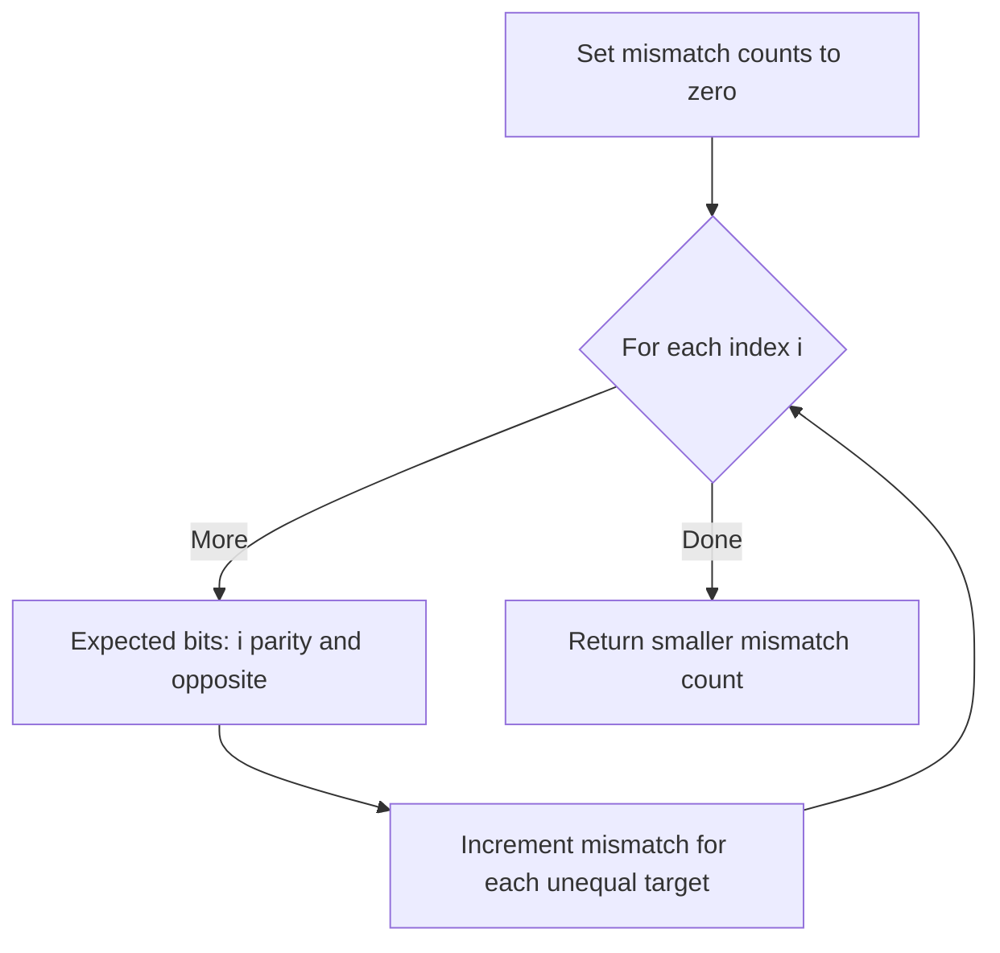

# Minimum Changes To Make Alternating Binary String — LeetCode 1758

## Problem, constraints आणि examples

Binary stringमध्ये कोणत्याही adjacent characters equal नसावेत. एका characterला flip करण्याची किंमत 1; minimum flips परत करा.
Example: `0100`: `0101` साठी 1 flip, `1010` साठी 3; answer `1`. `1111`: either alternating targetला 2 flips. Length 1 string आधीच alternating → `0`.

## Pattern clues

> **मराठी:** या clues मुळे योग्य pattern ओळखता येतो; constraints आणि relations नीट तपासा.
> | Clue | Pattern |
> |---|---|
> | only two valid alternating shapes | compare candidate patterns |
> | flip count equals mismatch count | Hamming distance |
> | second target is complement of first | one count gives both answers |

## Approaches

> **मराठी:** सोप्या उपायापासून सुरुवात करा आणि constraints नुसार योग्य optimization निवडा.
> | Method | Status | Cost |
> |---|---|---|
> | Compare with both patterns in one scan | Selected `O(n)` / `O(1)` |
> | Count mismatches against `0101...`, answer `min(x,n-x)` | Correct `O(n)` / `O(1)` |
> | Build both target strings then compare | Correct, `O(n)` time / `O(n)` space |
> | Greedily flip local equal pair without target | Incorrect; a flip affects both neighbors and may be suboptimal |

## Flowchart

Only two possible patterns आहेत; त्यांपैकी कमी mismatches असलेला target optimum.

## Selected algorithm, source explanation, dry run

> **मराठी:** मुख्य observation समजल्यावर algorithm चे steps लक्षात ठेवणे सोपे होते.
> `approachPatternCompare` tests expected `'0'` at even indices and `'1'` at odd indices, while simultaneously counting opposite-start pattern mismatches. `approachGreedy` counts only first target and uses `n-mismatch`; `approachBuildPattern` materializes targets. `minOperations` forwards to compare method.
> Dry run (`0100`):
> | Index | Actual | Pattern 0101 mismatch? | Pattern 1010 mismatch? |
> |---:|---:|---|---|
> | 0 | 0 | No | Yes |
> | 1 | 1 | No | Yes |
> | 2 | 0 | No | Yes |
> | 3 | 0 | Yes | No |
> | Total | — | 1 | 3 |

## Edge cases

> **मराठी:** Boundary, duplicate आणि off-by-one cases स्वतंत्रपणे तपासा.
> A one-character string needs 0 flips; already alternating strings need 0; either starting bit is a candidate.

## Complexity, correctness, traps

> **मराठी:** Input size आणि प्रत्येक operation कितीदा चालतो यावरून complexity ठरवा.
> The comparison logic is `O(n)` time and `O(1)` algorithmic extra space. Source methods take `string` by value, so the call-level input copy uses `O(n)` memory. Correctness: every valid alternating string must start with `0` or `1`; fixed start determines all positions, and each mismatch needs exactly one flip.
> Traps: do not only enforce adjacency with an unproven greedy; compare both starts. `n-x` is valid because patterns are complements at every index.

## Quick revision, variations, self-check

पुनरावलोकन: दोन्ही alternating startsचे mismatch मोजा.
Two targets; mismatch count; return minimum. Related: Hamming distance, binary string transformation, parity-pattern matching.

1. `1111` साठी उत्तर?
2. एक targetचा mismatch दुसऱ्यासाठी काय संबंध ठेवतो?
3. Index parityने expected bit कसा ठरतो?
4. Pattern constructionची अतिरिक्त जागा किती?
