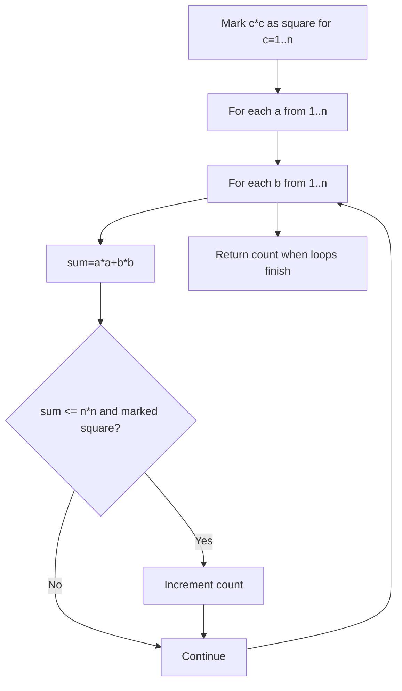

# Count Square Sum Triples — LeetCode 1925

## Problem, constraints आणि examples

Count integer triples `(a,b,c)` where `1≤a,b,c≤n` and `a²+b²=c²`. Ordered `a,b` are counted separately when swapped, as stated by the problem.
Example: `n=5`: `(3,4,5)` and `(4,3,5)` → answer `2`. For `n=4`, no hypotenuse 5 fits → `0`.

## Pattern clues

> **मराठी:** या clues मुळे योग्य pattern ओळखता येतो; constraints आणि relations नीट तपासा.
> | Clue | Pattern |
> |---|---|
> | two legs determine square sum | nested enumeration |
> | repeated perfect-square membership test | precompute square lookup |
> | values bounded by n | boolean table |

## Approaches

> **मराठी:** सोप्या उपायापासून सुरुवात करा आणि constraints नुसार योग्य optimization निवडा.
> | Method | Status | Cost |
> |---|---|---|
> | Precompute squares and test all `(a,b)` | Source method, `O(n²)` time, `O(n²)` space |
> | Triple loops over `(a,b,c)` | Correct brute force `O(n³)` / `O(1)` |
> | Floating-point sqrt for each sum | Possible; rounding/integer checks needed |
> | Count only `a<b` | Incorrect for ordered-leg count; would halve answers |

## Flowchart

Boolean lookup membershipला constant-time करते; `a,b` दोन्ही ordered loopमध्ये ठेवले आहेत.

## Selected algorithm, code-specific explanation, dry run

> **मराठी:** मुख्य observation समजल्यावर algorithm चे steps लक्षात ठेवणे सोपे होते.
> `countTriples` allocates `isSquare` through `n*n`, marks `i*i`, then tests every positive `(a,b)`; only sum `≤n²` can have a valid `c≤n`. Since loop considers `(3,4)` and `(4,3)`, both count. `main` runs selected `n` values.
> Dry run (`n=5`): `3²+4²=25`, lookup true → +1; `4²+3²=25` → +1; answer 2.

## Edge cases

> **मराठी:** Boundary, duplicate आणि off-by-one cases स्वतंत्रपणे तपासा.
> For n below 5 there is no positive Pythagorean triple; swapped legs are distinct ordered triples.

## Complexity, correctness, traps

> **मराठी:** Input size आणि प्रत्येक operation कितीदा चालतो यावरून complexity ठरवा.
> Square setup `O(n)`; pair scan `O(n²)`; table `O(n²)` booleans. Correctness: all allowed leg pairs are visited, and lookup is true exactly when sum equals some `c²` in `[1,n]`.
> Trap: bound table index by `n*n`; ordered pairs count twice; `a,b,c` all start at 1 (zero not allowed).

## Quick revision, variations, self-check

पुनरावलोकन: दोन्ही leg orders तपासून square lookup करा.
Mark squares; enumerate two legs; test sum. Related: perfect-square lookup, Pythagorean triples, number theory enumeration.

1. Why can sum exceed `n²` be skipped?
2. Is `(3,4,5)` one ordered triple or two?
3. Why is table `n*n+1` long?
4. What is source space complexity?
