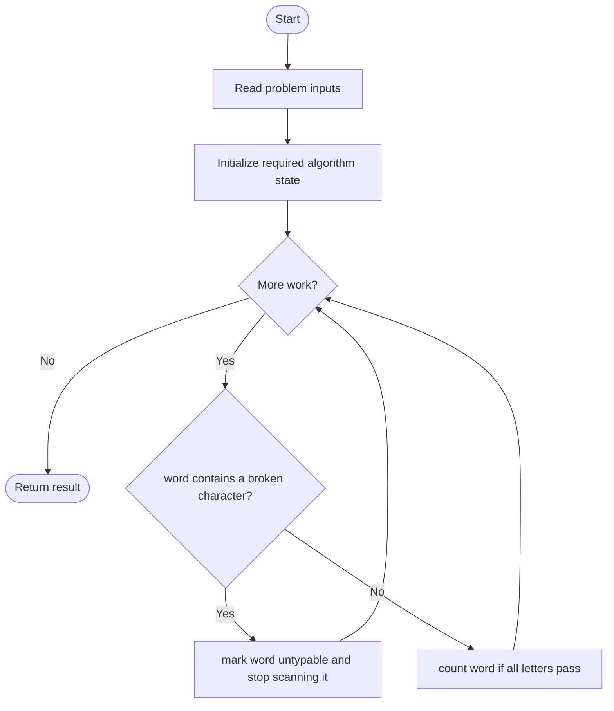
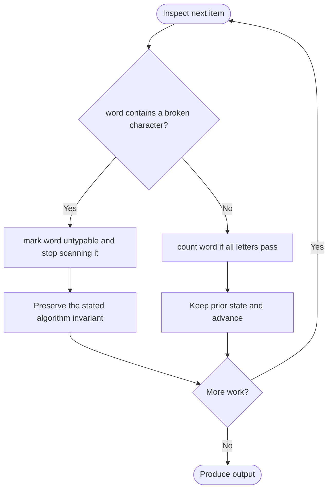

# Maximum Number of Words You Can Type

**LeetCode ID:** 1935

**Source file(s):** `1935.cpp` (originally `canBeTypedWords.cpp`)

**Identification evidence:** The original filename, declared signature, and distinctive behavior described below uniquely identify this problem; no number was inferred from a filename alone.

## Expected input/output or judge interface

canBeTypedWords_v1/v2(text,brokenLetters). Inputs follow the problem constraints; the output is the documented scalar, sequence, or design-object behavior. The description below reflects the implementation actually present in the source.

## Main flow



## Important branch and loop flow



## Core logic and invariant

Splits text into words and counts words containing no broken letter; compares repeated string searches with a 26-entry broken-letter table.

The key branch/loop rule above is applied once per relevant item; the algorithm relies on that rule to preserve its state and produce the required result.

## Optimization / comparison

The boolean alphabet table avoids repeated find searches and enables early exit.

## Complexity

v1 O(T*B) worst case; v2 O(T+B); constant-size alphabet table.

## Compile and run

The repository file includes a standalone demonstration `main()`; it is not a raw LeetCode submission unit. From the repository root, with a C++17 compiler:

```powershell
g++ -std=c++17 LeetCode\1935\1935.cpp -o solution.exe
.\solution.exe
```

For LeetCode's class-method judge, copy the relevant class/method or design-class API and omit the demo `main()` and local harness. Adapt free-function implementations to the requested `Solution` class signature where necessary. See the source caveat above for any compile blocker.
