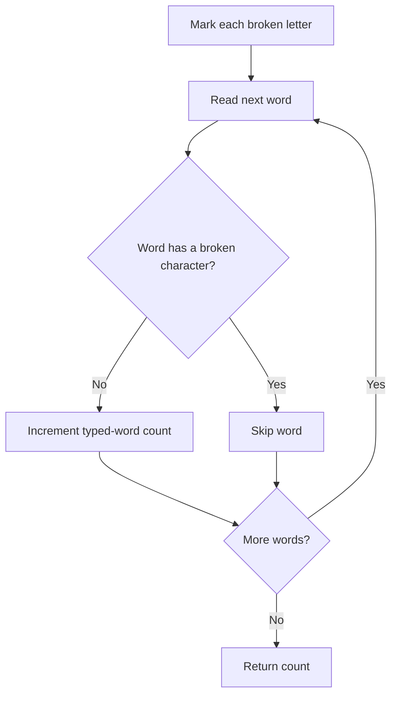

# Maximum Number of Words You Can Type — LeetCode 1935

## Problem, constraints आणि examples

Given words separated by spaces and a set of broken lowercase letters, count words that contain none of those letters. A broken letter invalidates a word if it appears anywhere in it.
Example: `text="hello world"`, broken=`"ad"` → `hello` works, `world` has `d`, answer `1`. Empty broken string means every word can be typed.

## Pattern clues

> **मराठी:** या clues मुळे योग्य pattern ओळखता येतो; constraints आणि relations नीट तपासा.
> | Clue | Pattern |
> |---|---|
> | fixed alphabet of 26 lowercase letters | boolean lookup table |
> | each word independently valid/invalid | tokenize and scan |
> | repeated character membership checks | preprocess lookup |

## Approaches

> **मराठी:** सोप्या उपायापासून सुरुवात करा आणि constraints नुसार योग्य optimization निवडा.
> | Method | Status | Cost |
> |---|---|---|
> | For each char, `string.find` among broken letters | Correct source v1; roughly `O(T*B)` |
> | Mark broken letters, scan each word once | Selected v2; `O(B+T)` |
> | Remove broken chars then count remaining words | Incorrect; a partially typed word is untypeable |
> | Compare whole word with broken string | Incorrect; membership, not equality, matters |

## Flowchart

प्रत्येक wordमध्ये एक broken character सापडल्यावर उरलेले word scan थांबवता येते.

## Selected algorithm, code-specific explanation, dry run

> **मराठी:** मुख्य observation समजल्यावर algorithm चे steps लक्षात ठेवणे सोपे होते.
> `canBeTypedWords_v2` builds `broken[26]`, streams words with `stringstream`, checks characters and breaks at first bad one. v1 uses `find` for every broken letter in each word. Both count words, not letters; `main` compares versions.
> Dry run (`"hello world"`, broken=`"ad"`):
> | Word | Broken hit? | Count after |
> |---|---|---:|
> | hello | none | 1 |
> | world | `d` | 1 |

## Edge cases

> **मराठी:** Boundary, duplicate आणि off-by-one cases स्वतंत्रपणे तपासा.
> No broken letters means every word counts; if every word contains a broken letter, answer is 0.

## Complexity, correctness, traps

> **मराठी:** Input size आणि प्रत्येक operation कितीदा चालतो यावरून complexity ठरवा.
> v2 `O(B+T)` time; v1 worst `O(T*B)` character search. Source parameters copy `text` and `brokenLetters`, so actual call-level space is `O(T+B)`; beyond those copies, v2 uses a fixed table and current token. Correctness: word is countable iff every character's membership flag is false; loop tests exactly that.
> Trap: a word with multiple broken letters still counts as one invalid word; empty broken set means all words are valid. Input uses lowercase English alphabet and spaces.

## Quick revision, variations, self-check

पुनरावलोकन: broken letter मिळताच तो शब्द वगळा.
Pre-mark alphabet, tokenize, reject word on first membership. Related: word filtering, set membership, character-frequency checks.

1. If a word has two broken letters, how many are subtracted?
2. What does empty brokenLetters imply?
3. Why is fixed array indexed by `ch-'a'`?
4. Which source version is asymptotically faster?
