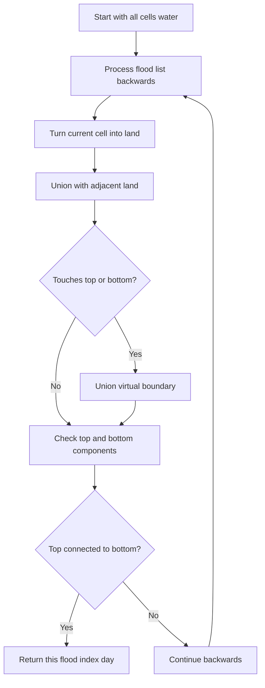

# Last Day Where You Can Still Cross — LeetCode 1970

## Problem, constraints आणि examples

An `row x col` grid starts as land. `cells[d]` floods one-based row/column on day `d+1`. From any top-row land cell, move four-directionally to bottom row through land. Return the last day crossing remains possible.
Example: `2x2`, flood order `[(1,1),(2,1),(1,2),(2,2)]`: after day 1 and day 2, the right column remains a land path; after day 3, crossing is impossible, so answer `2`. One-row grid loses crossing when its final usable top/bottom land is flooded.

## Pattern clues

> **मराठी:** या clues मुळे योग्य pattern ओळखता येतो; constraints आणि relations नीट तपासा.
> | Clue | Pattern |
> |---|---|
> | connectivity changes as cells flood | dynamic connectivity |
> | asks latest feasible day, monotone over time | binary search + connectivity, or reverse process |
> | reversing floods adds land | DSU union operations |

## Approaches

> **मराठी:** सोप्या उपायापासून सुरुवात करा आणि constraints नुसार योग्य optimization निवडा.
> | Method | Status | Cost |
> |---|---|---|
> | Reverse flood order with DSU + virtual top/bottom | Selected, `O(RC α(RC))` |
> | Binary search day and run BFS/DFS | Correct, about `O(RC log(RC))` |
> | Forward DFS after each flood | Correct but source naive repeated search; can be very slow, conservative worst `O(D*C*R*C)` |
> | Flood days with no reachability test | Incorrect; connectivity, not flooded count, decides crossing |

## Flowchart

Reverseमध्ये land वाढत असल्याने DSUने components merge होतात; first connection मिळताच त्या पुढच्या forward floodच्या आधी crossing शक्य असते.

## Selected algorithm, source-specific explanation, dry run

`latestDayToCross_DSU` initializes all cells as water, then opens `cells[day]` from last to first. Cell id `x*col+y`; neighboring land unions; top/bottom row union to virtual nodes. `findSet(TOP)==findSet(BOTTOM)` झाल्यावर `day` return. Alternative source `latestDayToCross_DFS` builds water forward and searches each day. `main` compares them.
Dry run (2x2 order above): reverse opens `(2,2)` (original flood day 4), then `(1,2)` (original flood day 3). They connect top and bottom while the first two flood cells remain water, so this is the grid after forward day 2; return `2`.

## Edge cases

> **मराठी:** Boundary, duplicate आणि off-by-one cases स्वतंत्रपणे तपासा.
> A 1x1 grid crosses before its only cell is flooded; day numbering must distinguish the state before and after each flood.

## Complexity, correctness, traps

> **मराठी:** Input size आणि प्रत्येक operation कितीदा चालतो यावरून complexity ठरवा.
> DSU `O(RC α(RC))` time and `O(RC)` DSU/grid space; source takes `cells` by value, an additional `O(RC)` copy. Correctness: reverse state after opening index `d` is the forward grid after flooding days `1..d`; first top-bottom connection marks the maximum crossing day.
> Trap: input cell coordinates are 1-based, internal indices 0-based; return zero-based `day` as actual latest day count. Only four-neighbor land connects.

## Quick revision, variations, self-check

पुनरावलोकन: floods reverse करून DSU connectivity शोधा.
Reverse time, open land, union neighbors and virtual borders. Related: number of islands II, DSU connectivity, monotone binary search with BFS.

1. Why is DSU inconvenient during forward flooding?
2. What does returned `day` mean in one-based flood list?
3. Why add virtual top and bottom nodes?
4. Are diagonal cells connected?
