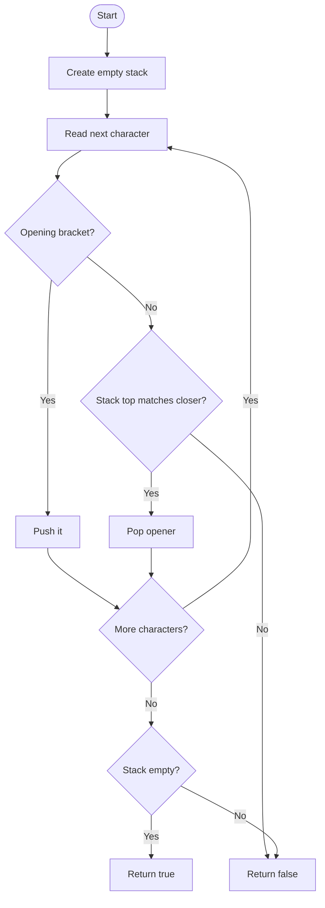

# Valid Parentheses — LeetCode 20

## 1. Understanding

`()`, `{}`, `[]` brackets योग्य प्रकारे open/close होतात का ते तपासा. प्रत्येक opener ला योग्य closer आणि योग्य nesting हवी.

## 2. Worked examples and edges

- `"()[]{}"` → true; `"{[]}"` → true.
- `"([)]"` किंवा `"(]"` → false; `""` → true.
- `"("` → false कारण stack रिकामा होत नाही.

## 3. Pattern identification + cheat sheet

| Clue                             | Pattern          | कारण                                 |
| -------------------------------- | ---------------- | ------------------------------------ |
| Nested matching pairs            | Stack            | शेवटचा unmatched opener आधी बंद होतो |
| Closing symbol needs counterpart | LIFO             | Top वरच योग्य opener असावा           |
| Input scan once                  | State validation | O(n) pass पुरेसा                     |

## 4. Approaches

- Source `isValidOriginal`: explicit closer cases — O(n) time/O(n) space.
- `isValidOptimized`: closer→opener map आणि stack — O(n)/O(n).
- Brute-force repeated pair deletion शक्य पण inefficient, साधारण O(n²).
- चुकीचे: count of each bracket समान असणे पुरेसे नाही (`"([)]"` counts match करतात पण nesting चुकते).

## 5. Flowchart

Top-of-stack nesting order सांभाळतो; शेवटी unmatched opener तपासतो.

## 6. Algorithm / intuition

Opener दिसला की push करा. Closer दिसल्यावर stack empty नसावा आणि top matching opener असावा; pop करा. सर्व chars नंतर stack रिकामा असेल तर valid.

## 7. Code explanation

`isValidOriginal` तीन closer cases तपासतो. `isValidOptimized` map मधून अपेक्षित opener घेतो. Source मध्ये दुसरा method non-closer कोणताही char opener म्हणून push करतो; LeetCode input फक्त bracket characters असल्याने ते ठीक, पण arbitrary text साठी strict validation लागेल.

## 8. Dry run

> **मराठी:** प्रत्येक महत्त्वाच्या step नंतर variable ची value trace करा.
> `"{[]}"`:
> | char | stack before | action | stack after |
> |:---:|---|---|---|
> | `{` | `[]` | push | `{` |
> | `[` | `{` | push | `{ [` |
> | `]` | `{ [` | match/pop | `{` |
> | `}` | `{` | match/pop | empty → true |

## 9. Complexity

> **मराठी:** Input size आणि प्रत्येक operation कितीदा चालतो यावरून complexity ठरवा.
> O(n) time, O(n) worst-case stack space (all opening brackets).

## 10. Correctness

Stack-ordered openers нь input prefix मधэх unmatched opens. Closer зөв top-ийг pop केल्यास nesting locally योग्य राहते. Invalid/mismatched closer लगेच reject होतो; शेवटी stack empty म्हणजे unmatched opener नाही.

## 11. Mistakes and interview traps

- Empty input valid आहे.
- Closer आल्यावर empty stack आधी तपासा.
- Matching type बरोबर असणे आवश्यक; फक्त pair count पुरेसे नाही.
- Source चे generic `else` non-bracket text साठी permissive आहे.

## 12. Quick revision

Open → push; close → top match? pop; end → stack empty. LIFO म्हणजे nesting.

## 13. Related problems / variations

> **मराठी:** प्रश्नात काय दिले आहे आणि नेमके काय शोधायचे आहे, हे आधी स्पष्ट करा.
> Minimum Remove to Make Valid Parentheses, Generate Parentheses, longest valid parentheses, expression parsing.

## 14. Self-assessment

1. `"([)]"` का invalid?
2. Stack ऐवजी queue का चुकीची?
3. Empty string चे उत्तर काय?
4. Source optimized method arbitrary characters बद्दल काय गृहीत धरतो?
