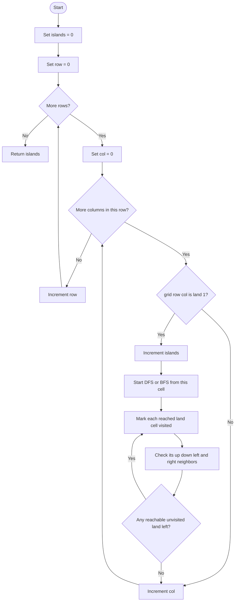

# 200. Number of Islands

> **Pattern:** Connected Components in a Grid  
> **Main tools:** DFS, BFS, or Disjoint Set Union (DSU)  
> **Language in this note:** Simple English + मराठी (English-Marathi mix)

## 1. Problem Understanding

आपल्याला `m x n` character grid दिला आहे. प्रत्येक cell मध्ये:

- `'1'` म्हणजे **land** (जमीन)
- `'0'` म्हणजे **water** (पाणी)
  एका island मध्ये एक किंवा अधिक land cells असतात जे **up, down, left, किंवा right** ने एकमेकांशी जोडलेले असतात. Diagonal connection ग्राह्य धरले जात नाही.
  **आपल्याला काय return करायचे?** Grid मधील वेगवेगळ्या islands ची संख्या.
  **महत्त्वाचे शब्द आणि constraints**
- **Connected:** फक्त चार दिशांनी चालत land cells पर्यंत पोहोचता येते.
- **Island:** एक connected land component.
- **Grid:** दिलेल्या problem मध्ये rectangular आहे; `m` आणि `n` प्रत्येकी `1` ते `300` असतात.
- Grid मधील values `'0'` आणि `'1'` या characters आहेत; ते integer `0` आणि `1` नाहीत.
- दिलेल्या constraints मध्ये grid रिकामा नसतो. तरीही या code मध्ये `m == 0` साठी defensive check आहे.

## 2. Example Understanding

### Example 1

```text
Input:
[
  ["1","1","1","1","0"],
  ["1","1","0","1","0"],
  ["1","1","0","0","0"],
  ["0","0","0","0","0"]
]
Output: 1
```

पहिल्या तीन rows मधील land cells चार दिशांनी एकमेकांपर्यंत पोहोचतात. मधल्या काही cells मध्ये पाणी असले, तरी बाकी land cells भोवतीचा route जोडलेला आहे. त्यामुळे सर्व land मिळून **एकच island** आहे.

### Example 2

```text
Input:
[
  ["1","1","0","0","0"],
  ["1","1","0","0","0"],
  ["0","0","1","0","0"],
  ["0","0","0","1","1"]
]
Output: 3
```

1. वरच्या डावीकडचे चार land cells जोडलेले आहेत → island 1.
2. तिसऱ्या row मधील मधला land cell वेगळा आहे → island 2.
3. खालच्या उजवीकडचे दोन land cells जोडलेले आहेत → island 3.
   Diagonal ने जोडलेले असणे पुरेसे नाही; म्हणून एकूण उत्तर `3`.

### Example 3

```text
Input:  [["0"]]
Output: 0
```

इथे land cell नाही, म्हणून कोणताही island नाही.

### आणखी लक्षात ठेवण्यासारखे cases

- सर्व cells land असतील → एक island.
- Land cells एकमेकांना फक्त diagonal ने भेटत असतील → प्रत्येक वेगळा component.
- एका cell ची grid `[['1']]` असेल → एक island.

## 3. Problem Identification — Pattern Recognition

प्रश्नात grid मधील **connected groups** मोजायचे आहेत. हे graph problem आहे: प्रत्येक land cell हा node, आणि त्याच्या चार बाजूंचे land cells हे neighbors.
**अनुभवी solver चा विचार:**

1. “Group” किंवा “connected” काय म्हणायचे आहे ते ठरवतो — इथे चार directions.
2. एका unvisited land cell पासून त्याच्या पूर्ण group ला भेट देण्याचा मार्ग शोधतो.
3. प्रत्येक नवीन unvisited land cell हा नवीन component सुरू करतो; count वाढवतो.
4. त्या component मधील सर्व land visited/marked करतो, म्हणजे पुढच्या scan मध्ये तो पुन्हा मोजला जाणार नाही.
5. सर्व cells scan झाले की component count हे उत्तर.

### स्वतःला विचारायचे प्रश्न

- Connection साठी कोणत्या directions परवानगी आहेत? Diagonal चालते का?
- एका cell ला पुन्हा भेट देऊ नये यासाठी visited कसे track करणार?
- प्रत्येक component एकदाच कसा count होईल?
- Input बदलण्याची परवानगी आहे का? नसेल तर वेगळा `visited` array लागेल का?
- Recursive DFS साठी worst-case depth किती असू शकते?

### Pattern Recognition Cheat Sheet

| Clue in Question                                    | Possible Pattern                   | Why?                                                 |
| --------------------------------------------------- | ---------------------------------- | ---------------------------------------------------- |
| Grid मधील connected land groups मोजा                | Grid DFS/BFS                       | Cell ला node आणि adjacent cells ला edges मानता येतात |
| “Number of groups/components”                       | Connected Components               | प्रत्येक disconnected group एकदा मोजायचा आहे         |
| Up/down/left/right explicitly सांगितले              | 4-direction traversal              | Neighbor rules निश्चित आहेत; diagonal वगळली जाते     |
| अनेक cell-pairs जोडणे, connectivity वारंवार विचारणे | DSU / Union-Find                   | Components merge करून connectivity track करता येते   |
| Visited cells पुन्हा process होऊ नयेत               | Visited set किंवा in-place marking | Duplicate traversal टाळते                            |

## 4. Different Approaches

### Approach A: Naive repeated reachability (correct, पण inefficient)

**Intuition:** प्रत्येक land cell साठी BFS/DFS करून त्याला जोडलेले सर्व land शोधा. कोणते cells आधीच्या groups मध्ये आले आहेत हे वेगळे track करूनच नवीन group मोजा.
**कसे चालेल?**

1. प्रत्येक land cell तपासा.
2. त्या cell पासून पूर्ण component शोधा.
3. आधी मोजलेल्या component मधील cell असल्यास count वाढवू नका; अन्यथा नवीन component मोजा.
   हे योग्य बनवण्यासाठी duplicate components ओळखण्याची अतिरिक्त व्यवस्था आवश्यक आहे. ती नसल्यास प्रत्येक cell वरून तोच island पुन्हा मोजला जाईल. `L` land cells आणि `V = m*n` cells असतील तर वारंवार पूर्ण traversal केल्यामुळे worst case `O(L * V)` होऊ शकतो.
   **कधी वापरायचा?** जवळजवळ कधीच नाही; फक्त repeated work का टाळायचे हे समजण्यासाठी baseline म्हणून.

### चुकीचा shortcut: प्रत्येक `'1'` मोजणे

हे **logically incorrect** आहे. Island म्हणजे land cell नव्हे, तर जोडलेल्या land cells चा group. उदाहरण 1 मध्ये अनेक `'1'` आहेत पण उत्तर `1` आहे. तसेच प्रत्येक land cell वरून traversal करून visited/marked न करता count वाढवणेही तोच island वारंवार मोजेल.

### Approach B: DFS Flood Fill (दिलेल्या code मधील पहिला approach)

**Intuition:** नवीन land सापडल्यावर DFS ने त्याच्या पूर्ण connected region मध्ये जा. भेटलेल्या cells ना `'0'` करून visited mark करा. प्रत्येक नवीन DFS start म्हणजे एक नवीन island.
**Steps:**

1. प्रत्येक cell scan करा.
2. `'1'` दिसल्यास `islands` वाढवा.
3. त्या cell पासून recursive DFS करा.
4. DFS प्रत्येक भेटलेल्या land ला `'0'` करते आणि चार directions तपासते.
5. पूर्ण grid scan झाल्यावर count return करा.
   प्रत्येक cell जास्तीत जास्त एकदा process होतो, म्हणून हा योग्य आणि optimal traversal approach आहे. Recursive call stack मोठ्या connected island मध्ये `O(mn)` पर्यंत वाढू शकतो.

### Approach C: BFS Flood Fill (दिलेल्या code मधील दुसरा approach)

**Intuition:** DFS सारखेच component शोधायचे, पण recursion ऐवजी queue वापरून level-by-level cells process करायचे.
**Steps:**

1. Unvisited `'1'` आढळल्यावर island count वाढवा.
2. त्या cell ला लगेच `'0'` करा आणि queue मध्ये टाका.
3. Queue मधून cell काढून त्याचे चार neighbors तपासा.
4. प्रत्येक नवीन land neighbor ला queue मध्ये टाकण्यापूर्वी visited mark करा.
5. Queue रिकामी झाल्यावर तो component पूर्ण; grid scan पुढे चालू ठेवा.
   Queue मध्ये टाकतानाच mark केल्यामुळे एखादा cell अनेकदा enqueue होत नाही. BFS आणि DFS दोन्ही `O(mn)` वेळेत चालतात. BFS recursion stack टाळते, पण queue मोठी होऊ शकते.

### Approach D: Disjoint Set Union (DSU / Union-Find)

**Intuition:** प्रत्येक cell ला एक id द्या. Adjacent land cells च्या sets union करा. शेवटी land cells चे distinct roots म्हणजे islands.
**दिलेल्या code मधील पद्धत:**

1. `id = row * n + col` वापरून cell ला 1D id द्या.
2. Land cell count प्रारंभी वाढवा.
3. Duplicate unions टाळण्यासाठी फक्त **right** आणि **down** land neighbors शी `unite` करा.
4. `find` path compression करते; `unite` rank वापरून लहान tree मोठ्या tree ला जोडते.
5. सर्व land cells चे roots `set` मध्ये घाला; set चा आकार म्हणजे island count.
   DSU योग्य आहे आणि connectivity operations साठी उपयुक्त आहे. या एका static grid traversal साठी DFS/BFS सहसा समजायला अधिक सोपे असतात. दिलेल्या implementation मध्ये सर्व `m*n` cells साठी parent/rank ठेवले जातात, पाण्यासाठीही; पण शेवटी roots फक्त land साठी मोजले जातात.

### Approach Comparison

| Approach                       |                    Time |                             Space | Pros                                          | Cons                                                                                       |
| ------------------------------ | ----------------------: | --------------------------------: | --------------------------------------------- | ------------------------------------------------------------------------------------------ |
| Repeated reachability baseline | `O(L * m*n)` worst case | `O(m*n)` per search plus tracking | साधी कल्पना; repeated work दाखवते             | खूप redundant; चुकीचे deduplication केल्यास उत्तर चुकते                                    |
| DFS flood fill                 |                `O(m*n)` |               `O(m*n)` worst case | छोटा, नैसर्गिक traversal; प्रत्येक cell एकदाच | Recursive stack overflow चा धोका                                                           |
| BFS flood fill                 |                `O(m*n)` |               `O(m*n)` worst case | Recursion नाही; iterative आणि स्पष्ट          | Queue ला मोठी जागा लागू शकते                                                               |
| DSU (या code मधील `set` सह)    |       `O(m*n log(m*n))` |                          `O(m*n)` | Dynamic unions/connectivity साठी उपयोगी       | `set` मुळे roots मोजण्याचा टप्पा `O(m*n log(m*n))`; या static problem साठी जास्त machinery |

इथे `L` = land cells, `V = m*n`, आणि `α` = inverse Ackermann function, जी practical input sizes साठी जवळजवळ constant असते. DSU चे `find`/`unite` operations एकत्र `O(V * α(V))` असतात; पण या code मधील `set` insertions मुळे एकूण worst-case वेळ `O(V log V)` होतो.

> **Code-specific note:** दिलेल्या C++ methods मध्ये `grid` value ने घेतला आहे, त्यामुळे प्रत्येक call साठी input grid ची copy तयार होते (`O(m*n)` अतिरिक्त space/time copy). हा खर्च asymptotic `O(m*n)` मध्येच येतो; DSU साठी `const vector<vector<char>>&` वापरल्यास अनावश्यक copy टाळता येईल. इथे मूळ approach बदललेला नाही.

## 5. Flowchart Using Mermaid



**Flowchart समजावून घेऊया:** बाहेरचा loop प्रत्येक row आणि आतला loop प्रत्येक column तपासतो. Cell पाणी असेल किंवा आधीच visited असेल तर पुढे जातो. नवीन land असेल तर island count एकाने वाढतो; DFS/BFS त्या island मधील सगळी land cells visited करते. त्यामुळे पुढे त्याच island मधील cell scan झाला तरी तो नवीन island म्हणून मोजला जात नाही.

## 6. Algorithm / Intuition

या code साठी final recommended approach म्हणजे **DFS/BFS flood fill**. दोन्हीची correctness आणि complexity सारखी आहे. Recursive stack चा विचार महत्त्वाचा असल्यास BFS निवडा; recursion योग्य असेल आणि code concise हवा असेल तर DFS निवडा.
**मुख्य observation:** एखाद्या unvisited land cell पासून चार दिशांनी पोहोचता येणारी प्रत्येक land cell त्याच island मध्ये आहे. त्या component मधील सर्व cells mark केल्यानंतर पुढे scan करताना नवीन component सुरू होईल तेव्हाच count वाढतो.
**Algorithm:**

1. `islands = 0` ठेवा.
2. प्रत्येक grid cell row-by-row scan करा.
3. Cell `'0'` असल्यास skip करा.
4. Cell `'1'` असल्यास `islands++` करा.
5. DFS/BFS ने connected land शोधा आणि त्यांना visited mark करा.
6. Scan संपल्यावर `islands` return करा.
   **महत्त्वाचे variables / data structures:**

- `m`, `n`: grid चे rows आणि columns.
- `islands`: आतापर्यंत सापडलेल्या components ची संख्या.
- DFS मध्ये `x`, `y`: current cell coordinates.
- BFS मध्ये `queue<pair<int,int>>`: पुढे process करायचे cells.
- `directions`: चार वैध neighbor offsets.
- DSU मध्ये `parent`, `rank`: प्रत्येक set चे representative आणि tree height estimate.

## 7. Code Explanation

तुमचा source: [`200.cpp`](./200.cpp)

### Recursive DFS

```cpp
void dfs(vector<vector<char>>& grid, int x, int y, int m, int n) {
    if (x < 0 || y < 0 || x >= m || y >= n || grid[x][y] == '0') {
        return;
    }
    grid[x][y] = '0';
    dfs(grid, x - 1, y, m, n);
    dfs(grid, x + 1, y, m, n);
    dfs(grid, x, y - 1, m, n);
    dfs(grid, x, y + 1, m, n);
}
```

- Boundary checks मुळे grid च्या बाहेर जाता येत नाही.
- `'0'` म्हणजे पाणी किंवा आधीच visited cell; दोन्ही वेळेस थांबतो.
- Cell ला recursive calls च्या **आधी** `'0'` करणे महत्त्वाचे आहे; यामुळे cycle/repeated visit होत नाही.
- मग चारही दिशांना traversal होते.
  `numIslandsDFS` मध्ये grid ची copy घेतली जाते. त्यामुळे DFS ने केलेले marking caller च्या मूळ grid ला बदलत नाही. Outer scan मध्ये प्रत्येक `'1'` सापडल्यावर एक नवीन DFS पूर्ण component mark करते आणि count एकदा वाढवते.

### BFS

`directions` मध्ये `(-1,0)`, `(1,0)`, `(0,-1)`, `(0,1)` आहेत. प्रत्येक नवीन land cell साठी queue सुरू होते. Start cell queue मध्ये टाकतानाच `'0'` होतो. नंतर प्रत्येक land neighbor साठीही enqueue करण्यापूर्वी marking होते. ही order duplicate enqueue टाळते.

### DSU

- `iota` प्रत्येक cell चा parent सुरुवातीला स्वतःच ठेवते.
- `find` root शोधते आणि path compression ने पुढील calls जलद करते.
- `unite` rank नुसार दोन roots जोडते.
- Right/down neighbors पुरेसे आहेत: प्रत्येक horizontal/vertical edge scan मध्ये एकदाच तपासली जाते.
- शेवटी land cells चे root ids `set<int>` मध्ये घातले जातात. Distinct root म्हणजे distinct component.
  **बग / correctness check:** दिलेल्या rectangular grid साठी DFS, BFS, आणि DSU या तिन्ही methods चा component-count logic योग्य आहे. विशेष लक्षात ठेवण्यासारखे implementation risks म्हणजे DFS ची मोठी recursion depth, तसेच सर्व methods चे `grid` by-value असल्याने होणारी copy. DSU मध्ये पाण्याचे cells सुद्धा parent array मध्ये असतात, पण ते union/count होत नाहीत; त्यामुळे उत्तर चुकीचे होत नाही.
  `main()` मधील test harness पाच grids वर तिन्ही methods चालवून output तुलना करतो. LeetCode submission मध्ये साधारणपणे `numIslands` या अपेक्षित method name/signature सह फक्त एक solution method आवश्यक असतो; हा file comparison/demo program आहे.

## 8. Dry Run

Example 2 वर DFS/BFS traversal समजून घेऊ:

```text
1 1 0 0 0
1 1 0 0 0
0 0 1 0 0
0 0 0 1 1
```

| Step | Variables                      | Condition                    | Action                                  | Result                                                |
| ---: | ------------------------------ | ---------------------------- | --------------------------------------- | ----------------------------------------------------- |
|    1 | `(row,col)=(0,0)`, `islands=0` | Cell is `'1'`                | Count वाढवा; component traversal सुरू   | `islands=1`; वरच्या डाव्या 2x2 group चे cells visited |
|    2 | Scan `(0,1)`, `(1,0)`, `(1,1)` | Cells आता visited `'0'` आहेत | नवीन traversal नाही                     | `islands=1`                                           |
|    3 | `(2,2)`                        | Cell is `'1'`                | Count वाढवा; एक-cell component mark करा | `islands=2`                                           |
|    4 | `(3,3)`                        | Cell is `'1'`                | Count वाढवा; `(3,4)` शोधून mark करा     | `islands=3`                                           |
|    5 | उरलेले cells                   | `'0'` किंवा visited          | Skip करा                                | Count बदलत नाही                                       |
|    6 | Grid scan पूर्ण                | आणखी cells नाहीत             | Return करा                              | उत्तर `3`                                             |

## 9. Complexity Analysis

`V = m*n` असे धरू.

- **DFS/BFS time:** `O(V)`. प्रत्येक cell outer scan मध्ये एकदा तपासला जातो आणि land cell जास्तीत जास्त एकदा traversal मध्ये visited होतो. प्रत्येक वेळी फक्त चार neighbors तपासतो.
- **DFS space:** worst case `O(V)` recursion stack, उदाहरणार्थ संपूर्ण grid land असेल.
- **BFS space:** worst case `O(V)` queue, मोठा component एकाच वेळी queue मध्ये असू शकतो.
- **DSU time:** `O(V * α(V))` find/union operations साठी; पण दिलेल्या code मध्ये प्रत्येक land root `set` मध्ये insert होतो, त्यामुळे एकूण वेळ `O(V log V)` worst case.
- **DSU space:** `O(V)` parent आणि rank arrays; तसेच roots मोजण्यासाठी worst case `O(V)` set.
  Code मधील by-value `grid` parameter मुळे प्रत्येक method साठी `O(V)` copy देखील होते. त्यामुळे auxiliary storage चे order तरीही `O(V)` राहते. `m,n <= 300` असल्याने asymptotic दृष्टीने हे approaches योग्य आहेत; मात्र recursive DFS मध्ये worst-case call stack लक्षात घ्या.

## 10. Why This Solution Works

**Loop invariant:** Outer scan ने पूर्ण केलेल्या प्रत्येक cell साठी, त्या cell च्या land component ला भेट दिली असेल तर तो component आधीच visited/marked आहे. `islands` हे आतापर्यंत सुरू केलेल्या distinct components ची संख्या आहे.

1. नवीन unvisited land cell मिळाल्यावर त्याच्या component मधील कोणत्याही cell वरून सुरुवात झाली तरी चार दिशांनी त्या component मधील सर्व reachable land cells सापडतात.
2. Traversal दरम्यान प्रत्येक सापडलेला cell visited होतो. त्यामुळे तो component पुन्हा count होत नाही.
3. वेगळ्या component मधील land cell पर्यंत traversal पोहोचू शकत नाही; कारण मधे चार-दिशांच्या land path ची व्याख्येनुसार जोडणीच नाही. त्यामुळे तो पुढे scan होताना count वाढवेल.
4. अशा रीतीने प्रत्येक component नेमका एकदा मोजला जातो आणि कोणताही component सुटत नाही.
5. प्रत्येक cell मर्यादित वेळा process होतो आणि grid scan संपतो, त्यामुळे algorithm terminate होतो.

## 11. Common Mistakes & Interview Traps

- **Diagonal ला connected समजणे:** इथे फक्त चार directions आहेत.
- **`'1'` आणि integer `1` गोंधळणे:** grid `char` आहे; तुलना `'1'` शी करा.
- **Visited mark उशिरा करणे:** DFS मध्ये recursive calls आधी mark करा; BFS मध्ये enqueue करण्याआधी mark करा.
- **प्रत्येक land cell मोजणे:** त्यामुळे cells नव्हे तर islands मोजायचे हे विसरले जाते.
- **DFS/BFS संपल्यावर पुढचा scan न करणे:** सर्व disconnected components शोधण्यासाठी पूर्ण grid scan आवश्यक आहे.
- **Boundary check चुकीचा लिहिणे:** वैध row `0 <= x < m`, column `0 <= y < n`.
- **Empty input बद्दल चुकीची गृहीतके:** LeetCode constraints non-empty आहेत; code चे `m == 0` check अतिरिक्त संरक्षण आहे.
- **DSU मध्ये प्रत्येक दिशा union करणे:** उत्तर बिघडणार नाही, पण duplicate work होईल. Right/down एकदाच तपासणे पुरेसे.
- **Recursion depth विसरणे:** मोठ्या grid मध्ये iterative BFS किंवा iterative DFS stack वापरण्याचा विचार करा.
- **Mutable input:** या code मधील DFS/BFS copy mutate करतात; caller च्या grid ला नाही. `&` reference आणि pass-by-value मधला फरक समजून घ्या.
  **Interview follow-ups:** Diagonal connectivity हवी असल्यास काय बदलेल? Input mutate करू नये तर visited कसे track कराल? अनेक connectivity queries असतील तर DSU का उपयोगी? Grid फार मोठा असेल तर recursion कशी टाळाल?

## 12. Revision Notes — Quick Recall

- **Pattern:** Grid वर connected components.
- **Clues:** Land/water grid, चार दिशांनी connection, islands/groups मोजा.
- **Core intuition:** प्रत्येक unvisited land पासून पूर्ण group traverse करा; प्रत्येक नवीन start म्हणजे एक island.
- **Observation:** Component मधील cells visited mark केल्याने तो पुन्हा count होत नाही.
- **Steps:** Scan → नवीन `'1'` मिळाला तर count++ → DFS/BFS flood fill → पुढे scan → count return.
- **Choices:** Static grid साठी DFS/BFS सोपे; repeated unions/connectivity साठी DSU.
- **Complexity:** DFS/BFS `O(mn)` time and `O(mn)` worst-case auxiliary space; this code's DSU with `set` takes `O(mn log(mn))` time and `O(mn)` space.
- **Mistakes:** Diagonal जोडू नका; `'1'` char वापरा; visited mark traversal दरम्यानच करा.
- **One-line takeaway:** **Connected components मोजताना प्रत्येक नवीन unvisited node पासून एक traversal सुरू करा आणि त्या component मधील सर्व nodes एकदाच mark करा.**

## 13. Similar Problem Recognition

याच pattern चे रूपांतर इतर grid/graph समस्यांमध्ये दिसते:

- **Number of Provinces:** Adjacency matrix graph मध्ये components मोजा; grid-neighbor logic ऐवजी graph neighbors वापरा.
- **Max Area of Island:** Component count न करता प्रत्येक traversal मधील cells मोजा आणि maximum ठेवा.
- **Flood Fill:** एका start cell पासून जोडलेले समान रंगाचे cells बदलणे; पूर्ण grid scan आवश्यक नसू शकतो.
- **Surrounded Regions:** Boundary पासून reachable cells शोधून उरलेले enclosed cells बदलणे.
- **Walls and Gates / shortest path grid problems:** प्रत्येक reachable cell शोधायचा असतो; shortest distance हवी असल्यास BFS उपयोगी.
  **Variations आणि constraint बदल:**
- **8-direction adjacency:** directions मध्ये चार diagonals जोडा; component ची व्याख्या बदलते.
- **Largest/smallest island:** Traversal दरम्यान component size मोजा.
- **Grid वारंवार बदलते आणि connectivity queries येतात:** DSU किंवा problem-specific dynamic connectivity विचारात घ्या.
- **Input read-only:** मूळ grid overwrite करू नका; `visited` matrix/set ठेवा.
- **खूप मोठा component / recursion मर्यादा:** recursive DFS ऐवजी queue किंवा explicit stack वापरा.
  Transfer करताना आधी **neighbor definition**, नंतर **प्रत्येक node कितीदा process होतो**, आणि शेवटी **काय मोजायचे — count, size, distance की connectivity** हे ठरवा.

## 14. Final Self-Assessment

1. दोन land cells diagonal ने touch होत असतील, पण side ने नाही, तर ते एक island का नाहीत?
2. BFS मध्ये एखादा cell queue मधून काढल्यावर नव्हे तर queue मध्ये टाकतानाच visited mark का करतो?
3. सर्व cells एकाच मोठ्या land component मध्ये असतील, तर recursive DFS ची worst-case call-stack space किती?
4. DSU implementation मध्ये फक्त right आणि down neighbors तपासूनही प्रत्येक adjacency union का होऊ शकतो?
5. Grid बदलण्याची परवानगी नसेल तर DFS/BFS code मध्ये कोणती रचना add किंवा बदलाल?
