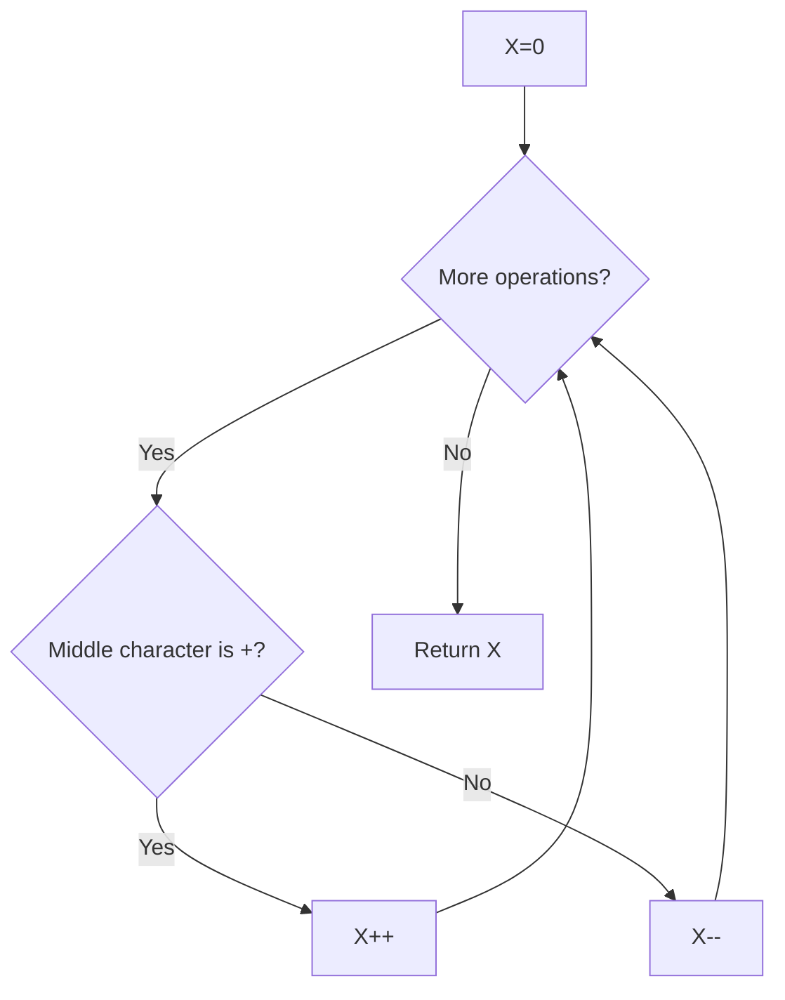

# Final Value of Variable After Performing Operations — LeetCode 2011

## Problem, constraints आणि examples

Variable `X` starts at `0`. Each operation is one of `++X`, `X++`, `--X`, `X--`; apply all operations and return final value.
Example: `[++X, X--, X++]`: changes `+1,-1,+1`, final `1`. Empty operation list (if considered) leaves `0`.

## Pattern clues

> **मराठी:** या clues मुळे योग्य pattern ओळखता येतो; constraints आणि relations नीट तपासा.
> | Clue | Pattern |
> |---|---|
> | operation has only increment/decrement effect | direct simulation |
> | `X` location differs but effect same | inspect operator character |
> | each operation independent | accumulate delta |

## Approaches

> **मराठी:** सोप्या उपायापासून सुरुवात करा आणि constraints नुसार योग्य optimization निवडा.
> | Method | Status | Cost |
> |---|---|---|
> | Inspect middle character and update counter | Selected, `O(n)` / `O(1)` |
> | Parse all operation strings into arithmetic expression | Correct but needless |
> | Interpret prefix/postfix as different values | Incorrect; no expression evaluation occurs |
> | Count only plus and ignore minus | Incorrect |

## Flowchart

चार valid operation formsमध्ये `operations[i][1]` हाच increment/decrement चिन्ह आहे.

## Selected algorithm, source explanation, dry run

> **मराठी:** मुख्य observation समजल्यावर algorithm चे steps लक्षात ठेवणे सोपे होते.
> `finalValueAfterOperations` loops over strings and checks `i[1]`; plus increments `X`, otherwise decrements. `main` runs sample arrays and prints final state.
> Dry run (`["--X","X++","X++"]`):
> | Operation | Middle char | X after |
> |---|---|---:|
> | `--X` | `-` | -1 |
> | `X++` | `+` | 0 |
> | `X++` | `+` | 1 |

## Edge cases

> **मराठी:** Boundary, duplicate आणि off-by-one cases स्वतंत्रपणे तपासा.
> Empty operations leave X at 0; all increments or all decrements are simple sign checks.

## Complexity, correctness, traps

> **मराठी:** Input size आणि प्रत्येक operation कितीदा चालतो यावरून complexity ठरवा.
> `O(n)` time, `O(1)` extra. Correctness: each operation changes `X` exactly by its sign; accumulating each delta equals sequential execution.
> Trap: prefix/postfix syntax is intentionally equivalent in this problem; source assumes only the four valid 3-character strings. No need to parse full token.

## Quick revision, variations, self-check

पुनरावलोकन: middle characterवरून `X`चा delta जोडा.
Check index 1; `+` means +1, otherwise -1. Related: token classification, counting signed events.

1. What is middle index in each 3-character operation?
2. Does `++X` differ from `X++` here?
3. What is result for `[++X,--X]`?
4. What state does empty input return?
