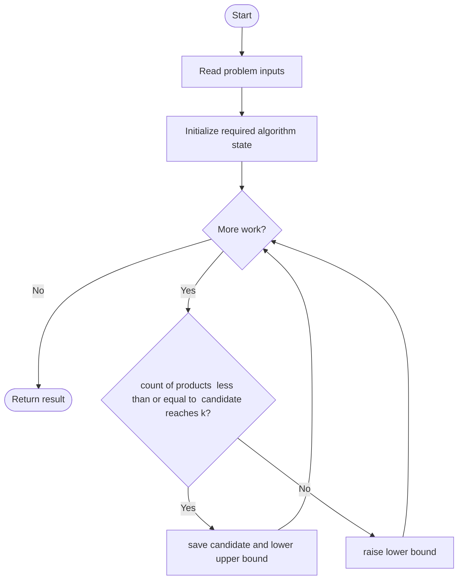
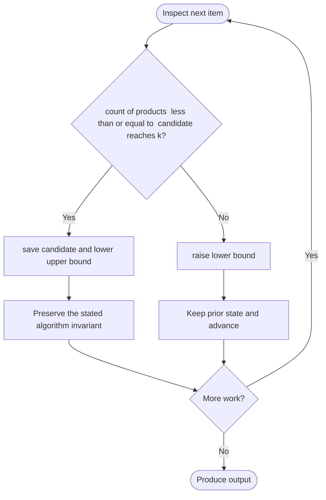

# Kth Smallest Product of Two Sorted Arrays

**LeetCode ID:** 2040
**Source file(s):** `2040.cpp` (originally `findCountSmallest.cpp`)
**Identification evidence:** The original filename, declared signature, and distinctive behavior described below uniquely identify this problem; no number was inferred from a filename alone.

## Expected input/output or judge interface

kthSmallestProduct(nums1,nums2,k); findCountSmallest(...). Inputs follow the problem constraints; the output is the documented scalar, sequence, or design-object behavior. The description below reflects the implementation actually present in the source.

## Main flow



## Important branch and loop flow



## Core logic and invariant

Binary-searches product value; for each candidate, binary-searches each sorted array row with monotonic directions adjusted for negative multipliers.
The key branch/loop rule above is applied once per relevant item; the algorithm relies on that rule to preserve its state and produce the required result.

## Optimization / comparison

For fixed nums1[i], products increase with nums2 for nonnegative factors and decrease for negative factors; threshold counting avoids materializing n\*m products.

## Complexity

O(n log m log R) time; O(1) extra space.

## Compile and run

The repository file includes a standalone demonstration `main()`; it is not a raw LeetCode submission unit. From the repository root, with a C++17 compiler:

```powershell
g++ -std=c++17 LeetCode\2040\2040.cpp -o solution.exe
.\solution.exe
```

For LeetCode's class-method judge, copy the relevant class/method or design-class API and omit the demo `main()` and local harness. Adapt free-function implementations to the requested `Solution` class signature where necessary. See the source caveat above for any compile blocker.
