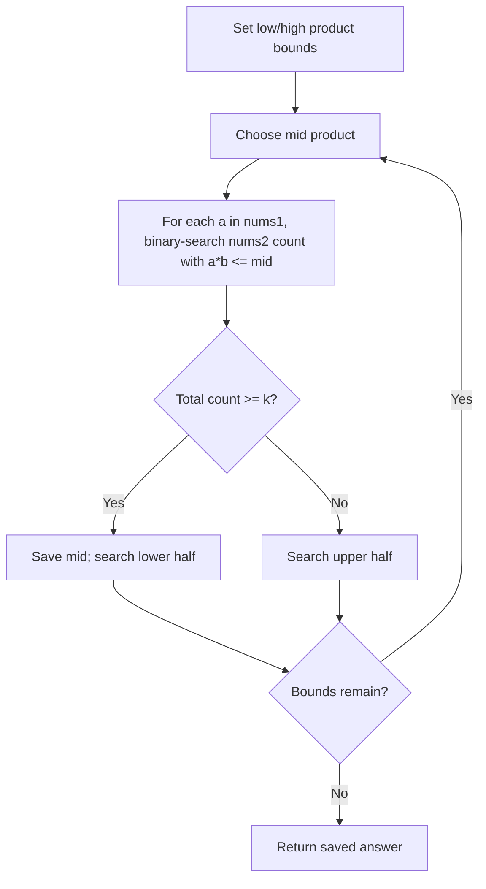

# Kth Smallest Product of Two Sorted Arrays — LeetCode 2040

## Problem, constraints आणि examples

Arrays are sorted ascending. Consider all `n1*n2` pair products (including duplicates); return the 1-indexed kth smallest. Values can be negative, zero, or positive, so products are not globally monotone by index for all signs.
Example: `[1,7]`, `[3,4]` products `[3,4,21,28]`; `k=3` → `21` (not `12`; product `12` is not present). `[-1,0] × [2,3]` products `-3,-2,0,0`; `k=1` → `-3`.

## Pattern clues

> **मराठी:** या clues मुळे योग्य pattern ओळखता येतो; constraints आणि relations नीट तपासा.
> | Clue | Pattern |
> |---|---|
> | kth value in huge implicit product set | binary search answer |
> | need count products `≤ mid` | monotone counting predicate |
> | arrays sorted but multiplication changes direction for negatives | sign-aware binary search |

## Approaches

> **मराठी:** सोप्या उपायापासून सुरुवात करा आणि constraints नुसार योग्य optimization निवडा.
> | Method | Status | Cost |
> |---|---|---|
> | Binary search product value + count `≤ mid` | Selected `O(n1 log n2 log range)` |
> | Materialize and sort every product | Correct brute force `O(n1*n2 log(n1*n2))`, huge space |
> | Binary search partner identically for negative and positive multipliers | Incorrect; product direction reverses for negative multiplier |
> | Use floating-point product bounds | Incorrect precision/range risk; use `long long` |

## Flowchart

Predicate `count(product≤mid)≥k` true झाल्यावर smaller threshold शोधून kth valueचा leftmost boundary मिळतो.

## Selected algorithm, source-specific explanation, dry run

> **मराठी:** मुख्य observation समजल्यावर algorithm चे steps लक्षात ठेवणे सोपे होते.
> `findCountSmallest` counts per `a`: for `a≥0`, products increase with sorted `nums2`, so find last `b` with product `≤mid`; for `a<0`, products decrease, so find first qualifying position and count suffix. Products use `1LL`. `kthSmallestProduct` binary-searches fixed bounds `[-1e10,1e10]`, keeping smallest feasible `mid`.
> Dry run (`nums1=[1,7]`, `nums2=[3,4]`, `k=3`): products sorted `3,4,21,28`; predicate count is 2 at `mid=4`, and 3 at `mid=21`; first threshold with count≥3 is `21`.

## Edge cases

> **मराठी:** Boundary, duplicate आणि off-by-one cases स्वतंत्रपणे तपासा.
> k=1 and k=n1\*n2 are boundary ranks; duplicates and zero products retain their multiplicity.

## Complexity, correctness, traps

> **मराठी:** Input size आणि प्रत्येक operation कितीदा चालतो यावरून complexity ठरवा.
> Each count costs `O(n1 log n2)`; binary search takes about `log2(2e10)` iterations, so total `O(n1 log n2 log range)`; extra space `O(1)`. Correctness: per multiplier, sign-aware binary search counts exactly the sorted-array positions meeting `a*b≤mid`; monotone total count identifies kth order statistic.
> Trap: preserve sign-specific monotonicity; use 64-bit multiplication; `k` is 1-indexed; fixed bounds rely on LeetCode value constraints. Check source sample comments: first case `k=3` expected should be `21`, not `12`.

## Quick revision, variations, self-check

पुनरावलोकन: signनुसार product countची दिशा बदलते.
Binary search answer; count `≤mid` with direction based on sign. Related: kth pair distance, multiplication table selection, answer-space binary search.

1. Why is binary search direction reversed when `a<0`?
2. What does `count≥k` imply about mid?
3. Why is `1LL` required?
4. For `[1,7] × [3,4]`, what is the third product?
