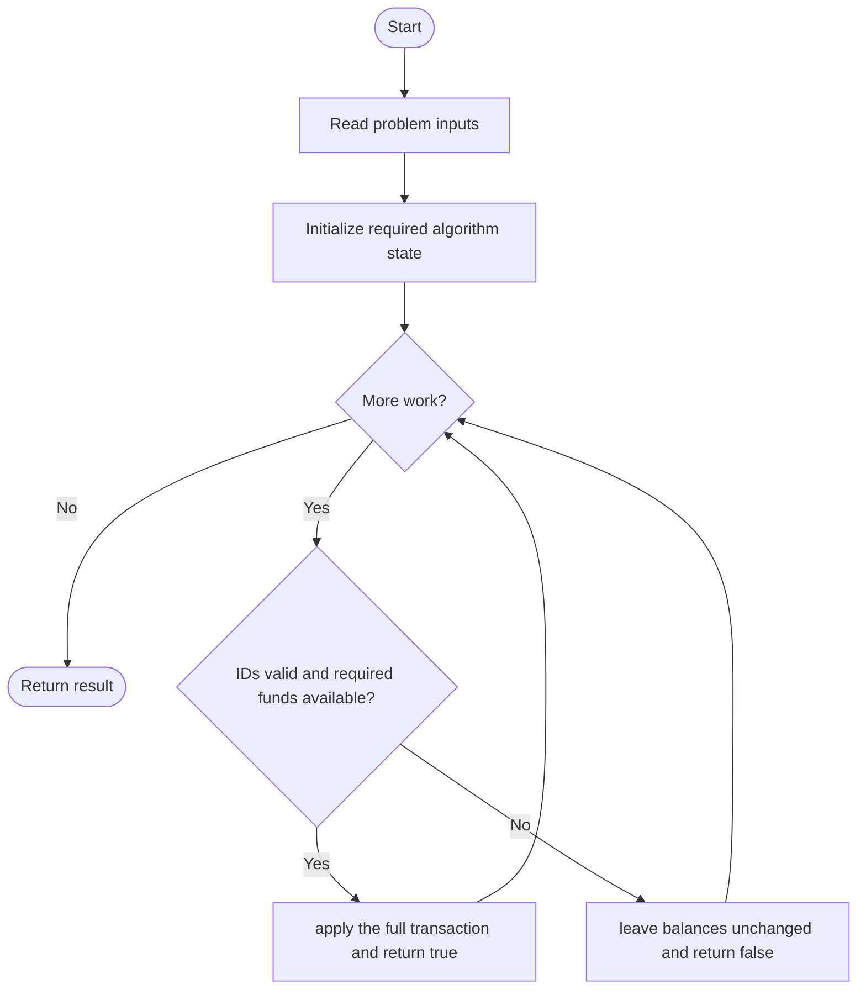
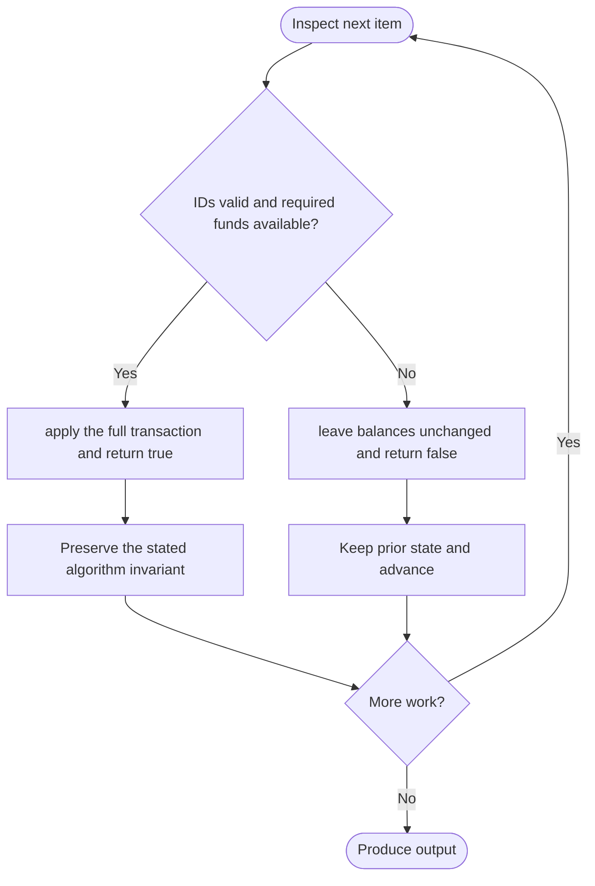

# Simple Bank System

**LeetCode ID:** 2043
**Source file(s):** `2043.cpp` (originally `Bank.cpp`), `2043-duplicate.cpp` (originally `countUnguarded.cpp`)
**Identification evidence:** The Bank class/API in the source uniquely identifies problem 2043; SHA-256 equality confirms the second source is byte-for-byte identical to Bank.cpp.

> **Same-ID collision:** `Bank.cpp` and `countUnguarded.cpp` both implement problem 2043. The second copy is `2043-duplicate.cpp`; neither source was overwritten.

## Expected input/output or judge interface

Bank(balance); transfer, deposit, withdraw. Inputs follow the problem constraints; the output is the documented scalar, sequence, or design-object behavior. The description below reflects the implementation actually present in the source.

## Main flow



## Important branch and loop flow



## Core logic and invariant

Stores a reference to the supplied balance vector; validates 1-based account IDs and sufficient funds before changing balances.
The key branch/loop rule above is applied once per relevant item; the algorithm relies on that rule to preserve its state and produce the required result.

## Optimization / comparison

Direct indexing avoids searches; failed operations make no partial balance update.

## Complexity

O(1) per operation; O(1) auxiliary state (balances are shared with caller).

## Compile and run

The repository file includes a standalone demonstration `main()`; it is not a raw LeetCode submission unit. From the repository root, with a C++17 compiler:

```powershell
g++ -std=c++17 LeetCode\2043\2043.cpp -o solution.exe
.\solution.exe
```

For LeetCode's class-method judge, copy the relevant class/method or design-class API and omit the demo `main()` and local harness. Adapt free-function implementations to the requested `Solution` class signature where necessary. See the source caveat above for any compile blocker.
