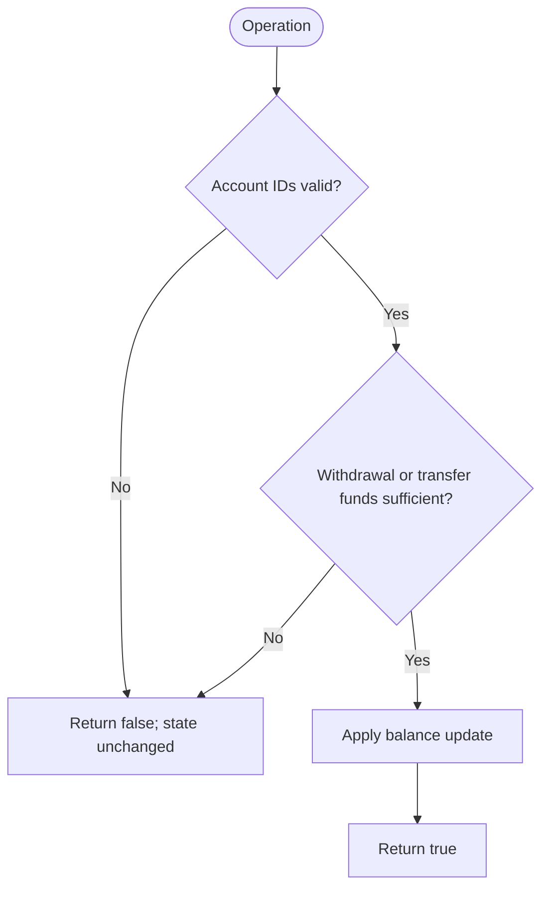

# Simple Bank System — LeetCode 2043

Source: `2043.cpp` and `2043-duplicate.cpp`. Both files contain the same `Bank` implementation; neither is the unrelated problem named by the duplicate file's former filename.

## 1. Understanding — समजून घ्या

Maintain balances and support `transfer`, `deposit`, and `withdraw`. Account IDs are 1-based, while the C++ vector is 0-based. Invalid operations return `false` and must not change balances.

## 2. Worked examples and edge cases

> **मराठी:** प्रश्नात काय दिले आहे आणि नेमके काय शोधायचे आहे, हे आधी स्पष्ट करा.
> With balances `[10, 5]`, `transfer(1,2,7)` succeeds and leaves `[3,12]`; `withdraw(2,13)` fails and leaves balances unchanged. Also check invalid IDs (`0`, `n+1`), insufficient funds, exact-balance withdrawal, and same-account transfer.

## 3. Pattern identification + cheat sheet

> **मराठी:** या clues मुळे योग्य pattern ओळखता येतो; constraints आणि relations नीट तपासा.
> This is a small **stateful design / guarded mutation** problem.
> | Clue | Pattern |
> |---|---|
> | Operations update shared state | Design a class |
> | Validate before changing state | Guard clauses / atomic operation |
> | Account IDs start at 1 | Convert to vector index with `id - 1` |

## 4. Approaches

> **मराठी:** सोप्या उपायापासून सुरुवात करा आणि constraints नुसार योग्य optimization निवडा.
> The direct vector-backed class is optimal: each operation needs only a constant number of checks and updates. Replaying a transaction history or copying all balances per operation is unnecessary. A tempting but incorrect approach is to mutate the sender before checking the receiver ID or available funds; failed operations must leave state unchanged.

## 5. Flowchart

> **मराठी:** Flowchart मधील decision, loop आणि termination condition क्रमाने समजून घ्या.

Validate all relevant conditions first; only then update the balance vector.

## 6. Algorithm and intuition

> **मराठी:** मुख्य observation समजल्यावर algorithm चे steps लक्षात ठेवणे सोपे होते.
> The constructor stores a reference to the supplied balance vector and its length. For every operation, validate 1-based account IDs, then check funds if money leaves an account. Apply the update using `account - 1`. A transfer subtracts and adds the same amount, preserving total money.

## 7. Code explanation

> **मराठी:** Code मधील variable आणि condition यांचा algorithm मधील उद्देश समजून घ्या.
> `transfer(a,b,m)` checks both IDs and `balance[a-1] >= m`, then performs both updates. `deposit` validates its account and adds. `withdraw` validates and checks funds before subtracting. The vector is held by reference, so callers observe the changes. Both listed source files are duplicate copies.

## 8. Dry run

> **मराठी:** प्रत्येक महत्त्वाच्या step नंतर variable ची value trace करा.
> | Call | Check | Balances after | Result |
> |---|---|---|---|
> | Initial | — | `[10,5]` | — |
> | `transfer(1,2,7)` | valid; 10 ≥ 7 | `[3,12]` | `true` |
> | `withdraw(2,13)` | 12 < 13 | `[3,12]` | `false` |

## 9. Complexity

> **मराठी:** Input size आणि प्रत्येक operation कितीदा चालतो यावरून complexity ठरवा.
> Each operation is **O(1)** time and uses **O(1)** extra space. The balance vector itself is shared state, not copied.

## 10. Correctness

> **मराठी:** Invariant किंवा तर्क वापरून algorithm योग्य उत्तर देतो हे समजून घ्या.
> If an operation returns `true`, all required validation has passed and its specified arithmetic is applied to the correct zero-based slots. If validation fails, the method returns before any write, so balances are unchanged. Transfer subtracts and adds the same amount.

## 11. Mistakes and interview traps

> **मराठी:** Boundary, duplicate आणि off-by-one cases स्वतंत्रपणे तपासा.

- Convert account IDs exactly once with `id - 1`; do not treat them as 0-based.
- Check funds before subtracting; failed calls must be atomic.
- `transfer` must validate both accounts.
- This class aliases the constructor's vector; passing a temporary or letting the vector die would leave a dangling reference (the judge keeps it alive).
- Problem constraints guarantee valid nonnegative transaction amounts.

## 12. Quick revision — झटपट उजळणी

> **मराठी सारांश:** आधी खाते आणि शिल्लक तपासा; मगच व्यवहार करा.
> Validate → funds check → mutate. IDs are 1-based; vector positions are 0-based. Deposit/withdraw/transfer all run in O(1).

## 13. Related problems and variations

> **मराठी:** प्रश्नात काय दिले आहे आणि नेमके काय शोधायचे आहे, हे आधी स्पष्ट करा.
> Design a bank/account API; implement rollback or transaction logs; support fees while preserving atomicity; test stateful objects against a sequence of operations.

## 14. Self-assessment

> **मराठी:** उत्तर न पाहता प्रश्न सोडवा आणि तुमच्या निवडीचे कारण सांगा.

1. Why must a failed transfer make no partial update?
2. Which account-number conversion is used for vector access?
3. What invariant does a successful transfer preserve?
