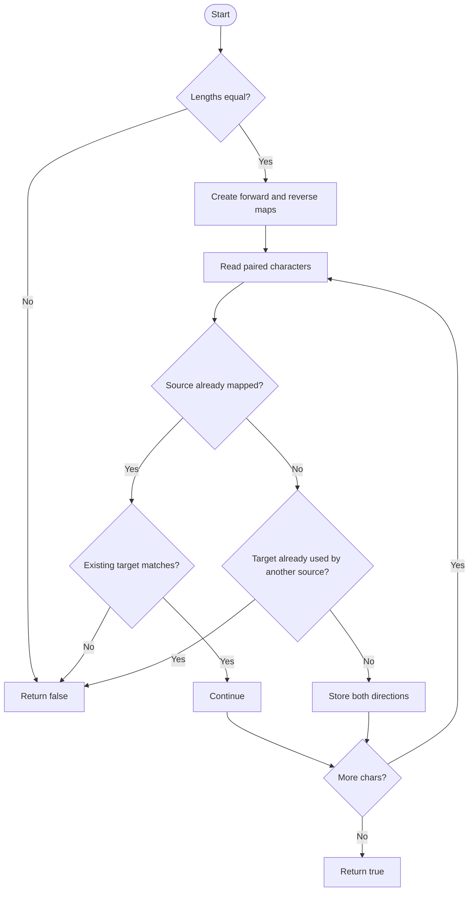

# Isomorphic Strings — LeetCode 205

## 1. Understanding

`s` मधील प्रत्येक characterला `t` मधील unique character map करून दोन्ही stringsचे character pattern समान आहे का ते ठरवा. Mapping consistent आणि one-to-one असावी.

## 2. Worked examples and edges

- `"egg"` → `"add"` true (`e→a`, `g→d`).
- `"foo"` → `"bar"` false (`o` एकदा दोन target charactersना map व्हायचा).
- `"ab"` → `"aa"` false (दोन्ही source chars එක target share करू शकत नाहीत).
- `""` आणि `""` true; lengths mismatch false.

## 3. Pattern identification + cheat sheet

| Clue                           | Pattern                  | कारण                            |
| ------------------------------ | ------------------------ | ------------------------------- |
| Character substitution         | Bijective mapping        | Source→target आणि target→source |
| Repeated character consistency | Hash maps / last-seen    | Same char same mapping          |
| Pattern equality               | First-occurrence indices | Isomorphic pattern compare      |

## 4. Approaches

- Two maps: source code; expected O(n) time/O(Σ) space.
- Fixed-size arrays for bounded charset: O(n) time/O(Σ) space, lower overhead.
- First-seen index arrays: compare previous-occurrence positions, also O(n).
- One-way map only चुकीचा; `"ab"`→`"aa"` injective condition तोडतो.

## 5. Flowchart

दोन maps एकाच वेळी consistency आणि uniqueness सिद्ध करतात.

## 6. Algorithm / intuition

प्रत्येक `(s[i],t[i])` जोडीवर existing mapping असेल तर match असावी. नसल्यास target आधी इतर sourceने घेतलेला नसावा; मग दोन्ही दिशांचे mappings नोंदवा.

## 7. Code explanation

`isIsomorphic` प्रथम size mismatch नाकारतो. `mapST` forward mapping, `mapTS` reverse mapping ठेवतात. `unordered_map<char,char>` sourceची character-domain assumptions जपतो.

## 8. Dry run

> **मराठी:** प्रत्येक महत्त्वाच्या step नंतर variable ची value trace करा.
> `"ab"` → `"aa"`:
> | i | pair | forward map | reverse check | result |
> |---:|---|---|---|---|
> | 0 | a→a | `{a:a}` | target a unused | continue |
> | 1 | b→a | b not mapped | a already maps back to a | false |

## 9. Complexity

> **मराठी:** Input size आणि प्रत्येक operation कितीदा चालतो यावरून complexity ठरवा.
> Expected O(n) time, O(min(n,Σ)) space for distinct characters; hash worst-case may degrade. Fixed alphabet version uses O(Σ) space.

## 10. Correctness

Forward map प्रत्येक source characterला एकच target देतो; reverse map प्रत्येक targetला एकच source देतो. प्रत्येक position तपासल्यामुळे mapping सर्व occurrencesशी consistent आहे; दोन्ही constraints मिळून bijection मिळते.

## 11. Mistakes and interview traps

- Same-length check आवश्यक.
- Target reuse रोखण्यासाठी reverse map आवश्यक.
- Repeated character mismatch लगेच false.
- Character alphabet मर्यादा बदलल्यास map type/indexing पुन्हा विचारात घ्या.

## 12. Quick revision

> **मराठी:** दोन मिनिटांच्या revision साठी pattern, मुख्य कल्पना आणि complexity आठवा.
> Length equal; each pair must satisfy existing forward map or create a fresh unused reverse mapping.

## 13. Related problems / variations

> **मराठी:** प्रश्नात काय दिले आहे आणि नेमके काय शोधायचे आहे, हे आधी स्पष्ट करा.
> Word Pattern, bijection check, pattern matching by first-seen indices, minimum edits to make strings isomorphic.

## 14. Self-assessment

1. `"ab"`→`"aa"` का fail?
2. Reverse map काय प्रतिबंधित करतो?
3. Empty stringsचे उत्तर?
4. Map ऐवजी index arrays कसे वापराल?
