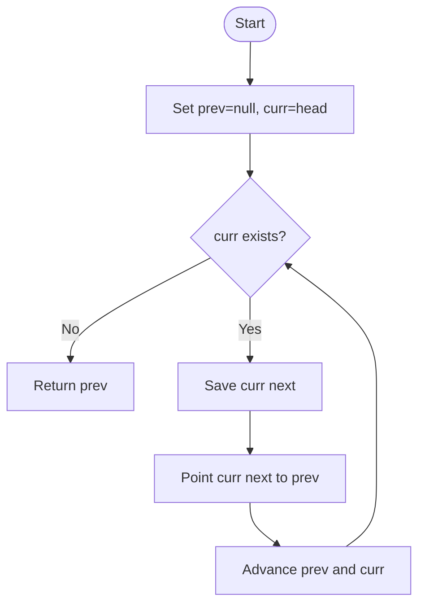

# Reverse Linked List — LeetCode 206

## 1. Understanding

Singly linked listचे `next` links उलटून नवीन head परत करा. Nodesची values किंवा identities बदलायच्या नाहीत.

## 2. Worked examples and edges

- `1→2→3→4→5` → `5→4→3→2→1`.
- Empty list → null; single node तसाच.
- Source iterative आणि recursive implementationsची तुलना करतो.

## 3. Pattern identification + cheat sheet

| Clue                      | Pattern             | कारण                     |
| ------------------------- | ------------------- | ------------------------ |
| Reverse pointer direction | Pointer rewiring    | प्रत्येक edge उलट        |
| Singly linked list        | Save-next traversal | पुढचा node हरवू नये      |
| Tail becomes head         | Iterative invariant | Previous reversed prefix |

## 4. Approaches

- Iterative three-pointer: O(n) time/O(1) space; preferred and source method.
- Recursive: O(n) time/O(n) call stack; source method, concise.
- Values copy करून reverse करणे required node topology बदलत नाही; judge node links अपेक्षित ठेवतो.

## 5. Flowchart

`nextTemp` ने उरलेली chain जपून मग pointer reverse करतो.

## 6. Algorithm / intuition

तीन pointers: `prev` reversed prefix, `curr` current node, `nextTemp` untouched suffix. प्रत्येक iteration edge उलटा करून pointers पुढे न्या.

## 7. Code explanation

`reverseListIterative` loop संपल्यावर `prev` नवीन head परत करतो. `reverseListRecursive` base case last node/null; recursive returnनंतर `head->next->next=head` आणि `head->next=nullptr`. Source helper methods test harnessसाठी आहेत.

## 8. Dry run

> **मराठी:** प्रत्येक महत्त्वाच्या step नंतर variable ची value trace करा.
> `1→2→3`:
> | curr | saved next | rewire | prev/curr after |
> |---:|---:|---|---|
> | 1 | 2 | `1→null` | `1 / 2` |
> | 2 | 3 | `2→1` | `2 / 3` |
> | 3 | null | `3→2` | `3 / null` |
> Return 3.

## 9. Complexity

> **मराठी:** Input size आणि प्रत्येक operation कितीदा चालतो यावरून complexity ठरवा.
> Both O(n) time. Iterative O(1) auxiliary space; recursive O(n) stack.

## 10. Correctness

> **मराठी:** Invariant किंवा तर्क वापरून algorithm योग्य उत्तर देतो हे समजून घ्या.
> Iterative invariant: `prev` points to the fully reversed processed prefix and `curr` to untouched suffix. Saving `next` preserves suffix; rewiring adds exactly one reversed edge. On termination, all nodes are in reversed order and `prev` is new head.

## 11. Mistakes and interview traps

> **मराठी:** Boundary, duplicate आणि off-by-one cases स्वतंत्रपणे तपासा.

- Save `curr->next` before overwriting it.
- New tail must point to null.
- Return `prev`, not old head.
- Recursive version uses stack and can overflow for very long lists.

## 12. Quick revision

> **मराठी:** दोन मिनिटांच्या revision साठी pattern, मुख्य कल्पना आणि complexity आठवा.
> `next=curr->next; curr->next=prev; prev=curr; curr=next`.

## 13. Related problems / variations

> **मराठी:** प्रश्नात काय दिले आहे आणि नेमके काय शोधायचे आहे, हे आधी स्पष्ट करा.
> Reverse Linked List II, Reverse Nodes in k-Group, palindrome linked list, reorder list.

## 14. Self-assessment

> **मराठी:** उत्तर न पाहता प्रश्न सोडवा आणि तुमच्या निवडीचे कारण सांगा.

1. Why save next before rewiring?
2. What does `prev` represent?
3. Iterative vs recursive space?
4. What is the new tail's `next`?
