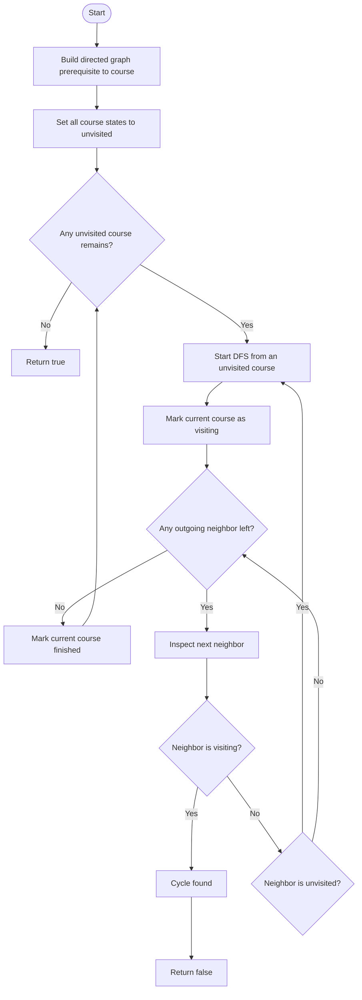

# 207. Course Schedule

> **Pattern:** Directed Graph + Cycle Detection  
> **Main tools:** DFS with recursion states or BFS with Kahn's topological sort  
> **Language in this note:** Simple English + मराठी (English-Marathi mix)

## 1. Problem Understanding

तुम्हाला `numCourses` courses घ्यायचे आहेत. काही courses साठी आधी दुसरा course पूर्ण केलेला असणे आवश्यक आहे. हे dependencies `prerequisites` मध्ये दिलेले आहेत.
प्रत्येक pair `[a, b]` चा अर्थ: **course `a` घेण्यापूर्वी course `b` पूर्ण करावा लागेल.**
**आपल्याला काय return करायचे?** सर्व courses पूर्ण करता येणे शक्य असेल तर `true`; dependencies मुळे ते अशक्य असेल तर `false`.
**महत्त्वाचे शब्द आणि constraints**

- **Prerequisite:** एखादा course सुरू करण्याआधी पूर्ण करावा लागणारा course.
- **Directed dependency:** `b -> a` म्हणजे `b` नंतर `a` घेता येतो.
- **Cycle:** dependencies मध्ये गोलाकार अट; उदाहरणार्थ `A` आधी `B`, `B` आधी `A`. अशा वेळी कोणताही course आधी सुरू करता येत नाही.
- Courses चे ids `0` ते `numCourses - 1` असतात.
- दिलेल्या constraints मध्ये `numCourses` किमान `1` आहे; prerequisites रिकामी असू शकतात.
  या प्रश्नात नेमका course order मागितलेला नाही. फक्त **सर्व courses पूर्ण करता येतात का** हे ठरवायचे आहे.

## 2. Example Understanding

### Example 1 — शक्य आहे

```text
Input:
numCourses = 2
prerequisites = [[1, 0]]
Output: true
```

`[1, 0]` म्हणजे course `1` घेण्याआधी course `0` पूर्ण करा. आधी `0`, मग `1` असा valid order आहे. म्हणून `true`.

### Example 2 — शक्य नाही

```text
Input:
numCourses = 2
prerequisites = [[1, 0], [0, 1]]
Output: false
```

- `[1, 0]` मुळे `0 -> 1`.
- `[0, 1]` मुळे `1 -> 0`.
  Course `0` साठी आधी `1` हवा आणि course `1` साठी आधी `0` हवा. हा directed cycle आहे; सुरुवातच करता येत नाही. उत्तर `false`.

### Example 3 — एकच course, prerequisite नाही

```text
Input:
numCourses = 1
prerequisites = []
Output: true
```

कुठलीही dependency नाही; तो एक course पूर्ण करता येतो.

### Code मधील आणखी examples

| `numCourses` | `prerequisites`             | Output  | कारण                                                    |
| -----------: | --------------------------- | ------- | ------------------------------------------------------- |
|            4 | `[[1,0],[2,1],[3,2]]`       | `true`  | `0 -> 1 -> 2 -> 3`; cycle नाही                          |
|            3 | `[[1,0],[2,1],[0,2]]`       | `false` | `0 -> 1 -> 2 -> 0` cycle                                |
|            5 | `[[1,0],[2,0],[3,1],[3,2]]` | `true`  | `0` नंतर `1` आणि `2`; त्यानंतर `3`; course `4` स्वतंत्र |

## 3. Problem Identification — Pattern Recognition

Prerequisites म्हणजे **directed graph मधील edges**. `[a,b]` ला `b -> a` असे दाखवतो. सर्व courses घेता येतात का हे विचारणे म्हणजे या directed graph मध्ये cycle आहे का हे तपासणे.
Directed graph मध्ये cycle नसेल तर त्याला **DAG** (Directed Acyclic Graph) म्हणतात. DAG साठी topological ordering असते; त्या order प्रमाणे courses घेता येतात.
**अनुभवी solver चा विचार:**

1. Pair मधील direction अचूक समजून घ्या: `[course, prerequisite]` असल्याने edge prerequisite कडून course कडे.
2. प्रश्न “सगळे पूर्ण होतात का?” विचारतो; exact order नाही.
3. एखादा course स्वतःभोवती किंवा आधी भेटलेल्या active dependency भोवती परत पोहोचतो का ते तपासा.
4. DFS मध्ये active recursion path वरचा node परत दिसला तर cycle.
5. किंवा Kahn's algorithm मध्ये prerequisite नसलेले courses काढत जा; सगळे काढले तर शक्य.

### स्वतःला विचारायचे प्रश्न

- Pair मधील पहिला course आधी घ्यायचा, की दुसरा?
- Dependency graph directed आहे का?
- एखादी dependency परत आधीच्या course कडे पोहोचते का?
- Cycle नसल्यास सर्व nodes topological order मध्ये ठेवता येतील का?
- Graph मध्ये disconnected parts आहेत का? प्रत्येक course/node तपासला आहे का?
- DFS मध्ये `visited` आणि `currently visiting` यात काय फरक आहे?

### Pattern Recognition Cheat Sheet

| Clue in Question                              | Possible Pattern               | Why?                                                          |
| --------------------------------------------- | ------------------------------ | ------------------------------------------------------------- |
| Course घेण्याआधी दुसरा course पूर्ण करणे      | Directed graph                 | Dependency ला directed edge म्हणून मांडता येते                |
| “सर्व courses पूर्ण करता येतील का?”           | Directed cycle detection       | Cycle असल्यास prerequisite order अशक्य                        |
| Valid order मागितला आहे                       | Topological sort               | DAG मधील nodes ना dependencies पाळणाऱ्या क्रमाने arrange करतो |
| Incoming prerequisites नसलेले nodes काढत जाणे | Kahn's BFS                     | Zero-indegree node आत्ता घेता येतो                            |
| DFS करताना active path वरचा node पुन्हा भेटतो | DFS cycle detection            | Active path मध्ये back-edge म्हणजे directed cycle             |
| अनेक स्वतंत्र dependency chains               | All-components graph traversal | प्रत्येक course/node पासून आवश्यक असल्यास search सुरू करावी   |

## 4. Different Approaches

### Approach A: सर्व possible course orders तपासणे — brute force, योग्य पण अव्यवहार्य

**Intuition:** Courses चे संभाव्य orders तयार करा आणि प्रत्येक order प्रत्येक prerequisite पाळतो का तपासा.
**Steps:**

1. `n` courses चे permutation तयार करा.
2. प्रत्येक prerequisite `[a,b]` साठी त्या permutation मध्ये `b` हा `a` च्या आधी आहे का तपासा.
3. एखादा valid order सापडल्यास `true`; सर्व orders तपासूनही न सापडल्यास `false`.
   हा विचार logically योग्य आहे, कारण प्रत्येक संभाव्य order तपासतो. पण `n!` orders असू शकतात; प्रत्येक order तपासण्याची किंमत धरल्यास वेळ साधारण `O(n! * (n + E))` होऊ शकतो. Constraints साठी हा मार्ग योग्य नाही. Cycle detection किंवा topological sort हाच मुख्य insight आहे.

### Approach B: DFS + `visited` + recursion path (दिलेल्या code मधील पहिला approach)

**Intuition:** प्रत्येक node च्या DFS मध्ये सध्या कोणते nodes active आहेत ते `path` मध्ये नोंदवा. चालू path मधील node कडे edge परत गेली तर cycle.
**Steps:**

1. Prerequisite pair `[a,b]` साठी adjacency `b -> a` तयार करा.
2. प्रत्येक unvisited course पासून DFS सुरू करा.
3. Node सुरू करताना `visited[node] = true` आणि `path[node] = true`.
4. प्रत्येक outgoing neighbor तपासा:
   - unvisited असल्यास त्यावर DFS;
   - `path[next] == true` असल्यास active recursion chain वर परतलो — cycle.
5. Node चे सर्व neighbors तपासल्यावर `path[node] = false` करा.
6. कोणत्याही DFS ला cycle दिसल्यास `false`; संपूर्ण traversal cycle शिवाय संपल्यास `true`.
   `visited` म्हणजे node कधी तरी तपासला आहे; `path` म्हणजे तो **सध्याच्या DFS chain मध्ये** अजून active आहे. दोन्ही वेगळे ठेवणे महत्त्वाचे.

### Approach C: BFS — Kahn's Topological Sort (दिलेल्या code मधील दुसरा approach)

**Intuition:** ज्या course ला अजून prerequisite नाही (`indegree == 0`) तो आत्ता घेता येतो. तो graph मधून काढा आणि त्याच्यावर अवलंबून असलेल्या courses ची indegree कमी करा.
**Steps:**

1. Adjacency list `b -> a` आणि प्रत्येक course ची indegree तयार करा.
2. Indegree `0` असलेले सर्व courses queue मध्ये घाला.
3. Queue मधून एक course काढून `completed++` करा.
4. त्याच्यावर अवलंबून असलेल्या प्रत्येक पुढील course ची indegree कमी करा.
5. Indegree `0` झालेला course queue मध्ये घाला.
6. शेवटी `completed == n` असेल तर सर्व courses घेता आले; अन्यथा उरलेले nodes cycle मध्ये अडकलेले आहेत.

### Approach D: DFS with three-state coloring (दिलेल्या code मधील तिसरा approach)

**Intuition:** दोन boolean arrays ऐवजी प्रत्येक course ला तीन states द्या:

- `0` = अजून सुरू केलेला नाही (**unvisited**)
- `1` = सध्याच्या DFS path मध्ये (**visiting**)
- `2` = पूर्ण तपासलेला (**visited/finished**)
  `state[next] == 1` दिसणे म्हणजे current DFS chain मध्ये परत जाणारी edge — cycle. `state[next] == 2` असल्यास तो node आधी पूर्ण तपासला आहे; त्या edge मुळे नवीन cycle तयार होत नाही.
  **Steps:**

1. प्रत्येक node ची state `0` ने सुरू करा.
2. Unvisited node वर DFS सुरू करून state `1` करा.
3. Neighbor visiting असेल तर cycle; unvisited असेल तर त्यावर DFS.
4. सर्व neighbors safe असल्यावर node state `2` करा.
5. सर्व nodes तपासून cycle सापडली नाही तर `true`.

### कोणते approach निवडावे?

| Approach                      |                   Time |                                   Space | Pros                                                        | Cons                                     |
| ----------------------------- | ---------------------: | --------------------------------------: | ----------------------------------------------------------- | ---------------------------------------- |
| All-order brute force         | `O(n! * (n+E))` अंदाजे | `O(n)` ते `O(n+E)` implementation नुसार | Problem चा अर्थ थेट तपासतो                                  | Factorial वेळ; constraints साठी अनुपयोगी |
| DFS + `visited` + active path |               `O(V+E)` |                                `O(V+E)` | Cycle चा अर्थ स्पष्ट; सर्व components तपासता येतात          | Recursive depth `O(V)` होऊ शकते          |
| Kahn's BFS                    |               `O(V+E)` |                                `O(V+E)` | Queue-based; recursion नाही; topological order जवळजवळ मिळतो | Indegree नीट मोजणे आवश्यक                |
| DFS three-state coloring      |               `O(V+E)` |                                `O(V+E)` | `0/1/2` states मधून cycle logic स्पष्ट                      | `1` आणि `2` states गोंधळल्यास bug        |

इथे `V = numCourses`, `E = prerequisites.size()`. Adjacency list बनवणे आणि traversal मिळून `O(V+E)` वेळ घेतात; प्रत्येक node आणि edge constant number of times तपासली जाते. Recursive DFS चा call stack सुद्धा `O(V)` पर्यंत जाऊ शकतो.

> **Logically incorrect shortcut:** प्रत्येक prerequisite pair वेगळा तपासून “याला order आहे” असे म्हणणे पुरेसे नाही. अनेक dependencies मिळून cycle तयार करू शकतात. पूर्ण directed graph मध्ये cycle तपासणे आवश्यक आहे.

## 5. Flowchart Using Mermaid



**Flowchart समजावून घेऊया:** आधी प्रत्येक prerequisite ला `prerequisite -> course` edge बनवतो. Unvisited course पासून DFS सुरू होते. Node `visiting` असताना त्याच node कडे परत edge मिळाली तर dependency loop आहे, म्हणून `false`. Node चे सगळे neighbors तपासून झाले की त्याला `finished` करतो. सर्व courses पूर्ण तपासून cycle सापडली नाही तर `true`.
या flowchart मध्ये `E` हा DFS call दाखवतो: unvisited neighbor वर recursive call होऊन त्याचे काम संपल्यावर current node चा neighbor loop पुन्हा चालू राहतो.

## 6. Algorithm / Intuition

या code मध्ये तीन योग्य cycle-detection implementations आहेत. **Interview मध्ये DFS three-state किंवा Kahn's BFS दोन्ही उत्तम पर्याय आहेत.** Iterative approach हवा असेल तर Kahn's algorithm निवडा; DFS ने cycle चा अर्थ समजावणे सोपे वाटत असेल तर three-state DFS वापरा.
**मुख्य observation:** Directed dependency cycle असेल तर प्रत्येक course साठी दुसरा course आधी हवा असेल आणि chain कधीच संपणार नाही. Cycle नसेल तर किमान एक node असा असतो ज्याची indegree `0` असते; त्याला घेऊन त्याच्या outgoing dependencies पुढे सोडवता येतात.
**Kahn's algorithm:**

1. `adj[b]` मध्ये `a` जोडा (`b` prerequisite, `a` dependent course).
2. `indegree[a]++` — `a` साठी अजून किती prerequisites बाकी आहेत.
3. `indegree == 0` असलेले courses queue मध्ये घाला.
4. Queue मधून course काढून completed count वाढवा.
5. त्यावर अवलंबून असलेल्या प्रत्येक course ची indegree decrement करा; `0` झाल्यास queue मध्ये घाला.
6. `completed == numCourses` असल्यास `true`, अन्यथा `false`.
   **DFS state variables:**

- `visited[node]`: DFS कधी सुरू केला आहे.
- `path[node]` किंवा `state[node] == 1`: सध्याच्या recursion chain मध्ये आहे.
- `state[node] == 2`: त्या node पासून पुढे cycle नसल्याचे तपासून झाले आहे.
- `adj[node]`: या course नंतर / याच्या आधीच्या prerequisite नंतर कोणते courses येतात, edge direction `prerequisite -> dependent` नुसार.

## 7. Code Explanation

तुमचा source: [`207.cpp`](./207.cpp)

### Graph construction

```cpp
for (auto& e : edges) {
    adj[e[1]].push_back(e[0]);
}
```

Input `e = [course, prerequisite]`. `e[1]` prerequisite आहे, म्हणून edge `prerequisite -> course`, म्हणजे `adj[e[1]].push_back(e[0])`. Direction उलटी केल्यास या समस्येतल्या prerequisites चे representation चुकीचे होईल.

### DFS with recursion stack

```cpp
visited[node] = true;
path[node] = true;
```

Node एकदा सुरू झाला हे `visited` सांगते. `path` मात्र तो सध्याच्या active DFS chain मध्ये आहे हे सांगते.

```cpp
else if (path[next]) {
    return true;
}
```

`next` active path वर आधीच असल्याने परत त्याच्याकडे जाणारी directed edge सापडली — cycle. DFS ने cycle परत दिल्यास public method `false` करते, कारण सर्व courses पूर्ण करता येत नाहीत.

```cpp
path[node] = false;
```

Node चे सर्व outgoing edges तपासल्यावर तो current recursion path मधून बाहेर पडतो. `visited` true राहते; म्हणजे पूर्ण झालेला node पुन्हा अनावश्यकपणे process होत नाही.

### Kahn's algorithm

`indegree[e[0]]++` प्रत्येक course साठी prerequisites ची संख्या मोजते. Queue मध्ये सुरुवातीला indegree `0` असलेले courses जातात. `adj[node]` मधील प्रत्येक dependent course साठी current prerequisite पूर्ण झाल्यामुळे indegree कमी होते. `completed == n` असल्यास सर्व courses topological order मध्ये process झाले; अन्यथा काही courses cycle मुळे अडकलेले आहेत.

### DFS with three-state coloring

- `state[node] = 1`: DFS सुरू झाला, node active आहे.
- Neighbor ची state `1` असल्यास active chain वर back-edge आहे — cycle.
- Neighbor ची state `0` असल्यास recursively तपासा.
- सर्व neighbors safe झाल्यावर `state[node] = 2`; पुढे node पुन्हा तपासण्याची गरज नाही.

### Correctness / implementation notes

- दिलेल्या adjacency direction आणि cycle checks सह तिन्ही methods योग्य `true/false` निर्णय देतात.
- प्रत्येक public method graph स्वतः तयार करते; `main()` त्यांना त्याच test case वर स्वतंत्रपणे चालवतो.
- DFS methods recursive आहेत. Worst-case chain मध्ये recursion depth `O(V)` होऊ शकते; stack limits कडक असतील तर Kahn's BFS stack टाळते.
- `buildGraph` आणि public methods edges non-const reference घेतात, पण त्यांना बदलत नाहीत. हा correctness bug नाही.
- LeetCode submission साठी अपेक्षित interface `canFinish(int numCourses, vector<vector<int>>& prerequisites)` आहे. या file मध्ये approaches तुलना करणारा `main()` आहे, त्यामुळे submission environment मध्ये demo `main()` सहसा काढून योग्य method नाव ठेवावे लागेल.

## 8. Dry Run

Kahn's algorithm वापरून code मधील valid case:

```text
numCourses = 5
prerequisites = [[1,0], [2,0], [3,1], [3,2]]
Edges: 0 -> 1, 0 -> 2, 1 -> 3, 2 -> 3
```

| Step | Queue / variables        | Condition                 | Action                                          | Result                                                             |
| ---: | ------------------------ | ------------------------- | ----------------------------------------------- | ------------------------------------------------------------------ |
|    1 | `indegree = [0,1,1,2,0]` | Graph तयार                | Indegree `0` असलेले courses शोधा                | Queue = `[0,4]`, `completed=0`                                     |
|    2 | Queue = `[0,4]`          | Pop `0`                   | `completed++`; courses `1`, `2` ची indegree कमी | Queue = `[4,1,2]`, `completed=1`; `indegree[1]=0`, `indegree[2]=0` |
|    3 | Queue = `[4,1,2]`        | Pop `4`                   | `completed++`; outgoing edge नाही               | Queue = `[1,2]`, `completed=2`                                     |
|    4 | Queue = `[1,2]`          | Pop `1`                   | `completed++`; course `3` ची indegree कमी       | `indegree[3]=1`, `completed=3`                                     |
|    5 | Queue = `[2]`            | Pop `2`                   | `completed++`; course `3` ची indegree कमी       | `indegree[3]=0`; queue = `[3]`, `completed=4`                      |
|    6 | Queue = `[3]`            | Pop `3`                   | `completed++`                                   | Queue रिकामी, `completed=5`                                        |
|    7 | End                      | `completed == numCourses` | Return `true`                                   | सर्व courses घेता येतात                                            |

**Cycle case:** `0 -> 1 -> 2 -> 0` असल्यास प्रत्येक course ची indegree positive राहते. सुरुवातीला queue रिकामी; `completed = 0`, `n = 3`. म्हणून `completed != n` आणि उत्तर `false`.

## 9. Complexity Analysis

`V = numCourses`, `E = prerequisites.size()` असे धरू.

- **Graph build:** `O(V+E)` वेळ आणि `O(V+E)` adjacency space.
- **DFS cycle detection:** प्रत्येक node जास्तीत जास्त एकदा पूर्ण होतो; प्रत्येक edge जास्तीत जास्त एकदा तपासली जाते. वेळ `O(V+E)`.
- **Kahn's BFS:** प्रत्येक node queue मधून जास्तीत जास्त एकदा काढला जातो आणि प्रत्येक edge मुळे indegree एकदाच decrement होते. वेळ `O(V+E)`.
- **Auxiliary space:** Adjacency `O(V+E)`, तसेच visited/state/indegree/queue `O(V)`. एकूण `O(V+E)`.
- **Recursive DFS stack:** Worst case `O(V)` अतिरिक्त call stack.
  Disconnected courses / graph parts साठी outer loop सर्व `V` courses तपासतो, म्हणून isolated courses देखील count होतात. Complexity `O(V+E)` constraints साठी योग्य आहे.

## 10. Why This Solution Works

### DFS correctness intuition

DFS मध्ये `visiting` node म्हणजे current dependency chain वरचा course. त्या chain मधील node कडे edge परत आली तर dependency loop तयार झाली आहे. Loop मधील प्रत्येक course दुसऱ्या loop-course ची वाट पाहतो; त्यामुळे सर्व courses पूर्ण करण्याचा order शक्य नाही.
Cycle नसेल, तर DFS कोणताही active node परत भेटत नाही. Graph DAG असल्याने prerequisites पूर्ण झाल्यानंतर courses घेण्याचा topological order असतो. म्हणून उत्तर `true`.

### Kahn's correctness intuition

Indegree `0` असलेला course घेण्यासाठी prerequisite बाकी नाही, म्हणून तो valid पुढचा course आहे. तो काढल्यावर त्याच्यावर अवलंबून असलेल्या courses साठी एक prerequisite पूर्ण झालेला असतो; म्हणून त्यांची indegree कमी होते.

- सगळे `V` courses queue मधून काढले तर एक valid topological order मिळाला — उत्तर `true`.
- काही nodes शिल्लक राहिले तर त्यांना अजून incoming dependency आहे. उरलेल्या graph मध्ये cycle असते; त्या courses पैकी कुठलाही पुढे काढता येत नाही — उत्तर `false`.
  **DFS loop invariant:** Active recursion path मध्ये नेहमी सध्याच्या DFS call chain मधील nodes असतात; node पूर्ण तपासल्यावरच तो path मधून बाहेर पडतो.
  **Kahn invariant:** Queue मध्ये फक्त सध्या उरलेले prerequisite नसलेले courses असतात. त्यामुळे काढलेला प्रत्येक course वैधपणे पुढे घेता येतो.

## 11. Common Mistakes & Interview Traps

- **Edge direction उलटी करणे:** `[a,b]` म्हणजे `b -> a`, `a -> b` नाही.
- **फक्त `visited` वापरून cycle ठरवणे:** आधी पूर्ण झालेला node पुन्हा दिसणे म्हणजे नेहमी cycle नाही. Active path (`path` किंवा `state==1`) तपासा.
- **DFS पूर्ण झाल्यावर state reset न करणे:** `path[node] = false` आवश्यक आहे; three-state मध्ये `state[node] = 2`.
- **एका starting node पासूनच DFS करणे:** इतर disconnected components किंवा isolated courses सुटू शकतात. सर्व courses loop मधून तपासा.
- **Kahn मध्ये indegree चुकीची मोजणे:** `[a,b]` असल्यास `indegree[a]++`.
- **Neighbor indegree decrement विसरणे:** prerequisite course काढल्यावर त्याच्यावर अवलंबून असलेल्या प्रत्येक neighbor ची indegree कमी करा.
- **Kahn मध्ये queue रिकामी म्हणजे नेहमी पूर्ण झाले असे समजणे:** `completed == n` तपासा; cycle असल्यास queue आधी रिकामी होऊ शकते.
- **Course ids आणि count गोंधळणे:** ids `0` ते `n-1`; `n` courses पूर्ण झाली का हे count ने तपासा.
- **Self-loop दुर्लक्षित करणे:** `[a,a]` असल्यास एक-node directed cycle; उत्तर `false`.
- **Exact ordering आणि feasibility एक समजणे:** या problem मध्ये फक्त feasibility विचारली आहे; Kahn algorithm order तयार करू शकतो, पण method count वापरून boolean परत करते.
- **Recursive stack risk:** लांब dependency chain मध्ये recursive DFS stack वाढतो; iterative Kahn वापरता येतो.
  **Interview follow-ups:** Valid course order कसा return कराल? फक्त cycle-मध्ये असलेले courses कसे शोधाल? Course dependency add झाल्यावर पुन्हा सर्व graph चालवावा लागतो का? Graph मध्ये duplicate prerequisite pairs असतील तर indegree आणि adjacency दोन्ही कसे हाताळाल?

## 12. Revision Notes — Quick Recall

- **Pattern:** Directed graph cycle detection / topological sort.
- **Clue:** `[course, prerequisite]`; सर्व courses पूर्ण होतात का?
- **Direction:** `prerequisite -> course`.
- **Core intuition:** Cycle असेल तर प्रत्येक course दुसऱ्याची वाट पाहतो; DAG असेल तर valid topological order असतो.
- **DFS:** `0 = unvisited`, `1 = active/visiting`, `2 = finished`; active neighbor दिसला की cycle.
- **Kahn:** Indegree `0` courses queue मध्ये; process करून outgoing neighbors ची indegree कमी करा.
- **Decision:** DFS ला cycle मिळाली किंवा Kahn मध्ये `completed < n` → `false`; अन्यथा `true`.
- **Complexity:** `O(V+E)` time, `O(V+E)` space.
- **Common mistakes:** Edge उलटी करणे; finished node ला active समजणे; सर्व components न तपासणे.
- **One-line takeaway:** **Prerequisites directed edges आहेत; सगळे courses शक्य आहेत का हे ठरवण्यासाठी graph मध्ये cycle नसणे आवश्यक आणि पुरेसे आहे.**

## 13. Similar Problem Recognition

याच pattern चे रूपांतर इतर graph problems मध्ये दिसते:

- **Course Schedule II:** Feasible आहे का एवढेच नाही, valid course order परत करा. Kahn queue मधून काढलेले nodes order म्हणून save करा; count `V` पेक्षा कमी असल्यास empty result.
- **Alien Dictionary:** अक्षरांमधील precedence constraints तयार करून directed graph चा topological order शोधा; cycle किंवा invalid prefix असल्यास order नाही.
- **Build-system / package dependencies:** Package आधी install करायचे dependencies edges म्हणून लिहा; dependency cycle असल्यास valid build/install order शक्य नसू शकतो.
- **Task scheduling:** Task precedence relations cycle-free आहेत का आणि valid schedule आहे का तपासा.
- **Graph cycle detection:** Directed graph मध्ये DFS visiting state किंवा topological-sort removal count वापरा. Undirected graph साठी cycle detection ची parent-edge logic वेगळी असते.
  **Constraint बदलल्यावर:**
- फक्त `true/false` हवे असेल तर DFS किंवा Kahn दोन्ही योग्य.
- Actual order हवा असेल तर topological order जमा करा.
- Recursive DFS नको असल्यास Kahn's BFS iterative आहे.
- Online/dynamic dependencies असल्यास प्रत्येक update नंतर साधा `O(V+E)` rebuild महाग असू शकतो; incremental topological-order techniques किंवा problem-specific उपाय आवश्यक असू शकतात.
- Duplicate edges परवानगी असल्यास त्याच edge ची adjacency entry आणि indegree increment/decrement सुसंगत ठेवा.
  यासारख्या प्रश्नात आधी entities ला nodes, precedence ला directed edges बनवा; मग प्रश्न cycle, order, किंवा reachability पैकी काय विचारतो ते ओळखा.

## 14. Final Self-Assessment

1. `prerequisites = [[2,0]]` असल्यास graph edge कोणत्या दिशेने बनवाल, आणि `0` व `2` पैकी आधी कोणता course घ्यावा?
2. DFS मध्ये `visited[next] == true` असले तरी cycle आहे असे लगेच का म्हणता येत नाही?
3. Kahn's algorithm संपल्यावर `completed < numCourses` असल्यास उरलेल्या courses बद्दल काय समजते?
4. Dependency graph मधील isolated course `completed` count मध्ये का धरला पाहिजे?
5. `canFinish` ऐवजी valid course order return करायचा असल्यास Kahn's BFS मध्ये काय बदलाल?
