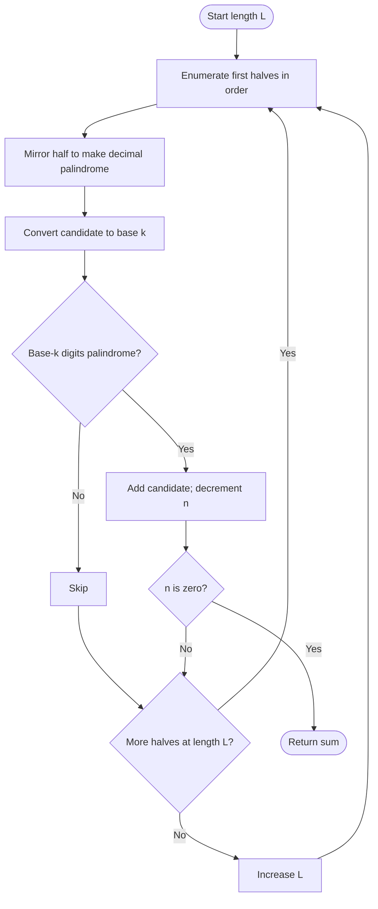

# Sum of k-Mirror Numbers — LeetCode 2081

Source: `2081.cpp`. The file includes two generators; `kMirrorV2` is the length-by-length approach. The `kMirrorV1` loop processes even-length palindromes first and may stop before it ever generates odd-length palindromes, so it is not a correct general solution.

## 1. Understanding — समजून घ्या

A k-mirror number is a positive integer that reads the same in decimal and base `k`. Return the sum of the first `n` such numbers in increasing numeric order.

## 2. Worked examples and edge cases

> **मराठी:** प्रश्नात काय दिले आहे आणि नेमके काय शोधायचे आहे, हे आधी स्पष्ट करा.
> For `k = 2`, `n = 5`, the first values are `1, 3, 5, 7, 9`, sum `25`. Decimal candidates must be checked in ascending order. Odd-length decimal palindromes mirror the first half without repeating its center digit; even lengths mirror the whole first half.

## 3. Pattern identification + cheat sheet

> **मराठी:** या clues मुळे योग्य pattern ओळखता येतो; constraints आणि relations नीट तपासा.
> Use **generate candidates by structure, then validate in another representation**.
> | Clue | Pattern |
> |---|---|
> | Decimal palindrome required | Construct by mirroring half |
> | Also palindrome in base `k` | Convert and two-pointer check |
> | Need first `n` in numeric order | Enumerate by decimal length |

## 4. Approaches

> **मराठी:** सोप्या उपायापासून सुरुवात करा आणि constraints नुसार योग्य optimization निवडा.
> Testing every integer is correct but wastes work on non-decimal-palindromes. Generating only decimal palindromes is the useful optimization. `kMirrorV2` does that in increasing length/order. `kMirrorV1` is flawed: its parity loop starts with even-length candidates and can reach `n` before odd lengths are considered.

## 5. Flowchart

> **मराठी:** Flowchart मधील decision, loop आणि termination condition क्रमाने समजून घ्या.

The generator keeps candidates ordered; only the second-base palindrome test is selective.

## 6. Algorithm and intuition

> **मराठी:** मुख्य observation समजल्यावर algorithm चे steps लक्षात ठेवणे सोपे होते.
> For each decimal length `L`, enumerate all `(L+1)/2`-digit prefixes. Reverse a copy: append its full reverse for even `L`, or omit the duplicated middle digit for odd `L`. Convert the resulting number to base `k`, test palindrome, and add matches until `n` are found.

## 7. Code explanation

> **मराठी:** Code मधील variable आणि condition यांचा algorithm मधील उद्देश समजून घ्या.
> `makePalindrome` and `convertToBaseK` are helpers. In `kMirrorV2`, `L` grows from 1, and `start..end` enumerate prefix values. `isPalindrome` compares ends inward. `long long` stores candidates and sum. `kMirrorV1` builds candidates from an unbounded half counter but does not correctly interleave odd and even lengths.

## 8. Dry run

> **मराठी:** प्रत्येक महत्त्वाच्या step नंतर variable ची value trace करा.
> For `k=2`, `L=2`: prefix `1` → decimal palindrome `11` → binary `1011` (reject); prefix `2` → `22` → `10110` (reject). Then `L=3`: prefix `1` → `101` → binary `1100101` (reject); prefix `2` → `202` → binary `11001010` (reject). Continue in order until the required count is reached.

## 9. Complexity

> **मराठी:** Input size आणि प्रत्येक operation कितीदा चालतो यावरून complexity ठरवा.
> Let `C` be the number of decimal-palindrome candidates tested and `D` the largest candidate's digit count. Time is **O(C·D)** for construction, conversion, and checking; auxiliary space is **O(D)**, excluding the constant-size result sum.

## 10. Correctness

> **मराठी:** Invariant किंवा तर्क वापरून algorithm योग्य उत्तर देतो हे समजून घ्या.
> Mirroring enumerates every decimal palindrome of each length exactly once and in increasing order. Base conversion preserves the candidate's value; the two-pointer test accepts exactly palindromic base-`k` representations. Therefore the accepted sequence is precisely the required first `n`, and summing it is correct.

## 11. Mistakes and interview traps

> **मराठी:** Boundary, duplicate आणि off-by-one cases स्वतंत्रपणे तपासा.

- For odd lengths, do not append the center digit twice.
- Do not enumerate arbitrary numbers if palindrome generation is available.
- The base-`k` representation is a string; leading zeroes do not occur for positive candidates.
- A reverse-order representation is still palindrome iff its forward order is, but `2081.cpp` reverses the digits back.
- Avoid claiming `kMirrorV1` is equivalent to V2; its order/parity handling is defective.

## 12. Quick revision — झटपट उजळणी

> **मराठी सारांश:** आधी दशमान पॅलिंड्रोम तयार करा; मग base `k` मध्ये तपासा.
> Enumerate decimal palindromes by length → convert to base `k` → palindrome check → add matches. Use half-mirroring and `long long`.

## 13. Related problems and variations

> **मराठी:** प्रश्नात काय दिले आहे आणि नेमके काय शोधायचे आहे, हे आधी स्पष्ट करा.
> Generate palindromes by mirroring; numbers palindromic in multiple bases; count rather than sum qualifying candidates; generate binary palindromes and test in decimal.

## 14. Self-assessment

> **मराठी:** उत्तर न पाहता प्रश्न सोडवा आणि तुमच्या निवडीचे कारण सांगा.

1. Why do odd and even lengths use different mirror rules?
2. Why does generation order guarantee the first `n` values?
3. What is wrong with stopping after the even-length pass in V1?
