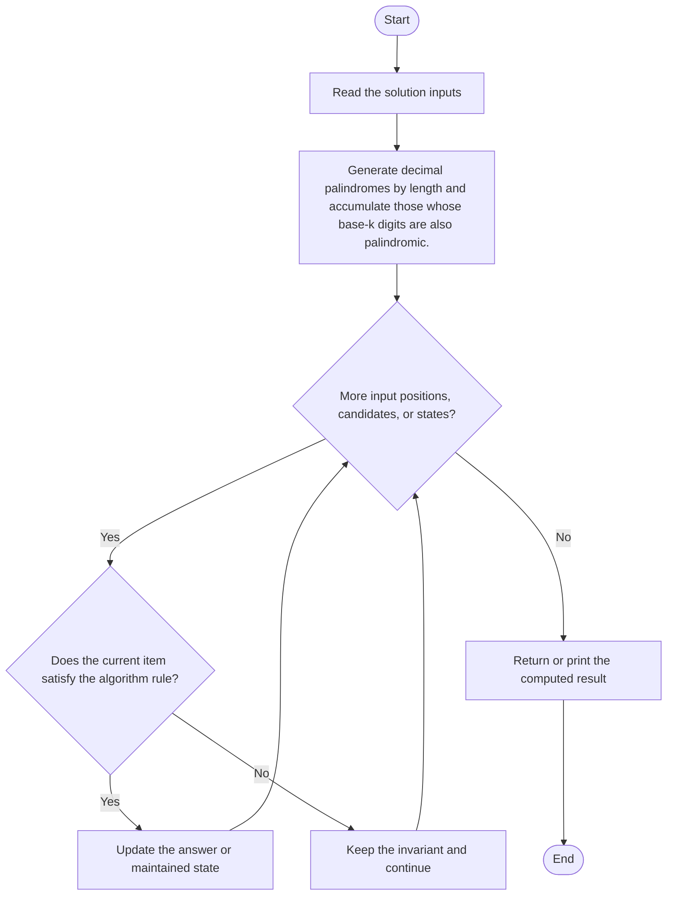
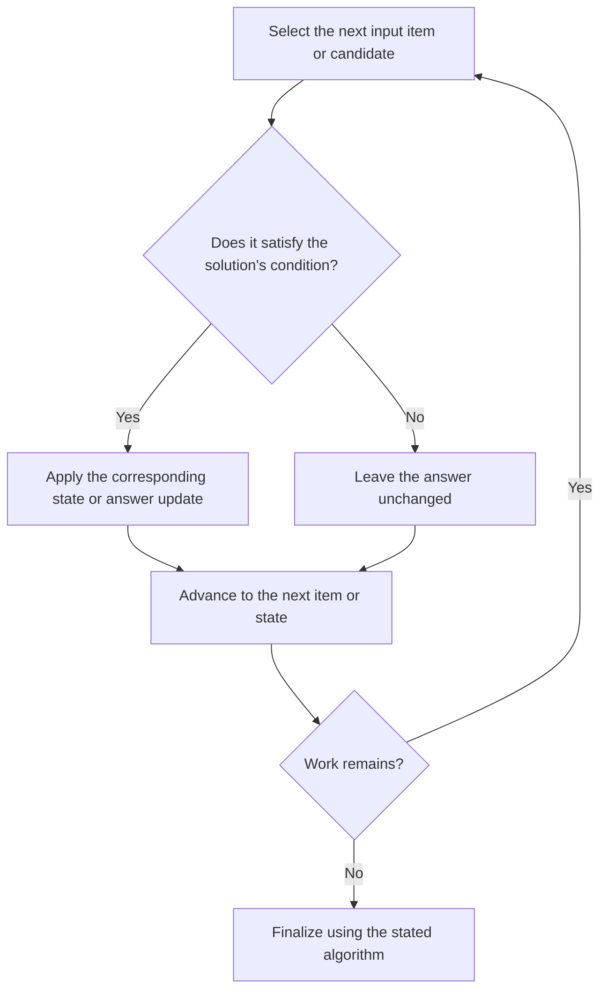

# K-Mirror Numbers

**Problem ID:** 2081  
**Source:** `isPalindrome.cpp`  
**Expected format:** C++ class-method solution with a local demonstration `main()`; see compile guidance below.

> **Collision handling:** kMirror.cpp is a second verified implementation of problem 2081. This source is kept in a named variant subfolder so the required 2081.cpp is not overwritten.

## Expected input and output / judge signature

Solution-facing declarations extracted from the source:

- `bool isPalindrome(string baseK)`
- `string convertToBaseK(long long num, int k)`
- `long long kMirror(int k, int n)`

The inputs and return value are described by these parameter and return types. The local `main()` runs test examples; it does not define a judge stdin/stdout protocol.

## Identification evidence

The filename, solution-facing signature, and implemented behavior support the mapping: Generate decimal palindromes by length and accumulate those whose base-k digits are also palindromic.

## Main flow

Generate decimal palindromes by length and accumulate those whose base-k digits are also palindromic.



## Important branch and loop flow

The repeated step processes the next input item, candidate, or state. The branch either applies the algorithm's update or leaves the state unchanged, then continues until no work remains.



## Core logic and invariant

Generate decimal palindromes by length and accumulate those whose base-k digits are also palindromic.

After each processed item or recursive state, the algorithm's maintained state represents the work accepted so far under the rule above; the final result is read from that accumulated state or returned by the terminal case.

## Complexity

- **Time:** O(C * d), where C is the number of decimal-palindrome candidates tested and d is the candidate digit length.
- **Auxiliary space:** O(d) for the current candidate and its base-k representation.


## Compile and run

This source includes a demonstration `main()` and can be compiled with a C++17 compiler from the repository root:

```powershell
g++ -std=c++17 "LeetCode\2081\isPalindrome-variant\isPalindrome-variant.cpp" -o solution.exe
.\solution.exe
```

For LeetCode's class-method judge, use the relevant method signature above and adapt the local harness: remove the demonstration `main()` and reconcile locally declared node/helper types with judge-provided definitions. Source bytes were preserved exactly during the move.