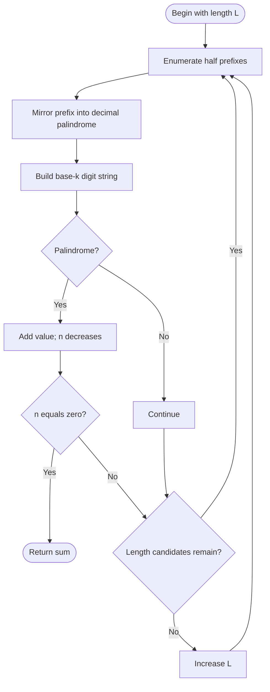

# Sum of k-Mirror Numbers — LeetCode 2081 (variant)

Source: `isPalindrome-variant.cpp`. This implementation generates decimal palindromes by length and uses `kMirror(k,n)`; unlike the sibling file's V1, it visits lengths in order.

## 1. Understanding — समजून घ्या

Find the sum of the first `n` positive numbers that are palindromes in decimal and base `k`.

## 2. Worked examples and edge cases

> **मराठी:** प्रश्नात काय दिले आहे आणि नेमके काय शोधायचे आहे, हे आधी स्पष्ट करा.
> For `k=2`, `n=1`, candidate `1` is palindrome in both bases, so the sum is `1`. A decimal palindrome such as `11` may fail the base-`k` check. Length one uses the same prefix for both halves but drops its mirrored center.

## 3. Pattern identification + cheat sheet

> **मराठी:** या clues मुळे योग्य pattern ओळखता येतो; constraints आणि relations नीट तपासा.
> | Clue | Pattern |
> |---|---|
> | Palindromic decimal candidates | Half-prefix mirroring |
> | Second base has a different digit string | Convert, then two-pointer check |
> | Need earliest `n` matches | Increase decimal length monotonically |
> Pattern: **structured generation + validation**.

## 4. Approaches

> **मराठी:** सोप्या उपायापासून सुरुवात करा आणि constraints नुसार योग्य optimization निवडा.
> Brute force checks every positive integer and both representations. This variant prunes candidates by generating only decimal palindromes. The `isPalindrome` helper checks both ends; `convertToBaseK` stores remainders in reverse order, but that is safe because reversing a string does not change whether it is a palindrome.

## 5. Flowchart

> **मराठी:** Flowchart मधील decision, loop आणि termination condition क्रमाने समजून घ्या.

## 6. Algorithm and intuition

> **मराठी:** मुख्य observation समजल्यावर algorithm चे steps लक्षात ठेवणे सोपे होते.
> For decimal length `L`, enumerate every prefix of length `ceil(L/2)`. Append its reverse for even `L`; for odd `L`, omit the duplicated center. Convert the candidate to base `k`. Add it only if the resulting digits read the same in either direction. Stop as soon as `n` matches have been found.

## 7. Code explanation

> **मराठी:** Code मधील variable आणि condition यांचा algorithm मधील उद्देश समजून घ्या.
> `convertToBaseK` repeatedly takes `% k` and `/= k`, so its string is least-significant digit first. `isPalindrome` is direction-independent. `kMirror` computes prefix bounds using `pow`, constructs each palindrome with `stoll`, and tracks `sum` and remaining `n`.

## 8. Dry run

> **मराठी:** प्रत्येक महत्त्वाच्या step नंतर variable ची value trace करा.
> For `k=2,n=1`: `L=1`, prefix `1` → decimal `1` → base-2 string `"1"` → accepted → sum `1`, remaining count `0` → return.

## 9. Complexity

> **मराठी:** Input size आणि प्रत्येक operation कितीदा चालतो यावरून complexity ठरवा.
> For `C` candidates and at most `D` digits per candidate: **O(C·D)** time and **O(D)** temporary space.

## 10. Correctness

> **मराठी:** Invariant किंवा तर्क वापरून algorithm योग्य उत्तर देतो हे समजून घ्या.
> Every positive decimal palindrome has a unique prefix of the chosen half-length, so the generator visits all such numbers once in increasing length and value. The base conversion produces the candidate's digits (in reverse order), and palindrome status is invariant under reversal. Thus exactly the qualifying values are summed.

## 11. Mistakes and interview traps

> **मराठी:** Boundary, duplicate आणि off-by-one cases स्वतंत्रपणे तपासा.

- Do not mirror the middle digit twice for odd lengths.
- The base conversion string is reversed; this is okay only because the check is palindrome-symmetric.
- Avoid integer overflow when forming palindromes; the implementation uses `long long` and problem constraints.
- `pow` uses floating point; for larger length limits, use integer powers.

## 12. Quick revision — झटपट उजळणी

> **मराठी सारांश:** अर्धा भाग उलटवून संख्या बनवा आणि दोन्ही bases तपासा.
> Prefix → mirror → convert → palindrome test → sum. Increase decimal length; stop at the `n`th accepted value.

## 13. Related problems and variations

> **मराठी:** प्रश्नात काय दिले आहे आणि नेमके काय शोधायचे आहे, हे आधी स्पष्ट करा.
> Palindrome generation; palindromes in two bases; count qualifying numbers in a range; replace the sum with a list of the first `n` matches.

## 14. Self-assessment

> **मराठी:** उत्तर न पाहता प्रश्न सोडवा आणि तुमच्या निवडीचे कारण सांगा.

1. Why can a reversed base-k digit string still be palindrome-tested?
2. How is the center handled for odd length?
3. Why is enumeration by length increasing?
