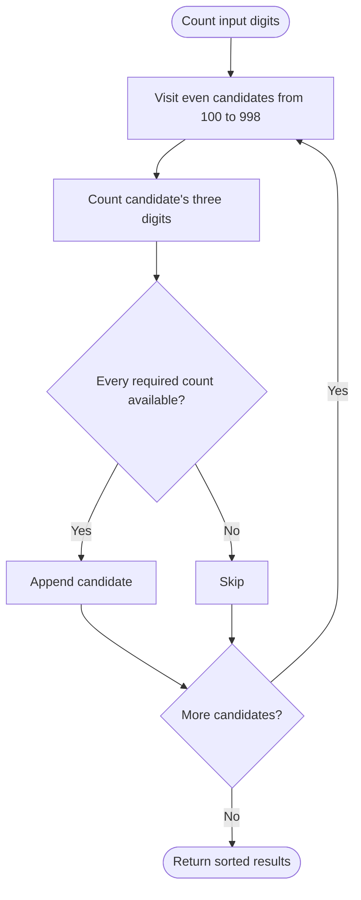

# Finding 3-Digit Even Numbers — LeetCode 2094

Source: `2094.cpp`, with four methods. `method4` counts digit frequencies and checks all three-digit even candidates; `method3` also uses frequencies with backtracking.

## 1. Understanding — समजून घ्या

Use available digits to form every distinct three-digit even number. A digit can be used only as many times as it occurs in the input; the hundreds digit cannot be zero; the units digit must be even. Return results in increasing order.

## 2. Worked examples and edge cases

> **मराठी:** प्रश्नात काय दिले आहे आणि नेमके काय शोधायचे आहे, हे आधी स्पष्ट करा.
> `digits=[2,1,3,0]` permits `102`, `120`, `130`, `132`, `202`? Not the last: only one `2` exists. Repeated digits need repeated input copies: `[1,1,2]` can form `112`, `122` is impossible. A zero may be units or tens, never hundreds.

## 3. Pattern identification + cheat sheet

> **मराठी:** या clues मुळे योग्य pattern ओळखता येतो; constraints आणि relations नीट तपासा.
> | Clue | Pattern |
> |---|---|
> | Tiny fixed output domain (100–999) | Enumerate candidates |
> | Reuse limited by multiplicity | Frequency array |
> | Distinct sorted answers | Ordered set or ascending scan |

## 4. Approaches

> **मराठी:** सोप्या उपायापासून सुरुवात करा आणि constraints नुसार योग्य optimization निवडा.
> `method1` scans even numbers and consumes digits with vector search/erase; it is simple but costly and can duplicate outputs only if candidate generation duplicates (it does not). `method2` adds a set. `method3` backtracks over the 10 digit counts. `method4` scans each even 3-digit candidate and compares required counts; this is the clearest optimal bounded-domain method. Reusing the same digit without checking frequency is incorrect.

## 5. Flowchart

> **मराठी:** Flowchart मधील decision, loop आणि termination condition क्रमाने समजून घ्या.

## 6. Algorithm and intuition

> **मराठी:** मुख्य observation समजल्यावर algorithm चे steps लक्षात ठेवणे सोपे होते.
> Build `freq[0..9]`. Enumerate 3-digit even values in ascending order, split each into hundreds, tens, and units digits, and build a required-frequency array. Keep the candidate iff `need[d] <= freq[d]` for every digit.

## 7. Code explanation

> **मराठी:** Code मधील variable आणि condition यांचा algorithm मधील उद्देश समजून घ्या.
> `method4` implements that frequency comparison and stores accepted values in `set<int>`, which guarantees uniqueness and ascending output. `method3` decrements and restores counts during recursion. `method1` and `method2` repeatedly search and erase digits from a copied vector.

## 8. Dry run

> **मराठी:** प्रत्येक महत्त्वाच्या step नंतर variable ची value trace करा.
> For `[1,1,2]`, candidate `112` requires `{1:2,2:1}` and is accepted. `122` requires two 2s and is rejected. `110` requires a zero and is rejected. Ascending candidate traversal/set order keeps output sorted.

## 9. Complexity

> **मराठी:** Input size आणि प्रत्येक operation कितीदा चालतो यावरून complexity ठरवा.
> Let `m` be the digit count and `r` the result count. `method4` takes **O(m + 900·10 + r log r)** time and **O(10 + r)** space (the scan is a fixed-size domain). `method1` can take **O(900·m²)** due to repeated vector search/erase.

## 10. Correctness

> **मराठी:** Invariant किंवा तर्क वापरून algorithm योग्य उत्तर देतो हे समजून घ्या.
> For each legal three-digit even value, `need[d] <= freq[d]` for every digit is exactly the condition that its digits can be selected from the input. The scan considers every such numeric value once, and the set returns each valid value once in sorted order.

## 11. Mistakes and interview traps

> **मराठी:** Boundary, duplicate आणि off-by-one cases स्वतंत्रपणे तपासा.

- Three-digit means hundreds digit is nonzero.
- Evenness depends only on the last digit.
- Respect duplicate counts; presence alone is insufficient.
- `method1` tests even candidates only, but the tens digit may be any digit.
- Fixed small bounds make candidate scanning simpler than complicated recursion.

## 12. Quick revision — झटपट उजळणी

> **मराठी सारांश:** अंकांची वारंवारता मोजा; प्रत्येक तीन-अंकी सम संख्या तपासा.
> Count digits → scan `[100,998]` step 2 → compare required counts → emit valid values.

## 13. Related problems and variations

> **मराठी:** प्रश्नात काय दिले आहे आणि नेमके काय शोधायचे आहे, हे आधी स्पष्ट करा.
> Digit permutation under multiplicity constraints; build the smallest/largest number from a multiset; count rather than list valid numbers; generalize to `p`-digit numbers using digit-frequency vectors.

## 14. Self-assessment

> **मराठी:** उत्तर न पाहता प्रश्न सोडवा आणि तुमच्या निवडीचे कारण सांगा.

1. Why is `001` not a three-digit number?
2. How does the algorithm reject using a digit too many times?
3. Why does `method4` produce sorted output?
