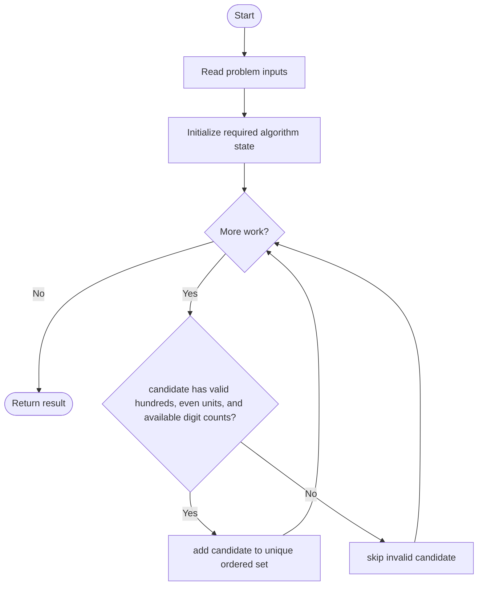
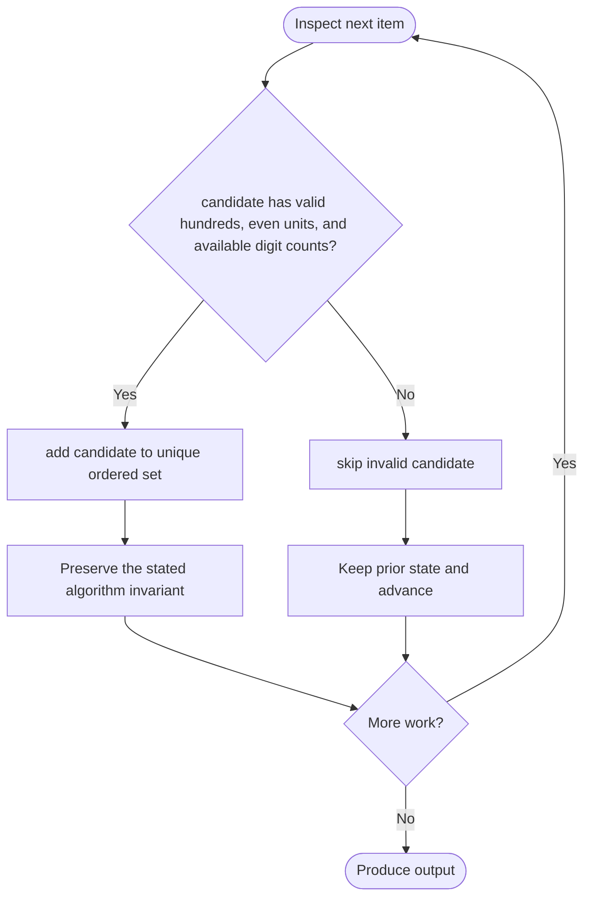

# Finding 3-Digit Even Numbers

**LeetCode ID:** 2094

**Source file(s):** `2094.cpp` (originally `findEvenNumbers.cpp`)

**Identification evidence:** The original filename, declared signature, and distinctive behavior described below uniquely identify this problem; no number was inferred from a filename alone.

## Expected input/output or judge interface

method1/2/3/4(vector<int> digits). Inputs follow the problem constraints; the output is the documented scalar, sequence, or design-object behavior. The description below reflects the implementation actually present in the source.

## Main flow



## Important branch and loop flow



## Core logic and invariant

Enumerates three-digit even candidates, verifies digit multiplicities, and returns unique values in ascending order; includes brute force, recursion, and frequency methods.

The key branch/loop rule above is applied once per relevant item; the algorithm relies on that rule to preserve its state and produce the required result.

## Optimization / comparison

Digit counts cannot exceed input frequencies; frequency checking avoids repeated vector erase/find.

## Complexity

Fixed-domain candidate scan O(900*d); frequency version O(900+digits); output storage.

## Compile and run

The repository file includes a standalone demonstration `main()`; it is not a raw LeetCode submission unit. From the repository root, with a C++17 compiler:

```powershell
g++ -std=c++17 LeetCode\2094\2094.cpp -o solution.exe
.\solution.exe
```

For LeetCode's class-method judge, copy the relevant class/method or design-class API and omit the demo `main()` and local harness. Adapt free-function implementations to the requested `Solution` class signature where necessary. See the source caveat above for any compile blocker.
