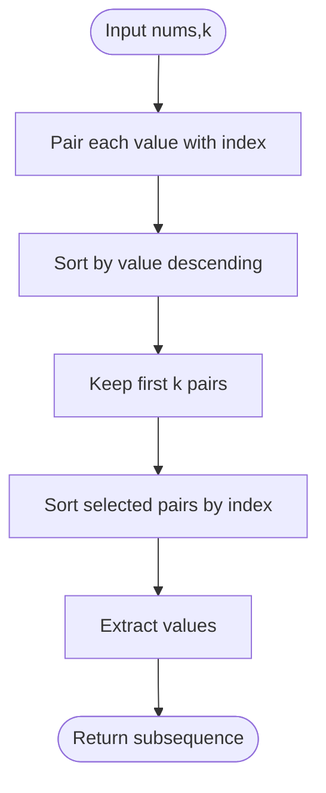

# Find Subsequence of Length K With the Largest Sum — LeetCode 2099

Source: `2099.cpp`. The implementation sorts `(value,index)` pairs, selects the top `k`, then restores their original index order.

## 1. Understanding — समजून घ्या

Choose exactly `k` elements with maximum possible sum, preserving the original relative order. The chosen values form a subsequence, not an arbitrary sorted result.

## 2. Worked examples and edge cases

> **मराठी:** प्रश्नात काय दिले आहे आणि नेमके काय शोधायचे आहे, हे आधी स्पष्ट करा.
> For `[3,4,3,3]`, `k=2`, choose `4` and one `3`; the answer is `[3,4]` because original order matters. Negative values are valid: for `[-1,-2,-3]`, `k=2`, choose the two largest (`-1,-2`) in source order. If `k=n`, return all values.

## 3. Pattern identification + cheat sheet

> **मराठी:** या clues मुळे योग्य pattern ओळखता येतो; constraints आणि relations नीट तपासा.
> | Clue | Pattern |
> |---|---|
> | Select top `k` by score | Sort or size-k heap |
> | Preserve original order | Carry indices, restore by index |
> | Ties allowed | Any valid maximum-sum choice |
> Pattern: **selection followed by stable reconstruction**.

## 4. Approaches

> **मराठी:** सोप्या उपायापासून सुरुवात करा आणि constraints नुसार योग्य optimization निवडा.
> Brute force checks all `k`-subsets (exponential). Sorting all indexed elements is simple and costs O(n log n); a min-heap of size `k` can reduce selection work to O(n log k), then sort the selected `k` indices. Returning the top values in descending order is incorrect because it loses subsequence order.

## 5. Flowchart

> **मराठी:** Flowchart मधील decision, loop आणि termination condition क्रमाने समजून घ्या.

## 6. Algorithm and intuition

> **मराठी:** मुख्य observation समजल्यावर algorithm चे steps लक्षात ठेवणे सोपे होते.
> Any maximum-sum solution must contain `k` largest values (ties can be resolved arbitrarily). Store each value with its original index, select those values, then sort only the selected pairs by index to recover their original relative order.

## 7. Code explanation

> **मराठी:** Code मधील variable आणि condition यांचा algorithm मधील उद्देश समजून घ्या.
> The free function `maxSubsequence` builds `indexed`, sorts on `first` descending, copies the first `k` entries to `topK`, sorts by `second` ascending, and emits each `first`. The comparator does not specify a tie-break; any equal-valued choice has the same sum and remains valid.

## 8. Dry run

> **मराठी:** प्रत्येक महत्त्वाच्या step नंतर variable ची value trace करा.
> `nums=[3,4,3,3], k=2`: value-sort selects `(4,1)` and one `(3,index)`. Index-sort gives `(3,0),(4,1)` → `[3,4]` (or another equal-sum valid choice if a different tied 3 was selected).

## 9. Complexity

> **मराठी:** Input size आणि प्रत्येक operation कितीदा चालतो यावरून complexity ठरवा.
> This implementation uses **O(n log n)** time and **O(n)** auxiliary space. A size-`k` heap improves selection to **O(n log k + k log k)** time, with **O(k)** extra space.

## 10. Correctness

> **मराठी:** Invariant किंवा तर्क वापरून algorithm योग्य उत्तर देतो हे समजून घ्या.
> Replacing any selected value with a larger unselected value cannot decrease the sum, so taking the `k` largest values maximizes it. Sorting those chosen pairs by original index preserves exactly their source order, yielding a valid subsequence.

## 11. Mistakes and interview traps

> **मराठी:** Boundary, duplicate आणि off-by-one cases स्वतंत्रपणे तपासा.

- Preserve the selected items' indices until the final ordering step.
- Do not sort the returned values by magnitude.
- Negative values do not change the top-`k` reasoning.
- Ties may yield multiple valid answers; do not assume a particular tied index.

## 12. Quick revision — झटपट उजळणी

> **मराठी सारांश:** मोठ्या `k` संख्या निवडा, पण मूळ क्रम जपून ठेवा.
> Rank `(value,index)` → keep `k` largest → sort chosen items by index → emit values.

## 13. Related problems and variations

> **मराठी:** प्रश्नात काय दिले आहे आणि नेमके काय शोधायचे आहे, हे आधी स्पष्ट करा.
> Top-k selection; maximum-sum subsequence; return the selected indices; use a heap for streaming input; preserve earliest indices as an explicit tie-break if required.

## 14. Self-assessment

> **मराठी:** उत्तर न पाहता प्रश्न सोडवा आणि तुमच्या निवडीचे कारण सांगा.

1. Why must selected indices be sorted after value selection?
2. What is the benefit of a size-`k` heap?
3. How should equal-valued choices be handled?
