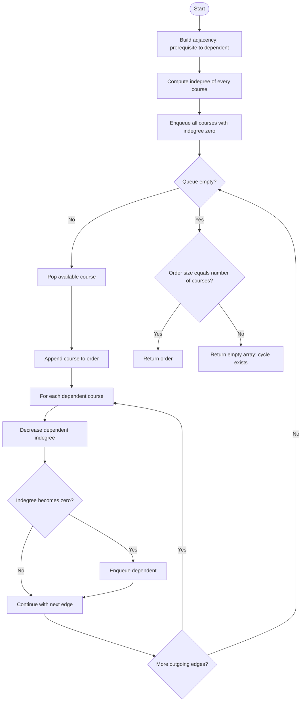

# 210. Course Schedule II

## 1. Problem Understanding

`numCourses` courses `0` ते `numCourses-1` आहेत. `prerequisites[i] = [a, b]` याचा अर्थ **course `a` घेण्यापूर्वी course `b` पूर्ण करणे आवश्यक**. सर्व courses पूर्ण करता येतील असा कोणताही valid order return करा. शक्य नसेल—म्हणजे prerequisite cycle असेल—तर empty array return करा.
प्रत्येक course एकदा order मध्ये येतो. अनेक valid orders असू शकतात; एक योग्य order पुरेसा आहे.

## 2. Example Understanding

### Example 1

```text
numCourses = 2, prerequisites = [[1,0]]
Output: [0,1]
```

Pair `[1,0]` म्हणजे `1` च्या आधी `0`. आधी course `0`, मग `1`; म्हणून `[0,1]`.

### Example 2

```text
numCourses = 4
prerequisites = [[1,0],[2,0],[3,1],[3,2]]
Output: [0,2,1,3]
```

`0` आधी `1` व `2`; आणि `1`, `2` दोन्ही आधी `3`. `[0,2,1,3]` हे सर्व नियम पाळते. `[0,1,2,3]` सुद्धा योग्य आहे.

### Example 3

```text
numCourses = 2, prerequisites = [[1,0],[0,1]]
Output: []
```

`0` आधी `1` आणि `1` आधी `0` अशी cycle आहे. कोणताही पहिला course निवडता येत नाही.

## 3. Problem Identification

Prerequisites म्हणजे **directed dependencies**; output मध्ये dependency आधी आणि dependent नंतर हवा. हे topological sorting चे थेट लक्षण आहे. Directed graph मध्ये topological order अस्तित्वात असतो तेव्हा आणि तेव्हाच graph acyclic (DAG) असतो.
स्वतःला विचारा:

1. Edge कोणत्या दिशेने? prerequisite `b` → dependent `a`.
2. Dependency order कसा तयार करायचा? Topological sort.
3. Cycle असेल तर काय? Valid order नाही; `[]`.
4. DFS वापरल्यास cycle कसा कळेल? Current recursion stack मधील node पुन्हा भेटला.
5. BFS वापरल्यास? Indegree zero nodes process करा; processed count `< V` म्हणजे cycle.

### Pattern Recognition Cheat Sheet

| Clue in Question                                         | Possible Pattern | Why?                                             |
| -------------------------------------------------------- | ---------------- | ------------------------------------------------ |
| Prerequisites / dependencies                             | Directed graph   | One course must precede another                  |
| Return an order satisfying dependencies                  | Topological sort | DAG nodes-ना dependency-respecting order देतो    |
| Circular prerequisite                                    | Cycle detection  | Cycle असल्यास order अशक्य                        |
| Repeatedly process items with no remaining prerequisites | Kahn's BFS       | Indegree-zero nodes next available courses असतात |
| DFS “currently exploring” node पुन्हा भेटतो              | Three-color DFS  | Back edge directed cycle दर्शवते                 |

Build systems, task scheduling, package dependencies आणि course planning याच pattern चे उदाहरणे आहेत.

## 4. Different Approaches

### A. Separate DFS cycle detection, मग DFS topological order

पहिल्या DFS मध्ये `visited` आणि `recursionStack` वापरून cycle शोधा. Cycle नसेल तर visited reset करून दुसरा DFS करा; प्रत्येक node त्याचे outgoing neighbors पूर्ण केल्यानंतर stack मध्ये push करा. Stack reverse-pop केल्यावर topological order मिळतो.

- Time: `O(V + E)`; प्रत्येक vertex आणि edge constant number of times process होतात.
- Space: adjacency list व traversal state मुळे `O(V + E)`.
- Code comment मध्ये या approach साठी `O(V * E)` दिले आहे; ते conservative पण चुकीचे complexity annotation आहे. या code चे actual graph traversal `O(V + E)`.
- Pros: cycle detection / ordering-ची वेगळी जबाबदारी स्पष्ट.
- Cons: graph दोनदा traverse होतो; तीन-state DFS पेक्षा जास्त काम.

### B. Three-state DFS

प्रत्येक node state: `0` unvisited, `1` visiting, `2` fully processed. State `1` node पुन्हा भेटला तर current path मध्ये cycle आहे. पूर्ण झाल्यावर node order मध्ये append करा; शेवटी reverse करा.

- Time: `O(V + E)`, space: `O(V + E)`.
- Pros: cycle detect व order एकाच traversal मध्ये.
- Cons: recursion depth graph chain-இன் நீளம் ஆகலாம்; மிகப்பெரிய graph-இல் stack depth கவனத்தில் घ्या.
- Code: `findOrderDFS`.

### C. BFS — Kahn's Algorithm

प्रत्येक node चा indegree म्हणजे अजून किती prerequisites पूर्ण व्हायचे. Indegree `0` courses queue मध्ये घाला. Course process करताना त्याच्या dependents चे indegree कमी करा; zero झाल्यावर ते queue मध्ये येतात. शेवटी order मध्ये `V` courses नसतील तर cycle आहे.

- Time: `O(V + E)`, space: `O(V + E)`.
- Pros: iterative; available courses स्पष्ट; processed-count cycle check सोपा.
- Cons: indegree व adjacency दोन्ही योग्य direction मध्ये तयार करावी लागते.
- **Final recommended:** Kahn's algorithm; iterative आणि course scheduling शी intuitive mapping.
  | Approach | Time | Space | Pros | Cons |
  |---|---:|---:|---|---|
  | Separate DFS passes | `O(V+E)` | `O(V+E)` | Cycle/order stages स्पष्ट | Graph पुन्हा traverse होतो |
  | Three-state DFS | `O(V+E)` | `O(V+E)` | एक traversal, compact cycle logic | Recursion stack लागू शकतो |
  | Kahn's BFS | `O(V+E)` | `O(V+E)` | Iterative, indegree-based reasoning | Indegree bookkeeping आवश्यक |
  Cycle असताना partial `order` परत करणे चुकीचे; LeetCode contract नुसार `[]` द्यायचे. Multiple correct topological orders असू शकतात—एकच अपेक्षित order आहे असे समजू नका.

## 5. Flowchart



Indegree zero म्हणजे अजून काहीही prerequisite उरलेले नाही. Queue संपल्यानंतर सर्व courses process झाले असतील तर order valid; अन्यथा cycle ने काही courses अडकवले.

## 6. Algorithm / Intuition

**Key observation:** प्रत्येक edge `u → v` म्हणजे `u` आधी `v`; `v` तेव्हाच उपलब्ध होतो जेव्हा सर्व incoming prerequisite edges काढले जातात.

1. `adj[b].push_back(a)` करा, कारण `[a,b]` म्हणजे `b` आधी `a`.
2. प्रत्येक prerequisite pair साठी `indegree[a]++`.
3. सर्व indegree-zero courses queue मध्ये ठेवा.
4. Queue मधून course काढून answer मध्ये जोडा.
5. त्याच्या प्रत्येक outgoing neighbor चा indegree कमी करा; zero झाला तर enqueue.
6. Answer size `numCourses` असल्यास order return करा; नाहीतर `[]`.

## 7. Code Explanation

`buildGraph` `[course, prerequisite]` pair ला prerequisite → course edge बनवते. हा direction सहज उलट होऊ शकतो, म्हणून pair semantics तपासा.

- `findOrderBFS`: adjacency, `indegree`, queue, `order` वापरून Kahn's algorithm.
- `findOrderDFS`: `state` तीन रंगांप्रमाणे; recursion मध्ये visiting node पुन्हा भेटला तर cycle.
- `findOrderSeparateDFS`: आधी cycle detection, नंतर topological postorder.
  Code मधील `findOrderSeparateDFS` comment `O(V * E)` म्हणतो; actual complexity `O(V + E)` आहे कारण प्रत्येक DFS adjacency edge एकूण linear वेळेत तपासते (दोन passes असले तरी Big-O तसाच). हा documentation/comment mismatch आहे, algorithmic bug नाही.
  **Submission note:** LeetCode method `findOrder` अपेक्षित असतो. फाइलमध्ये तुलना करणारे methods आणि local `main` आहेत; judge मध्ये योग्य method signature expose करा. Topological ordering unique असण्याची गरज नाही.

## 8. Dry Run

Input: `n=4`, prerequisites `[[1,0],[2,0],[3,1],[3,2]]`
| Step | Variables | Condition | Action | Result |
|---:|---|---|---|---|
| 1 | edges | `[a,b]` | Add `b → a` | `0→1`, `0→2`, `1→3`, `2→3` |
| 2 | indegree | all edges counted | Find zero-indegree | `indegree=[0,1,1,2]`, queue `[0]` |
| 3 | pop `0` | queue nonempty | Add `0`; decrease indegree of `1`,`2` | order `[0]`, queue `[1,2]` |
| 4 | pop `1` | queue nonempty | Add `1`; decrease `3` from 2 to 1 | order `[0,1]` |
| 5 | pop `2` | queue nonempty | Add `2`; decrease `3` from 1 to 0; enqueue | order `[0,1,2]`, queue `[3]` |
| 6 | pop `3` | queue nonempty | Add `3` | order `[0,1,2,3]` |
| 7 | queue empty | order size = 4 | Return order | Valid |

## 9. Complexity Analysis

`V = numCourses`, `E = prerequisites.size()`. Adjacency list construction `O(V+E)`, indegree-zero scan `O(V)`, आणि प्रत्येक edge एकदाच process होतो `O(E)`: total **`O(V+E)` time**. Adjacency list `O(V+E)`, तसेच queue/order/indegree `O(V)`: total **`O(V+E)` space**.
ही complexity दिलेल्या constraints साठी scalable आहे. Dense graph मध्ये `E` मोठा असतो, पण input edges process करणे आवश्यकच आहे.

## 10. Why This Solution Works

Kahn's algorithm मध्ये queue मध्ये फक्त indegree-zero nodes असतात, म्हणजे अजून बाकी असलेला prerequisite नाही. म्हणून त्यांना output च्या पुढे ठेवणे नेहमी सुरक्षित आहे. Node काढल्यावर त्याचे outgoing edges काढण्यासारखे indegrees कमी होतात; नवीन zero-indegree nodes पुढे येतात. सर्व nodes process झाले तर प्रत्येक prerequisite आधी आला. Cycle असल्यास त्यातील nodes चे indegree positive राहते, त्यामुळे queue त्यांना कधीच देत नाही आणि `order.size() < V`. प्रत्येक iteration node किंवा edge progress करते; finite graph असल्याने algorithm terminate होतो.

## 11. Common Mistakes & Interview Traps

- `[a,b]` चा अर्थ `a → b` समजणे; प्रत्यक्षात prerequisite `b` → dependent `a`.
- Indegree prerequisite च्या जागी dependent वर मोजायचे हे विसरणे.
- Duplicate prerequisite pair input मध्ये असू शकतो का, constraints तपासा; असल्यास adjacency व indegree दोन्हीत consistently count करणे.
- Cycle detection न करता partial result परत करणे.
- एकच valid order अपेक्षित मानणे.
- DFS मध्ये `visited` मात्र recursion-stack/state tracking न ठेवणे; directed cycle चुकू शकते.
- Empty prerequisite list: सर्व courses indegree zero, म्हणून कोणताही order valid.
- Interview follow-up: “Can finish?” म्हणजे topological order exists? फक्त order size `V` आहे का ते तपासा.

## 12. Revision Notes (Quick Recall)

- **Pattern:** Directed graph topological sort.
- **Clues:** prerequisites, dependency order, cycle makes task impossible.
- **Intuition:** indegree zero course आत्ता घेता येतो; घेतल्यावर dependents unlock होतात.
- **Steps:** `b→a` graph, indegrees, zero queue, process edges, count check.
- **Complexity:** `O(V+E)` time, `O(V+E)` space.
- **Mistakes:** edge direction, cycle partial output, indegree update.
- **Takeaway:** Dependencies असतील तर graph बनवा; valid ordering साठी topological sort तपासा.

## 13. Similar Problem Recognition

Course Schedule I मध्ये फक्त शक्य आहे का विचारतात; Kahn's algorithm मध्ये processed count `V` झाला का हे उत्तर देते. Build/package dependency ordering आणि task scheduling मध्येही हाच DAG pattern. DFS topological order किंवा Kahn's BFS निवडू शकता; cycle असणेही detect करायचे असेल तर तीन-state DFS किंवा Kahn processed count वापरा. Weighted prerequisites/order cost वेगळा प्रश्न आहे—topological sort एकट्याने optimization सोडवत नाही.

## 14. Final Self-Assessment

1. `[course, prerequisite]` pair graph edge कोणत्या दिशेने बनवतो?
2. Kahn's queue मध्ये indegree-zero courses का safe असतात?
3. Queue संपली पण `order.size() < numCourses` असेल तर याचा अर्थ काय?
4. अनेक वेगळे output arrays valid का असू शकतात?
5. DFS मध्ये `visited` असणे cycle detect करण्यासाठी एकट्याने पुरेसे का नाही?
