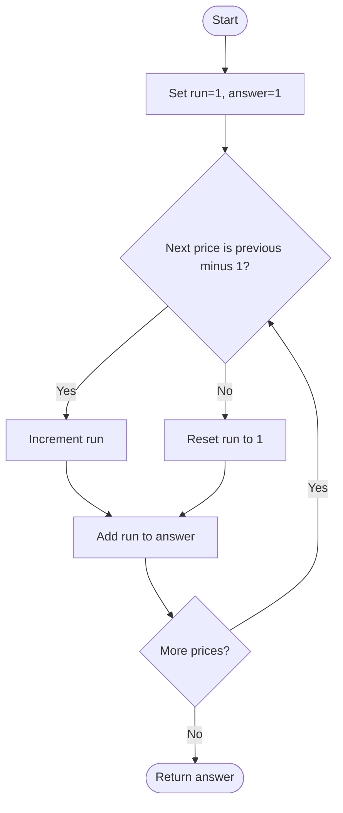

# Number of Smooth Descent Periods of a Stock — LeetCode 2110

Source: `2110.cpp`. `getDescentPeriods` uses a rolling count; `getDescentPeriodsDP` stores the same state per index.

## 1. Understanding — समजून घ्या

A descent period is a contiguous nonempty range where each next price is exactly one less than the previous price. Count all such ranges.

## 2. Worked examples and edge cases

> **मराठी:** प्रश्नात काय दिले आहे आणि नेमके काय शोधायचे आहे, हे आधी स्पष्ट करा.
> For `[3,2,1,4]`, the run `[3,2,1]` contributes `3+2+1=6`; `[4]` adds one, total `7`. Equal prices break a run. A single price contributes one.

## 3. Pattern identification + cheat sheet

> **मराठी:** या clues मुळे योग्य pattern ओळखता येतो; constraints आणि relations नीट तपासा.
> | Clue | Pattern |
> |---|---|
> | Contiguous subarrays | Consecutive-run counting |
> | Each step follows a local relation | Rolling DP |
> | Need count all subarrays ending here | Add current run length |

## 4. Approaches

> **मराठी:** सोप्या उपायापासून सुरुवात करा आणि constraints नुसार योग्य optimization निवडा.
> Enumerating every subarray and checking every adjacent pair is O(n²) or worse. A DP array tracks valid descent periods ending at each day in O(n) time/O(n) space. The source's rolling version is optimal in auxiliary space.

## 5. Flowchart

> **मराठी:** Flowchart मधील decision, loop आणि termination condition क्रमाने समजून घ्या.

Each day contributes all valid descent subarrays that end on that day.

## 6. Algorithm and intuition

> **मराठी:** मुख्य observation समजल्यावर algorithm चे steps लक्षात ठेवणे सोपे होते.
> Keep `dp` as the length of the exact-step-down suffix ending at the current day. If `prices[i] == prices[i-1]-1`, extend it; otherwise reset to 1. Add that count to the answer because every suffix length from 1 through `dp` is a valid descent period ending at `i`.

## 7. Code explanation

> **मराठी:** Code मधील variable आणि condition यांचा algorithm मधील उद्देश समजून घ्या.
> `getDescentPeriods` initializes `ans=dp=1` for the first day, updates `dp`, and accumulates into `long long`. `getDescentPeriodsDP` expresses the same recurrence with a vector. Both assume the problem's nonempty input constraint.

## 8. Dry run

> **मराठी:** प्रत्येक महत्त्वाच्या step नंतर variable ची value trace करा.
> | Price | Relation to previous | `dp` | Answer |
> |---:|---|---:|---:|
> | 3 | first | 1 | 1 |
> | 2 | 3−1 | 2 | 3 |
> | 1 | 2−1 | 3 | 6 |
> | 4 | broken | 1 | 7 |

## 9. Complexity

> **मराठी:** Input size आणि प्रत्येक operation कितीदा चालतो यावरून complexity ठरवा.
> Rolling implementation: **O(n)** time, **O(1)** extra space. DP-array variant: **O(n)** time and **O(n)** extra space. The answer uses 64-bit storage.

## 10. Correctness

> **मराठी:** Invariant किंवा तर्क वापरून algorithm योग्य उत्तर देतो हे समजून घ्या.
> At each index, the recurrence gives exactly the number of valid contiguous descent subarrays ending there: one singleton, plus all extensions of the previous valid suffix when the adjacent difference is one. Summing these per-ending-index counts counts every valid subarray exactly once.

## 11. Mistakes and interview traps

> **मराठी:** Boundary, duplicate आणि off-by-one cases स्वतंत्रपणे तपासा.

- Descent means difference exactly `1`, not merely decreasing.
- Reset to one, not zero: the current day alone is always valid.
- Count every ending suffix, not just maximal runs.
- Use `long long`; the number of subarrays can be quadratic.
- Source assumes `prices` is nonempty, as the judge guarantees.

## 12. Quick revision — झटपट उजळणी

> **मराठी सारांश:** सलग घसरणीची लांबी वाढवा; प्रत्येक टप्प्याला ती उत्तरात जोडा.
> `dp = (prev-current==1) ? dp+1 : 1`; add `dp` each day.

## 13. Related problems and variations

> **मराठी:** प्रश्नात काय दिले आहे आणि नेमके काय शोधायचे आहे, हे आधी स्पष्ट करा.
> Count arithmetic subarrays; count monotone runs; longest smooth descent; generalize the allowed step to a fixed difference.

## 14. Self-assessment

> **मराठी:** उत्तर न पाहता प्रश्न सोडवा आणि तुमच्या निवडीचे कारण सांगा.

1. Why does a run of length `r` contribute `r` new periods at its end?
2. What should the recurrence do on equal adjacent prices?
3. Why is the answer type 64-bit?
