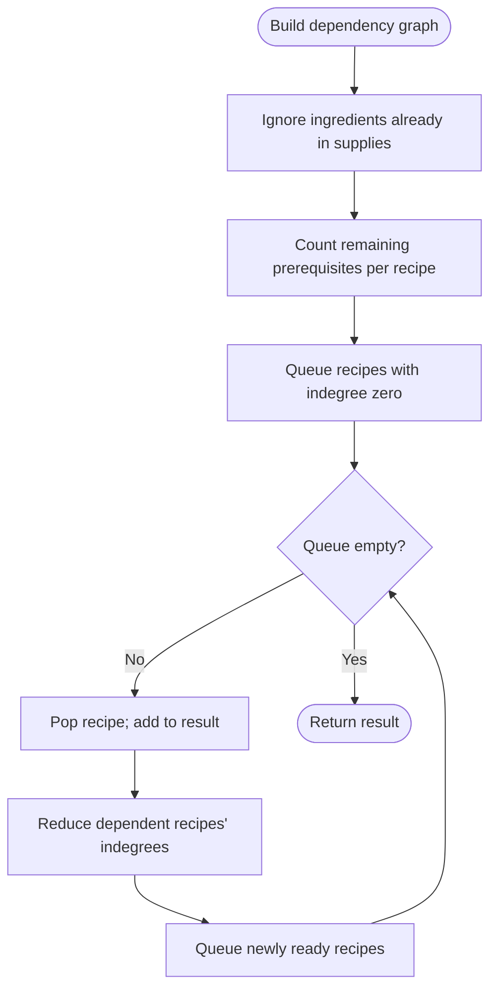

# Find All Possible Recipes from Given Supplies — LeetCode 2115

Source: `2115.cpp`; it models recipe dependencies as a graph and runs Kahn's topological process from recipes whose ingredients are already supplies.

## 1. Understanding — समजून घ्या

Return every recipe that can eventually be made from the initial supplies and other makeable recipes. A recipe becomes available only when all its ingredients are available.

## 2. Worked examples and edge cases

> **मराठी:** प्रश्नात काय दिले आहे आणि नेमके काय शोधायचे आहे, हे आधी स्पष्ट करा.
> If `bread` needs `flour,water` and both are supplies, `bread` is ready; a `sandwich` needing `bread,meat` becomes ready later. A recipe with an unavailable ingredient stays blocked. Cyclic dependencies cannot become ready unless all dependencies are supplied through some other path.

## 3. Pattern identification + cheat sheet

> **मराठी:** या clues मुळे योग्य pattern ओळखता येतो; constraints आणि relations नीट तपासा.
> | Clue | Pattern |
> |---|---|
> | Items unlock after prerequisites | Dependency graph |
> | Every prerequisite must be satisfied | Indegree counter |
> | Process newly ready nodes | Kahn's BFS/topological traversal |

## 4. Approaches

> **मराठी:** सोप्या उपायापासून सुरुवात करा आणि constraints नुसार योग्य optimization निवडा.
> Repeatedly rescanning all recipes until no change is easy but may take O(R) rounds. DFS can detect cycles but must model ingredients carefully. Kahn's algorithm processes each dependency edge once and is the appropriate linear-time approach. A common incorrect graph adds edges only for recipe ingredients but forgets to mark initially supplied ingredients as already satisfied.

## 5. Flowchart

> **मराठी:** Flowchart मधील decision, loop आणि termination condition क्रमाने समजून घ्या.

## 6. Algorithm and intuition

> **मराठी:** मुख्य observation समजल्यावर algorithm चे steps लक्षात ठेवणे सोपे होते.
> For each recipe, create a count of ingredients that are not in supplies. Add an edge from each such ingredient to the recipe that needs it. Enqueue recipes with zero missing ingredients. When a recipe is popped, it becomes an available ingredient: decrease the indegree of every recipe that depends on it and enqueue any that reach zero.

## 7. Code explanation

> **मराठी:** Code मधील variable आणि condition यांचा algorithm मधील उद्देश समजून घ्या.
> `points` maps ingredient name to dependent recipes; `indegree` counts unresolved dependencies. `supply` is initialized from the given supplies and is used while constructing edges. The queue is seeded from `indegree==0`; each popped recipe is appended to `res`.

## 8. Dry run

> **मराठी:** प्रत्येक महत्त्वाच्या step नंतर variable ची value trace करा.
> `bread ← flour,water`, `sandwich ← bread,meat`; supplies are `{flour,water,meat}`. Bread indegree is 0; sandwich indegree is 1. Pop bread, reduce sandwich to 0, enqueue/pop sandwich. Result: `[bread,sandwich]`.

## 9. Complexity

> **मराठी:** Input size आणि प्रत्येक operation कितीदा चालतो यावरून complexity ठरवा.
> Let `R` be recipes and `E` ingredient occurrences. Expected **O(R+E)** time and **O(R+E)** space with the hash maps, graph, queue, and result.

## 10. Correctness

> **मराठी:** Invariant किंवा तर्क वापरून algorithm योग्य उत्तर देतो हे समजून घ्या.
> Indegree is exactly the number of recipe prerequisites not yet available. A zero-indegree recipe has all ingredients supplied or previously produced, so it is makeable. Every time a makeable recipe is processed, all its outgoing dependencies are updated. Thus every makeable recipe is eventually queued; blocked/cyclic recipes never reach zero.

## 11. Mistakes and interview traps

> **मराठी:** Boundary, duplicate आणि off-by-one cases स्वतंत्रपणे तपासा.

- Count only ingredients absent from initial supplies.
- An ingredient may be a recipe name or an external supply; both are graph labels.
- Result ordering is not fixed because `unordered_map` iteration seeds the queue; the judge accepts any order.
- Duplicate ingredient entries would need careful edge/indegree handling; the problem's input constraints avoid duplicates.
- Do not enqueue recipes with positive indegree.

## 12. Quick revision — झटपट उजळणी

> **मराठी सारांश:** तयार असलेल्या रेसिपी काढा आणि त्यांच्या अवलंबित गोष्टी मोकळ्या करा.
> Missing ingredient count → reverse dependency edges → queue zero counts → release dependents.

## 13. Related problems and variations

> **मराठी:** प्रश्नात काय दिले आहे आणि नेमके काय शोधायचे आहे, हे आधी स्पष्ट करा.
> Course Schedule / topological sorting; build-system dependencies; task scheduling; report cyclic or unmakeable recipes by checking unprocessed nodes.

## 14. Self-assessment

> **मराठी:** उत्तर न पाहता प्रश्न सोडवा आणि तुमच्या निवडीचे कारण सांगा.

1. What does recipe indegree represent here?
2. Why are initial supplies excluded from the count?
3. Why might the returned recipe order vary?
