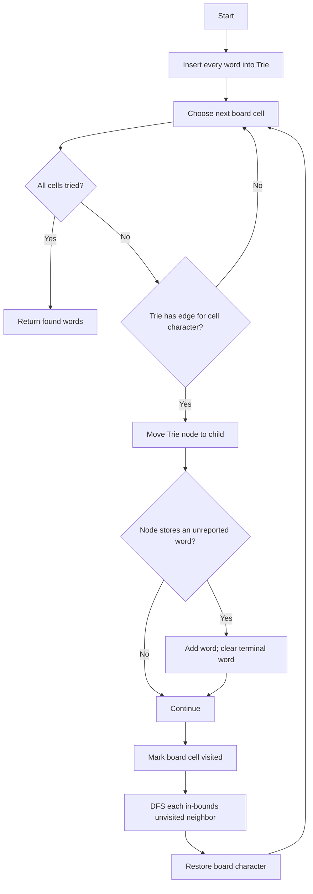

# 212. Word Search II

## 1. Problem Understanding

Given a 2D character board and a list of words, return every word that can be formed by moving horizontally or vertically. A board cell can be used only once in one word path. We return found words, not paths. अक्षरे adjacent असली पाहिजेत; diagonal movement allowed नाही.

## 2. Example Understanding

For the standard board

```text
o a a n
e t a e
i h k r
i f l v
```

and `["oath","pea","eat","rain"]`, `oath` follows `(0,0)->(0,1)->(1,1)->(2,1)` and `eat` also exists; `pea` and `rain` do not. Output is `["eat","oath"]` (ordering is not important). Edge cases: empty board gives `[]`; repeated board letters do not allow reusing one cell.

## 3. Problem Identification

### Pattern Recognition Cheat Sheet

| Clue in Question                        | Possible Pattern                 | Why?                                                        |
| --------------------------------------- | -------------------------------- | ----------------------------------------------------------- |
| Many target words on one character grid | Trie + DFS                       | Share prefixes instead of searching each word independently |
| Neighbor-by-neighbor path               | Grid DFS / backtracking          | Explore four choices, undo visited state                    |
| No cell reuse                           | Visited marking + restore        | A path must track its own used cells                        |
| Report all words                        | Search with output deduplication | A word may be reached from multiple starts                  |

Ask: Are searches independent or do words share prefixes? Can a prefix be abandoned early? Here trie traversal answers that instantly.

## 4. Different Approaches

1. **DFS once per word (provided brute variant):** Search from matching start cells, backtrack after each path. Correct, but repeats work for shared prefixes.
2. **Trie + DFS (optimized):** Insert all words into a prefix tree, then walk the board while walking trie edges. A missing edge prunes that path. Store full word at terminal node; clear it after reporting to avoid duplicates.
   | Approach | Time | Space | Pros | Cons |
   |---|---:|---:|---|---|
   | Separate word DFS | Up to O(W·R·C·4^L) | O(L) stack | Simple and reusable for one word | Repeats prefix exploration |
   | Trie + board DFS | Worst-case exponential in board path length; often much less via prefix pruning | O(total word chars + L) | Shares prefixes; efficient for word lists | Trie implementation/backtracking more involved |
   `W` words, board `R×C`, max word length `L`. Trie does not make the theoretical worst case polynomial; its win is pruning common impossible prefixes. Brute force is correct but can time out on large inputs.

## 5. Flowchart



Trie node sobat board madhye search chalto. Prefix नसल्यास लगेच backtrack; word सापडल्यावर terminal clear केल्याने duplicate output टळते.

## 6. Algorithm / Intuition

Build a 26-child trie. Start DFS at every cell. Each DFS step must match a trie child; mark that cell as visited, check for a completed word, search four neighbors, then restore the character. Search work stops as soon as the current board path is not a prefix of any requested word.

## 7. Code Explanation

[`212.cpp`](./212.cpp) includes `findWordsBruteForce` and `findWordsTrie`. `TrieNode::children` stores next lowercase letters and `word` marks a terminal. `dfs` advances the trie node, records and clears a found word, marks board cells as `#`, explores four directions, and restores the original letter. `findWordsTrie` guards empty boards and launches DFS from all cells. Brute helper `dfsWord` restores each cell during backtracking. The online judge can use the Trie version; `main` is local comparison code.

## 8. Dry Run

For the path `o-a-t-h`:
| Step | Variables | Condition | Action | Result |
|---|---|---|---|---|
| 1 | cell `(0,0)`, root | Trie has `o` | Move to `o` node; mark visited | Prefix `o` |
| 2 | `(0,1)` | Neighbor matches `a` edge | Move and mark | Prefix `oa` |
| 3 | `(1,1)` | Neighbor matches `t` edge | Move and mark | Prefix `oat` |
| 4 | `(2,1)` | Neighbor matches `h` edge | Move and mark | Terminal `oath`; add once |
| 5 | returning | DFS complete | Restore every marked cell | Board unchanged |

## 9. Complexity Analysis

Trie construction is O(total characters in all words), with equal-order storage. DFS explores paths up to length `L`; in the worst case each start may branch in four directions (excluding visited cells), so a safe loose bound is O(RC·4^L), plus trie construction. Recursion stack is O(L). Actual work is reduced by trie prefix pruning; output storage is additional.

## 10. Why This Solution Works

Every valid word path starts at some board cell and follows only four-neighbor moves, exactly what the outer loop and DFS enumerate. Trie edges enforce that the visited characters are a prefix of a requested word. A terminal node means that exact word has been formed. Backtracking restores the board so separate paths remain independent; clearing the terminal word prevents duplicate reporting without hiding other words sharing that prefix.

## 11. Common Mistakes & Interview Traps

- Forgetting to restore the board cell after recursion.
- Allowing diagonal moves or reusing a cell.
- Checking only complete words and missing prefix pruning.
- Output order is not guaranteed by the problem.
- `#` sentinel is safe for the stated lowercase-letter board; otherwise use a separate visited matrix.
- Production-quality C++ should release allocated trie nodes (the sample uses `new` without a destructor).
- Follow-up: discuss trie pruning/removing empty branches after all words below them are found.

## 12. Revision Notes (Quick Recall)

- **Pattern:** Trie + grid DFS/backtracking.
- **Clues:** Many words, shared prefixes, 4-direction paths, no cell reuse.
- **Intuition:** One board walk can serve many words; stop on missing trie edge.
- **Steps:** Build Trie → start DFS per cell → mark/visit neighbors → report terminal → restore.
- **Complexity:** Build O(total word chars); search worst-case exponential in max path length.
- **Trap:** Restore board and deduplicate terminal hits.
- **Takeaway:** Trie shares prefixes; DFS handles path constraints.

## 13. Similar Problem Recognition

Related to Word Search (one word) and prefix search in dictionaries. For a single target, Trie construction is unnecessary. For eight-direction movement, update neighbor enumeration only. If paths may reuse cells, the visited-state rule changes. Useful adjacent patterns: Trie, board DFS, Boggle, prefix pruning.

## 14. Final Self-Assessment

1. Why does the Trie improve on searching each word independently?
2. Why must the current board character be restored?
3. How does clearing a terminal word prevent duplicates?
4. What is the maximum recursion depth?
5. What changes if diagonal adjacency is allowed?
