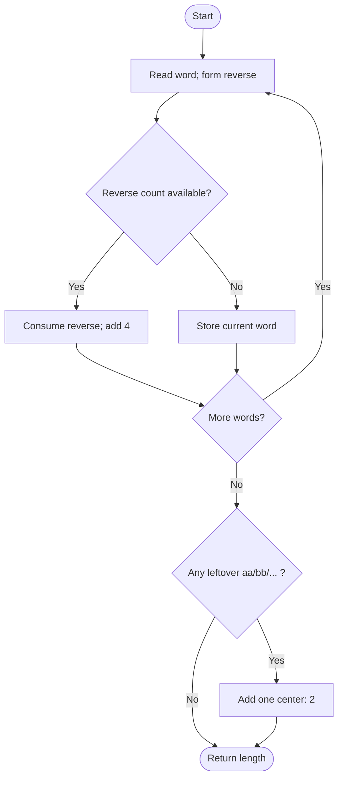

# Longest Palindrome by Concatenating Two Letter Words — LeetCode 2131

Source: `2131.cpp`; it greedily pairs a word with its reverse using a frequency map.

## 1. Understanding — समजून घ्या

Reorder the given two-letter words and concatenate selected words into the longest palindrome. Each input word can be used at most once.

## 2. Worked examples and edge cases

> **मराठी:** प्रश्नात काय दिले आहे आणि नेमके काय शोधायचे आहे, हे आधी स्पष्ट करा.
> `"lc"` pairs with `"cl"` and contributes 4 characters. A self-reversing word such as `"gg"` can be paired with another `"gg"` for 4, or one unpaired `"gg"` can be the 2-character center. Only one center word is allowed.

## 3. Pattern identification + cheat sheet

> **मराठी:** या clues मुळे योग्य pattern ओळखता येतो; constraints आणि relations नीट तपासा.
> | Word type | Pairing rule |
> |---|---|
> | `ab`, where `a != b` | Pair with `ba` |
> | `aa` | Pair two for 4; possibly keep one for center |
> | Count-based matching | Frequency map / greedy complement |

## 4. Approaches

> **मराठी:** सोप्या उपायापासून सुरुवात करा आणि constraints नुसार योग्य optimization निवडा.
> Brute force over subsets and arrangements is exponential. Counting all words then pairing opposite orientations also works. The source processes each word once and consumes an available reverse; it is linear expected time. Pairing a word with itself when letters differ is invalid.

## 5. Flowchart

> **मराठी:** Flowchart मधील decision, loop आणि termination condition क्रमाने समजून घ्या.

## 6. Algorithm and intuition

> **मराठी:** मुख्य observation समजल्यावर algorithm चे steps लक्षात ठेवणे सोपे होते.
> For each word, if its reversed word has an unmatched occurrence, pair them and add 4. Otherwise, record this word as unmatched. After processing, any remaining identical-letter word can be used as the center; add 2 once, not once per type.

## 7. Code explanation

> **मराठी:** Code मधील variable आणि condition यांचा algorithm मधील उद्देश समजून घ्या.
> `wordCount` stores unmatched words. For each `word`, `rev` swaps its two characters. On a positive reverse count, decrement that count; otherwise increment the current word's count. The final loop finds any leftover `aa`-style word and adds a single center.

## 8. Dry run

> **मराठी:** प्रत्येक महत्त्वाच्या step नंतर variable ची value trace करा.
> Input `["lc","cl","gg"]`: `"lc"` waits; `"cl"` consumes it → length 4; `"gg"` remains. It is self-reversing, so use as center → total length 6.

## 9. Complexity

> **मराठी:** Input size आणि प्रत्येक operation कितीदा चालतो यावरून complexity ठरवा.
> For `n` words: expected **O(n)** time and **O(u)** space, where `u` is the number of distinct unmatched words.

## 10. Correctness

> **मराठी:** Invariant किंवा तर्क वापरून algorithm योग्य उत्तर देतो हे समजून घ्या.
> Every non-center palindrome pair must consist of a word and its reverse, so consuming such pairs earns 4 characters per pair without conflict. A self-reversing word can be paired the same way, with at most one leftover placed at the center. The algorithm consumes each word at most once and uses exactly these allowable structures.

## 11. Mistakes and interview traps

> **मराठी:** Boundary, duplicate आणि off-by-one cases स्वतंत्रपणे तपासा.

- Only one self-reversing word can be the center.
- Non-self-reversing words cannot be centers.
- Decrement a matched reverse so an occurrence is not reused.
- The final center check must happen after all pairs are consumed.
- Return character length, not number of words.

## 12. Quick revision — झटपट उजळणी

> **मराठी सारांश:** उलट शब्दांची जोडी करा; मध्यभागी एकच समान-अक्षरी शब्द ठेवा.
> Pair `ab` with `ba` (+4); after all pairs, one leftover `aa` (+2 center).

## 13. Related problems and variations

> **मराठी:** प्रश्नात काय दिले आहे आणि नेमके काय शोधायचे आहे, हे आधी स्पष्ट करा.
> Longest palindrome from character counts; pair reverse strings; count maximum pairs plus optional center; generalize to longer fixed-length strings and their reverses.

## 14. Self-assessment

> **मराठी:** उत्तर न पाहता प्रश्न सोडवा आणि तुमच्या निवडीचे कारण सांगा.

1. Why can a non-self-reversing word not be the center?
2. Why is at most one leftover `aa` used?
3. What must happen to the reverse count after a match?
