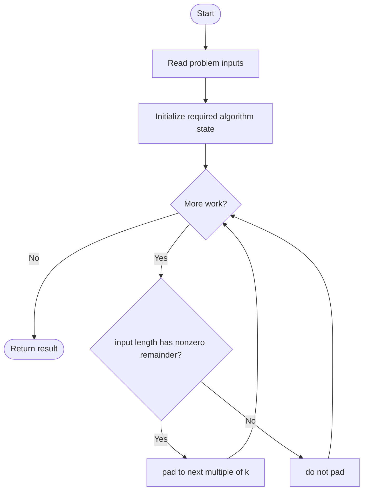
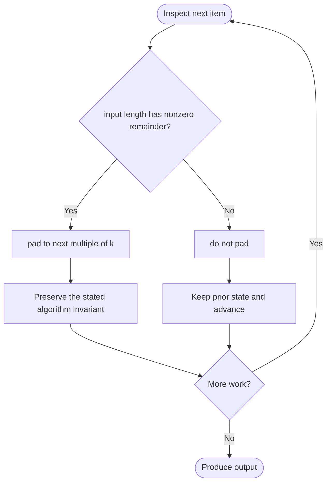

# Divide a String Into Groups of Size k

**LeetCode ID:** 2138
**Source file(s):** `2138.cpp` (originally `divideString.cpp`)
**Identification evidence:** The original filename, declared signature, and distinctive behavior described below uniquely identify this problem; no number was inferred from a filename alone.

## Expected input/output or judge interface

divideString_V1/V2/V3(string s,int k,char fill). Inputs follow the problem constraints; the output is the documented scalar, sequence, or design-object behavior. The description below reflects the implementation actually present in the source.

## Main flow



## Important branch and loop flow



## Core logic and invariant

Pads the final partial group and slices into k-sized strings; V1 always appends k-remainder characters, even when divisible, while V2/V3 fix that.
The key branch/loop rule above is applied once per relevant item; the algorithm relies on that rule to preserve its state and produce the required result.

## Optimization / comparison

V3 reserves output capacity; V2/V3 preserve exact-multiple input without extra padding.

## Complexity

V2/V3 O(n) time and output space; V1 may append an erroneous extra group.

## Compile and run

The repository file includes a standalone demonstration `main()`; it is not a raw LeetCode submission unit. From the repository root, with a C++17 compiler:

```powershell
g++ -std=c++17 LeetCode\2138\2138.cpp -o solution.exe
.\solution.exe
```

For LeetCode's class-method judge, copy the relevant class/method or design-class API and omit the demo `main()` and local harness. Adapt free-function implementations to the requested `Solution` class signature where necessary. See the source caveat above for any compile blocker.
