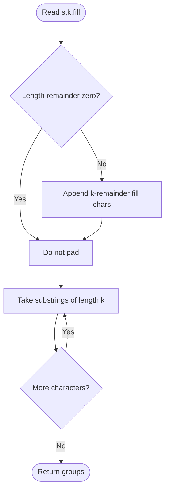

# Divide a String Into Groups of Size K — LeetCode 2138

Source: `2138.cpp` provides three versions. `divideString_V2` and `_V3` pad only when needed; `_V1` always appends at least `k` fill characters and is wrong when the input length is divisible by `k` (and for empty input).

## 1. Understanding — समजून घ्या

Split `s` into consecutive groups of exactly `k` characters. Pad only the final group with `fill` if it is short.

## 2. Worked examples and edge cases

> **मराठी:** प्रश्नात काय दिले आहे आणि नेमके काय शोधायचे आहे, हे आधी स्पष्ट करा.
> `"abcdefghi", k=3` → `["abc","def","ghi"]`, no padding. `"abcd", k=3, fill='z'` → `["abc","dzz"]`. If length is already divisible by `k`, append nothing. An empty string has no groups under the usual interpretation.

## 3. Pattern identification + cheat sheet

> **मराठी:** या clues मुळे योग्य pattern ओळखता येतो; constraints आणि relations नीट तपासा.
> | Clue | Pattern |
> |---|---|
> | Fixed-size sequential chunks | Index stepping / substring |
> | Last chunk may be incomplete | Remainder-based padding |
> | Need exact group width | `k - (n % k)` only if remainder nonzero |

## 4. Approaches

> **मराठी:** सोप्या उपायापासून सुरुवात करा आणि constraints नुसार योग्य optimization निवडा.
> Appending `k - n%k` unconditionally is incorrect when `n%k==0`, because it creates an extra group. `V1` has that bug. `V2` is the straightforward correct solution; `V3` reserves result capacity and builds substrings from iterator ranges. The string and returned groups inherently require O(n) storage.

## 5. Flowchart

> **मराठी:** Flowchart मधील decision, loop आणि termination condition क्रमाने समजून घ्या.

## 6. Algorithm and intuition

> **मराठी:** मुख्य observation समजल्यावर algorithm चे steps लक्षात ठेवणे सोपे होते.
> Let `r = s.size() % k`. If `r != 0`, append `k-r` fill characters. Then take substrings starting at `0,k,2k,...`; after padding, every substring has length `k`.

## 7. Code explanation

> **मराठी:** Code मधील variable आणि condition यांचा algorithm मधील उद्देश समजून घ्या.
> `divideString_V2` applies the remainder guard and uses `substr`. `_V3` follows the same logic, reserves `(size+k-1)/k` output slots, and constructs each group from iterators. `_V1` computes `k-(n%k)` even when that is `k`, causing unwanted padding.

## 8. Dry run

> **मराठी:** प्रत्येक महत्त्वाच्या step नंतर variable ची value trace करा.
> `s="abcd", k=3`: remainder `1`; append `3-1=2` fill chars → `"abcdzz"`. Starts 0 and 3 give `"abc"`, `"dzz"`.

## 9. Complexity

> **मराठी:** Input size आणि प्रत्येक operation कितीदा चालतो यावरून complexity ठरवा.
> For input length `n`, time is **O(n)**; returned groups plus padded string use **O(n)** space. `V3`'s “O(1) extra space” comment excludes the required output and padding, so it is not O(1) total auxiliary storage.

## 10. Correctness

> **मराठी:** Invariant किंवा तर्क वापरून algorithm योग्य उत्तर देतो हे समजून घ्या.
> Padding to a multiple of `k` changes only the incomplete suffix and adds exactly the missing characters. Fixed `k`-step slicing partitions the padded string into disjoint complete groups, preserving original order and including every original character once.

## 11. Mistakes and interview traps

> **मराठी:** Boundary, duplicate आणि off-by-one cases स्वतंत्रपणे तपासा.

- Do not pad when the remainder is zero.
- For a short final group, append `k-r`, not `r`.
- `k` must be positive (as guaranteed by the problem).
- Treat V1 as a buggy historical version; use V2/V3.
- Output allocation is not constant space.

## 12. Quick revision — झटपट उजळणी

> **मराठी सारांश:** शेवटचा गट अपुरा असेल तेव्हाच `fill` अक्षरे जोडा.
> If `n%k != 0`, pad `k-n%k`; slice every `k` characters.

## 13. Related problems and variations

> **मराठी:** प्रश्नात काय दिले आहे आणि नेमके काय शोधायचे आहे, हे आधी स्पष्ट करा.
> Chunk a string or array; batch records into fixed-size pages; split into groups with variable final-group rules; pad binary/data blocks to a block boundary.

## 14. Self-assessment

> **मराठी:** उत्तर न पाहता प्रश्न सोडवा आणि तुमच्या निवडीचे कारण सांगा.

1. Why must the padding branch check `remainder != 0`?
2. How many fill characters are needed for a suffix of length `r`?
3. What is wrong with V1 when `n` is divisible by `k`?
