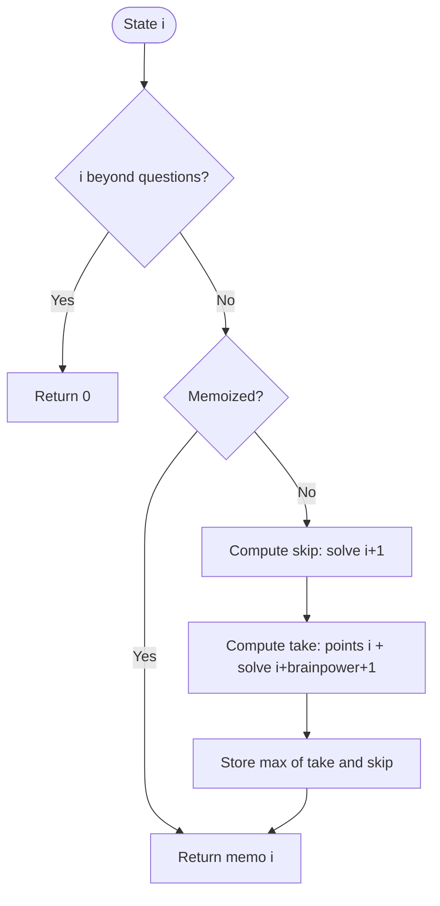

# Solving Questions With Brainpower — LeetCode 2140

Source: `2140.cpp` uses recursive memoization in `mostPoints`.

## 1. Understanding — समजून घ्या

Each question gives points and a brainpower skip count. Solve it to earn points, then skip the next `brainpower` questions; or skip it and consider the next question. Maximize total points.

## 2. Worked examples and edge cases

> **मराठी:** प्रश्नात काय दिले आहे आणि नेमके काय शोधायचे आहे, हे आधी स्पष्ट करा.
> At index `i`, if question is `(3,2)`, taking it earns 3 and resumes at `i+3`; skipping it resumes at `i+1`. At the last question, the answer is its points. If taking a question jumps past the end, the remaining score is zero.

## 3. Pattern identification + cheat sheet

> **मराठी:** या clues मुळे योग्य pattern ओळखता येतो; constraints आणि relations नीट तपासा.
> | Choice | Next state |
> |---|---|
> | Skip question `i` | `i+1` |
> | Take `(points, brainpower)` | `i+brainpower+1` |
> | Overlapping choices, optimal score | 1D DP / memoized recursion |

## 4. Approaches

> **मराठी:** सोप्या उपायापासून सुरुवात करा आणि constraints नुसार योग्य optimization निवडा.
> Trying every subset is exponential. Plain recursion repeats states and is exponential. Memoizing by index makes each state compute once; bottom-up DP is also O(n) and avoids recursion depth. Greedy choice by highest points is incorrect because brainpower affects future opportunities.

## 5. Flowchart

> **मराठी:** Flowchart मधील decision, loop आणि termination condition क्रमाने समजून घ्या.

## 6. Algorithm and intuition

> **मराठी:** मुख्य observation समजल्यावर algorithm चे steps लक्षात ठेवणे सोपे होते.
> Define `dp(i)` as the maximum points obtainable starting at `i`. The recurrence is `max(dp(i+1), points[i] + dp(i+brainpower[i]+1))`, with `dp(i)=0` past the last question. The memo table avoids recomputing suffix decisions.

## 7. Code explanation

> **मराठी:** Code मधील variable आणि condition यांचा algorithm मधील उद्देश समजून घ्या.
> `FindMaxPoints` handles the out-of-range base case, returns `remaing[position]` when cached, recursively calculates both choices, and stores their maximum. `mostPoints` creates an `n`-element `long long` memo initialized to `-1`.

## 8. Dry run

> **मराठी:** प्रत्येक महत्त्वाच्या step नंतर variable ची value trace करा.
> For questions `[(3,2),(4,3),(4,4),(2,5)]`: index 0 take = `3 + dp(3) = 5`; skip = `dp(1)`. At index 1 take = `4 + dp(5)=4`; skip eventually yields 2. The maximum is 5, selecting questions 0 and 3.

## 9. Complexity

> **मराठी:** Input size आणि प्रत्येक operation कितीदा चालतो यावरून complexity ठरवा.
> **O(n)** time because each index is memoized once; **O(n)** memo space plus **O(n)** worst-case recursion stack.

## 10. Correctness

> **मराठी:** Invariant किंवा तर्क वापरून algorithm योग्य उत्तर देतो हे समजून घ्या.
> Any valid strategy from index `i` either skips question `i`, leaving the optimal subproblem `i+1`, or takes it and must resume at `i+brainpower+1`. These choices cover every legal strategy. Taking their maximum is optimal; memoization changes only repeated computation.

## 11. Mistakes and interview traps

> **मराठी:** Boundary, duplicate आणि off-by-one cases स्वतंत्रपणे तपासा.

- The next index after taking is `i + brainpower + 1`.
- Use `long long` for accumulated points.
- Check the out-of-range base case before indexing the memo.
- A `-1` memo sentinel is safe because point totals are nonnegative.
- Recursive depth may be O(n); bottom-up DP avoids that risk.

## 12. Quick revision — झटपट उजळणी

> **मराठी सारांश:** प्रश्न सोडवा किंवा वगळा; दोन्ही पर्यायांतील जास्त गुण निवडा.
> `dp[i] = max(dp[i+1], points[i] + dp[i+brainpower[i]+1])`; memoize or fill backward.

## 13. Related problems and variations

> **मराठी:** प्रश्नात काय दिले आहे आणि नेमके काय शोधायचे आहे, हे आधी स्पष्ट करा.
> House Robber; weighted interval scheduling; skip-cost choice DP; convert this recurrence to bottom-up or reconstruct which questions were solved.

## 14. Self-assessment

> **मराठी:** उत्तर न पाहता प्रश्न सोडवा आणि तुमच्या निवडीचे कारण सांगा.

1. Why is the take transition `i+b+1`, not `i+b`?
2. What does `dp(i)` represent?
3. How does memoization change the recursive complexity?
