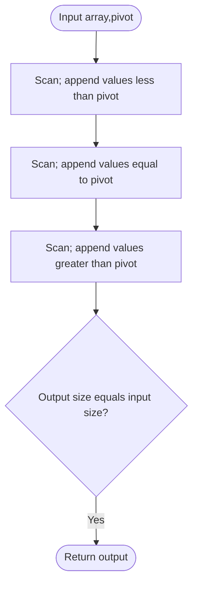

# Partition Array According to Given Pivot — LeetCode 2161

Source: `2161.cpp`; it makes three stable passes over the input.

## 1. Understanding — समजून घ्या

Rearrange values so that elements smaller than pivot come first, then values equal to pivot, then greater values. Preserve relative order within each of the three groups.

## 2. Worked examples and edge cases

> **मराठी:** प्रश्नात काय दिले आहे आणि नेमके काय शोधायचे आहे, हे आधी स्पष्ट करा.
> For `[9,12,5,10,14,3,10]`, pivot `10`, result is `[9,5,3,10,10,12,14]`. Equal pivot values keep their original order. If no value equals pivot, the middle section is empty.

## 3. Pattern identification + cheat sheet

> **मराठी:** या clues मुळे योग्य pattern ओळखता येतो; constraints आणि relations नीट तपासा.
> | Requirement | Pattern |
> |---|---|
> | Three value classes | Stable partition |
> | Preserve original order | Scan in source order |
> | Small number of buckets | Multi-pass append |

## 4. Approaches

> **मराठी:** सोप्या उपायापासून सुरुवात करा आणि constraints नुसार योग्य optimization निवडा.
> Sorting is incorrect because it reorders values inside each category. A two-pointer in-place partition is tricky because it can break stability. The source's three scans are simple and optimal O(n), using an output vector. A one-pass solution can use three temporary buckets and has the same asymptotic cost.

## 5. Flowchart

> **मराठी:** Flowchart मधील decision, loop आणि termination condition क्रमाने समजून घ्या.

Three ordered scans preserve order independently within each class.

## 6. Algorithm and intuition

> **मराठी:** मुख्य observation समजल्यावर algorithm चे steps लक्षात ठेवणे सोपे होते.
> Append every `< pivot` value in original order. Repeat for `== pivot`, then `> pivot`. Every element belongs to exactly one category, so the concatenated result is a stable partition.

## 7. Code explanation

> **मराठी:** Code मधील variable आणि condition यांचा algorithm मधील उद्देश समजून घ्या.
> `pivotArray(vector<int>& n, int p)` allocates `ans`, performs one range-for scan per relation, and returns it. The input is not modified.

## 8. Dry run

> **मराठी:** प्रत्येक महत्त्वाच्या step नंतर variable ची value trace करा.
> Input `[3,1,2,4,5]`, pivot `3`: less pass → `[1,2]`; equal pass → `[1,2,3]`; greater pass → `[1,2,3,4,5]`.

## 9. Complexity

> **मराठी:** Input size आणि प्रत्येक operation कितीदा चालतो यावरून complexity ठरवा.
> **O(n)** time (three passes) and **O(n)** output space.

## 10. Correctness

> **मराठी:** Invariant किंवा तर्क वापरून algorithm योग्य उत्तर देतो हे समजून घ्या.
> Each input element satisfies exactly one of `<`, `==`, or `>`, so it is appended exactly once. Each pass visits elements in original order, preserving relative order within its category. The passes are concatenated in the required category order.

## 11. Mistakes and interview traps

> **मराठी:** Boundary, duplicate आणि off-by-one cases स्वतंत्रपणे तपासा.

- Stable partition is stronger than merely placing values in three sections.
- Do not sort the array.
- Preserve duplicates; each occurrence is a distinct element.
- If an in-place approach is requested, explain the stability trade-off.

## 12. Quick revision — झटपट उजळणी

> **मराठी सारांश:** कमी, समान, जास्त — तीन स्थिर फेऱ्यांत घटक जोडा.
> Three stable scans: less, equal, greater.

## 13. Related problems and variations

> **मराठी:** प्रश्नात काय दिले आहे आणि नेमके काय शोधायचे आहे, हे आधी स्पष्ट करा.
> Stable partition by predicate; Dutch National Flag (not stable); partition around a pivot with stability; group records into ordered categories.

## 14. Self-assessment

> **मराठी:** उत्तर न पाहता प्रश्न सोडवा आणि तुमच्या निवडीचे कारण सांगा.

1. Why are three passes stable?
2. Why can ordinary sorting violate the requirement?
3. What is the extra-space cost?
