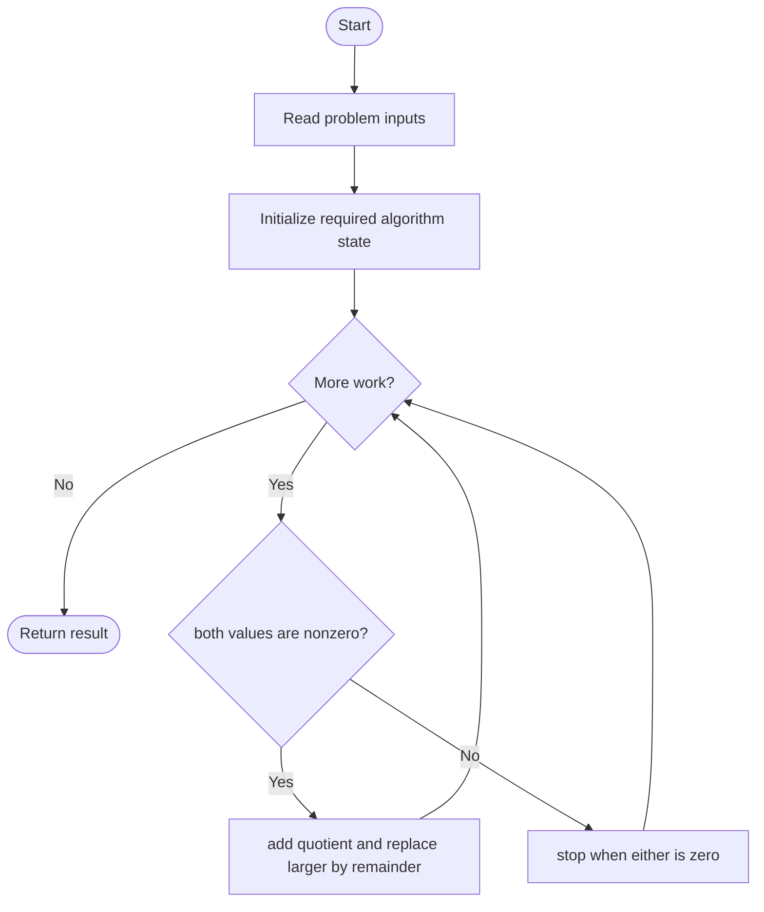

# Count Operations to Obtain Zero

**LeetCode ID:** 2169

**Source file(s):** `2169.cpp` (originally `countOperations.cpp`)

**Identification evidence:** The original filename, declared signature, and distinctive behavior described below uniquely identify this problem; no number was inferred from a filename alone.

## Expected input/output or judge interface

int countOperations(int num1,int num2). Inputs follow the problem constraints; the output is the documented scalar, sequence, or design-object behavior. The description below reflects the implementation actually present in the source.

## Main flow



## Important branch and loop flow

```mermaid
flowchart TD
    A([Inspect next item]) --> B{both values are nonzero?}
    B -- Yes --> C[add quotient and replace larger by remainder]
    B -- No --> D[stop when either is zero]
    C --> E[Preserve the stated algorithm invariant]
    D --> F[Keep prior state and advance]
    E --> G{More work?}
    F --> G
    G -- Yes --> A
    G -- No --> H([Produce output])
```



## Core logic and invariant

Orders the values and repeatedly adds the integer quotient, replaces the larger value by its remainder, and swaps—batched Euclidean subtraction.

The key branch/loop rule above is applied once per relevant item; the algorithm relies on that rule to preserve its state and produce the required result.

## Optimization / comparison

Each quotient counts repeated subtraction steps; division batches the commented one-at-a-time approach.

## Complexity

O(log(min(num1,num2))) iterations for positive inputs; O(1) space.

## Compile and run

The repository file includes a standalone demonstration `main()`; it is not a raw LeetCode submission unit. From the repository root, with a C++17 compiler:

```powershell
g++ -std=c++17 LeetCode\2169\2169.cpp -o solution.exe
.\solution.exe
```

For LeetCode's class-method judge, copy the relevant class/method or design-class API and omit the demo `main()` and local harness. Adapt free-function implementations to the requested `Solution` class signature where necessary. See the source caveat above for any compile blocker.
