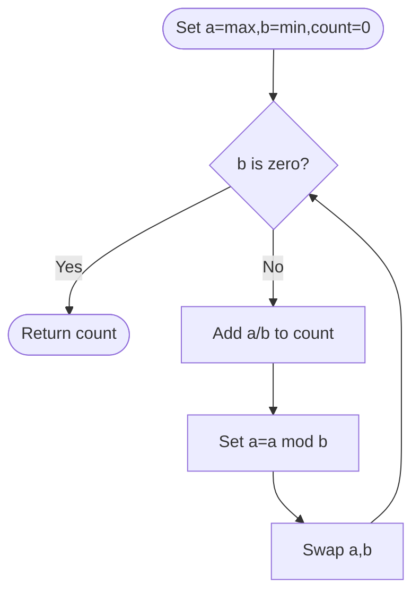

# Count Operations to Obtain Zero — LeetCode 2169

Source: `2169.cpp`; the active method uses quotient/remainder steps, with repeated subtraction shown as a commented alternative.

## 1. Understanding — समजून घ्या

Given nonnegative `num1` and `num2`, repeatedly subtract the smaller from the larger while both are nonzero. Count the subtractions until one becomes zero.

## 2. Worked examples and edge cases

> **मराठी:** प्रश्नात काय दिले आहे आणि नेमके काय शोधायचे आहे, हे आधी स्पष्ट करा.
> `(18,12)`: subtract 12 once → `(6,12)`, then subtract 6 twice → `(6,0)`, total 3. If either input is zero initially, answer is 0. Equal positive values require one operation.

## 3. Pattern identification + cheat sheet

> **मराठी:** या clues मुळे योग्य pattern ओळखता येतो; constraints आणि relations नीट तपासा.
> | Clue | Pattern |
> |---|---|
> | Repeated subtraction of smaller | Euclidean algorithm |
> | Many identical subtractions | Batch them with quotient |
> | Stop at zero | Positive remainder loop |

## 4. Approaches

> **मराठी:** सोप्या उपायापासून सुरुवात करा आणि constraints नुसार योग्य optimization निवडा.
> Literal repeated subtraction is correct but can require O(max(num1,num2)) iterations (for `(large,1)`). The source accelerates each run of subtractions using integer division, like Euclid's algorithm. Be careful to count quotient steps, not just Euclidean iterations.

## 5. Flowchart

> **मराठी:** Flowchart मधील decision, loop आणि termination condition क्रमाने समजून घ्या.

## 6. Algorithm and intuition

> **मराठी:** मुख्य observation समजल्यावर algorithm चे steps लक्षात ठेवणे सोपे होते.
> For positive `a>=b`, `a/b` is the number of consecutive subtractions of `b` from `a` before the remainder is smaller than `b`. Add that quotient to the operation count, keep the remainder, and swap to continue.

## 7. Code explanation

> **मराठी:** Code मधील variable आणि condition यांचा algorithm मधील उद्देश समजून घ्या.
> The method orders inputs using `max`/`min`. Each loop does `cnt += a/b`, then `a %= b`, then swaps. The commented alternative performs one subtraction per iteration and initializes the count based on whether either value is zero.

## 8. Dry run

> **मराठी:** प्रत्येक महत्त्वाच्या step नंतर variable ची value trace करा.
> | `a,b` before | Quotient added | Remainder, swap |
> |---|---:|---|
> | `18,12` | 1 | `(6,12)` → `(12,6)` |
> | `12,6` | 2 | `(0,6)` → `(6,0)` |
> Total `1+2=3`.

## 9. Complexity

> **मराठी:** Input size आणि प्रत्येक operation कितीदा चालतो यावरून complexity ठरवा.
> The quotient/remainder method takes **O(log(max(a,b)))** Euclidean iterations and **O(1)** space. Repeated subtraction can take **O(max(a,b))** operations.

## 10. Correctness

> **मराठी:** Invariant किंवा तर्क वापरून algorithm योग्य उत्तर देतो हे समजून घ्या.
> For `a>=b>0`, exactly `floor(a/b)` repeated subtractions of `b` can be performed before the remaining value is below `b`; that remainder equals `a%b`. Thus each quotient contributes exactly the operations being counted, and swapping preserves the next larger/smaller pair. The loop ends precisely when one number is zero.

## 11. Mistakes and interview traps

> **मराठी:** Boundary, duplicate आणि off-by-one cases स्वतंत्रपणे तपासा.

- Add the quotient to the count; one modulo step may represent many subtractions.
- Stop when the smaller value is zero to avoid division by zero.
- For equal inputs, quotient is one.
- This operation count is related to, but not identical to, merely counting Euclidean algorithm steps.

## 12. Quick revision — झटपट उजळणी

> **मराठी सारांश:** वजाबाकींची संख्या भागाकाराने एकदम मोजा.
> While `b>0`: `count += a/b; a%=b; swap(a,b)`.

## 13. Related problems and variations

> **मराठी:** प्रश्नात काय दिले आहे आणि नेमके काय शोधायचे आहे, हे आधी स्पष्ट करा.
> Euclidean GCD; count subtraction operations; reduce ratios; replace repeated addition/subtraction loops with quotient batching.

## 14. Self-assessment

> **मराठी:** उत्तर न पाहता प्रश्न सोडवा आणि तुमच्या निवडीचे कारण सांगा.

1. What does `a/b` count in this process?
2. Why is the swap needed after taking the remainder?
3. How does this improve the `(large,1)` case?
