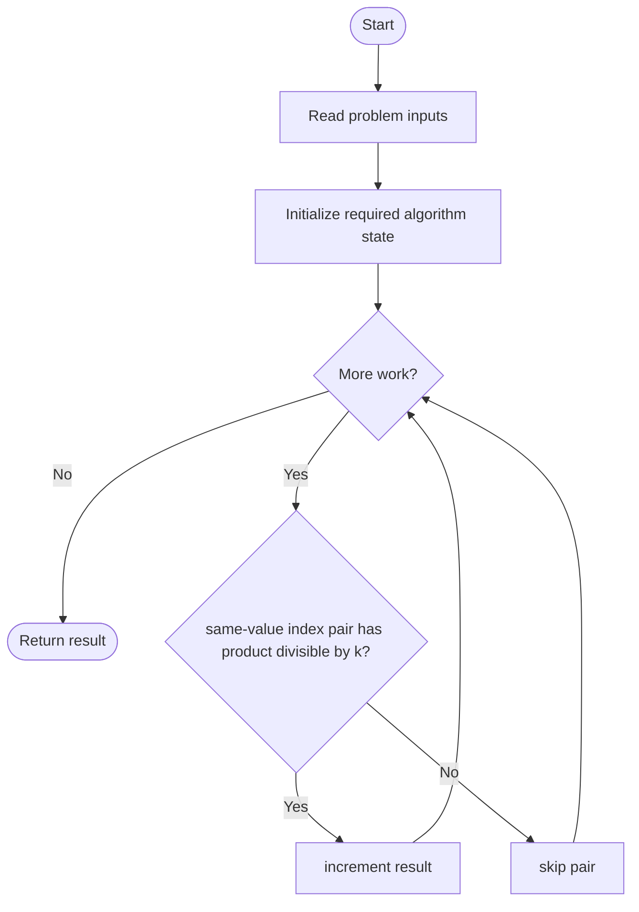
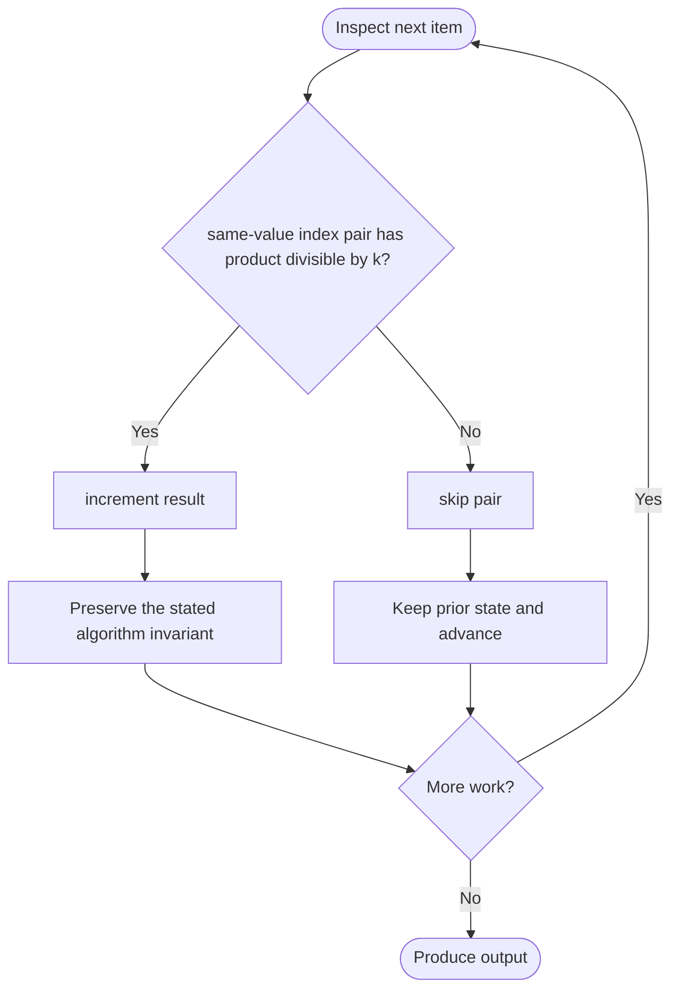

# Count Equal and Divisible Pairs in an Array

**LeetCode ID:** 2176
**Source file(s):** `2176.cpp` (originally `countPairs.cpp`)
**Identification evidence:** The original filename, declared signature, and distinctive behavior described below uniquely identify this problem; no number was inferred from a filename alone.

## Expected input/output or judge interface

countPairsBruteForce/Optimized(vector<int>& nums,int k). Inputs follow the problem constraints; the output is the documented scalar, sequence, or design-object behavior. The description below reflects the implementation actually present in the source.

## Main flow



## Important branch and loop flow



## Core logic and invariant

Counts i<j with equal values and (i\*j)%k==0; the second version groups indices by value before pair testing.
The key branch/loop rule above is applied once per relevant item; the algorithm relies on that rule to preserve its state and produce the required result.

## Optimization / comparison

Grouping excludes cross-value pairs but still tests all same-value pairs; it can help when many values are distinct.

## Complexity

Both O(n^2) worst-case; grouped version uses O(n) map storage.

## Compile and run

The repository file includes a standalone demonstration `main()`; it is not a raw LeetCode submission unit. From the repository root, with a C++17 compiler:

```powershell
g++ -std=c++17 LeetCode\2176\2176.cpp -o solution.exe
.\solution.exe
```

For LeetCode's class-method judge, copy the relevant class/method or design-class API and omit the demo `main()` and local harness. Adapt free-function implementations to the requested `Solution` class signature where necessary. See the source caveat above for any compile blocker.
