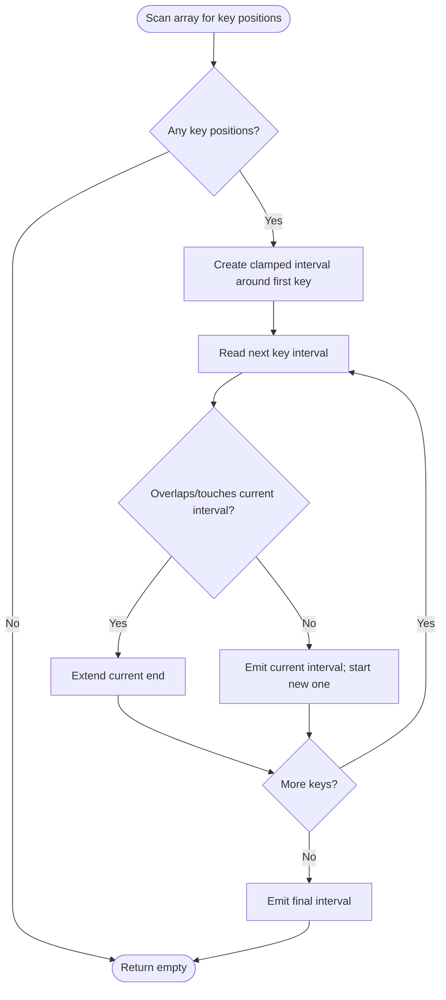

# Find All K-Distant Indices in an Array — LeetCode 2200

Source: `2200.cpp` has a direct interval-expansion method and a key-position/interval-merge method.

## 1. Understanding — समजून घ्या

An index `i` is k-distant if some index `j` has `nums[j]==key` and `|i-j|<=k`. Return all such indices in increasing order without duplicates.

## 2. Worked examples and edge cases

> **मराठी:** प्रश्नात काय दिले आहे आणि नेमके काय शोधायचे आहे, हे आधी स्पष्ट करा.
> For `nums=[3,4,9,1,3,9,5], key=9, k=1`, key positions are 2 and 5, so intervals `[1,3]` and `[4,6]` give `[1,2,3,4,5,6]`. With no key, return empty. `k=0` returns only key positions.

## 3. Pattern identification + cheat sheet

> **मराठी:** या clues मुळे योग्य pattern ओळखता येतो; constraints आणि relations नीट तपासा.
> | Clue | Pattern |
> |---|---|
> | Each key position covers `[j-k,j+k]` | Interval generation |
> | Output must be sorted and unique | Merge overlapping intervals |
> | Array bounds matter | Clamp to `[0,n-1]` |

## 4. Approaches

> **मराठी:** सोप्या उपायापासून सुरुवात करा आणि constraints नुसार योग्य optimization निवडा.
> For each array index, scan all key positions: O(n·m). The source either expands each key's bounded interval while skipping already-emitted indices, or gathers key positions and merges their intervals. Interval merging is the cleanest view. Appending full intervals independently creates duplicates when they overlap.

## 5. Flowchart

> **मराठी:** Flowchart मधील decision, loop आणि termination condition क्रमाने समजून घ्या.

Key positions are ordered, so their intervals are ordered too. Merge overlaps before emitting indices; touching intervals can be emitted separately and still produce the same consecutive output.

## 6. Algorithm and intuition

> **मराठी:** मुख्य observation समजल्यावर algorithm चे steps लक्षात ठेवणे सोपे होते.
> Scan `nums` to collect each key index `j`. Its eligible indices form `[max(0,j-k), min(n-1,j+k)]`. Since key positions are ordered, these intervals are ordered too. Merge overlaps, then output every index in each merged interval.

## 7. Code explanation

> **मराठी:** Code मधील variable आणि condition यांचा algorithm मधील उद्देश समजून घ्या.
> The direct method iterates the array, computes each interval, and starts from `Result.back()+1` when earlier output already covers part of it. The second method collects `keyPos`, merges interval bounds, and emits completed ranges.

## 8. Dry run

> **मराठी:** प्रत्येक महत्त्वाच्या step नंतर variable ची value trace करा.
> `n=7`, key positions `2,5`, `k=1`: intervals `[1,3]`, `[4,6]`. They do not overlap, but emitting both in order still gives `1..6` exactly once.

## 9. Complexity

> **मराठी:** Input size आणि प्रत्येक operation कितीदा चालतो यावरून complexity ठरवा.
> Both source methods run in **O(n + r)** time and **O(r)** output space for `r` returned indices; the interval method also stores key positions in **O(m)** space. Since `r<=n`, the bound is O(n).

## 10. Correctness

> **मराठी:** Invariant किंवा तर्क वापरून algorithm योग्य उत्तर देतो हे समजून घ्या.
> Every qualifying `i` lies in an interval centered on at least one key position. Conversely, every index emitted from such an interval is within `k` of its center key. Merging ordered overlapping intervals preserves their union and emits each member once in increasing order.

## 11. Mistakes and interview traps

> **मराठी:** Boundary, duplicate आणि off-by-one cases स्वतंत्रपणे तपासा.

- Clamp both interval ends to array bounds.
- Avoid duplicate indices across overlapping windows.
- “Touches” means intervals with `newStart <= end+1` can be emitted contiguously; actual overlap uses `newStart<=end`.
- If no key exists, return empty rather than building an interval.

## 12. Quick revision — झटपट उजळणी

> **मराठी सारांश:** प्रत्येक key भोवतीची मर्यादित रेंज जोडा आणि पुनरावृत्ती टाळा.
> Key `j` covers `[max(0,j-k), min(n-1,j+k)]`; merge windows and enumerate.

## 13. Related problems and variations

> **मराठी:** प्रश्नात काय दिले आहे आणि नेमके काय शोधायचे आहे, हे आधी स्पष्ट करा.
> Merge intervals; union of radius-`k` neighborhoods; return a boolean mask instead of indices; answer repeated range queries with a difference array.

## 14. Self-assessment

> **मराठी:** उत्तर न पाहता प्रश्न सोडवा आणि तुमच्या निवडीचे कारण सांगा.

1. What interval does one key index generate?
2. Why are the intervals already sorted?
3. How does merging prevent duplicate output?
