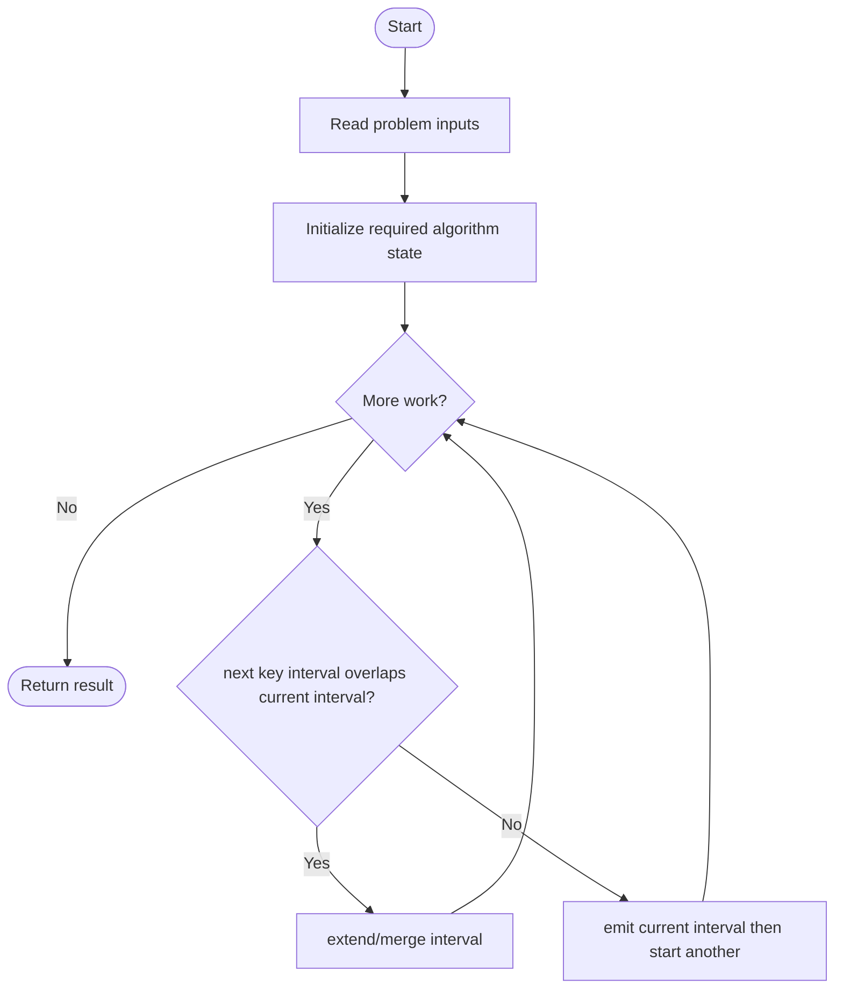
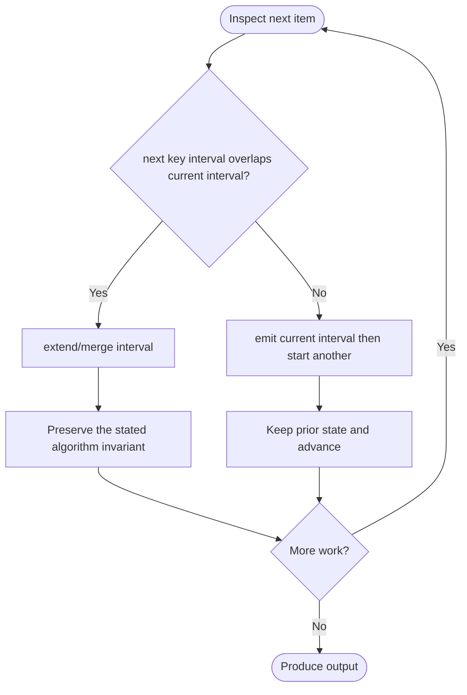

# Find All K-Distant Indices in an Array

**LeetCode ID:** 2200

**Source file(s):** `2200.cpp` (originally `findKDistantIndices.cpp`)

**Identification evidence:** The original filename, declared signature, and distinctive behavior described below uniquely identify this problem; no number was inferred from a filename alone.

> **Source blocker:** The original file has duplicated/interleaved code and the token `Result.bac#include`, so it is not valid C++. Bytes are preserved exactly; repairing the source was outside the requested scope.

## Expected input/output or judge interface

Visible intended signatures: findKDistantIndices(nums,key,k), findKDistantIndices_v1/v2(...). Inputs follow the problem constraints; the output is the documented scalar, sequence, or design-object behavior. The description below reflects the implementation actually present in the source.

## Main flow



## Important branch and loop flow



## Core logic and invariant

Contains intended interval-union scans around key indices, but source is interleaved/corrupted mid-token (`Result.bac#include`) and is not valid C++.

The key branch/loop rule above is applied once per relevant item; the algorithm relies on that rule to preserve its state and produce the required result.

## Optimization / comparison

Intended result is the sorted union of clipped k-neighborhoods around key indices; source corruption prevents validating it.

## Complexity

Intended interval merging is O(n) output-sensitive; malformed translation unit has no valid runtime complexity.

## Compile and run

The repository file includes a demonstration `main()`, but the original translation unit is malformed and **cannot compile as-is**. The command below documents the intended invocation only; source repair was outside scope. From the repository root, with a C++17 compiler:

```powershell
g++ -std=c++17 LeetCode\2200\2200.cpp -o solution.exe
.\solution.exe
```

For LeetCode's class-method judge, copy the relevant class/method or design-class API and omit the demo `main()` and local harness. Adapt free-function implementations to the requested `Solution` class signature where necessary. See the source caveat above for any compile blocker.
